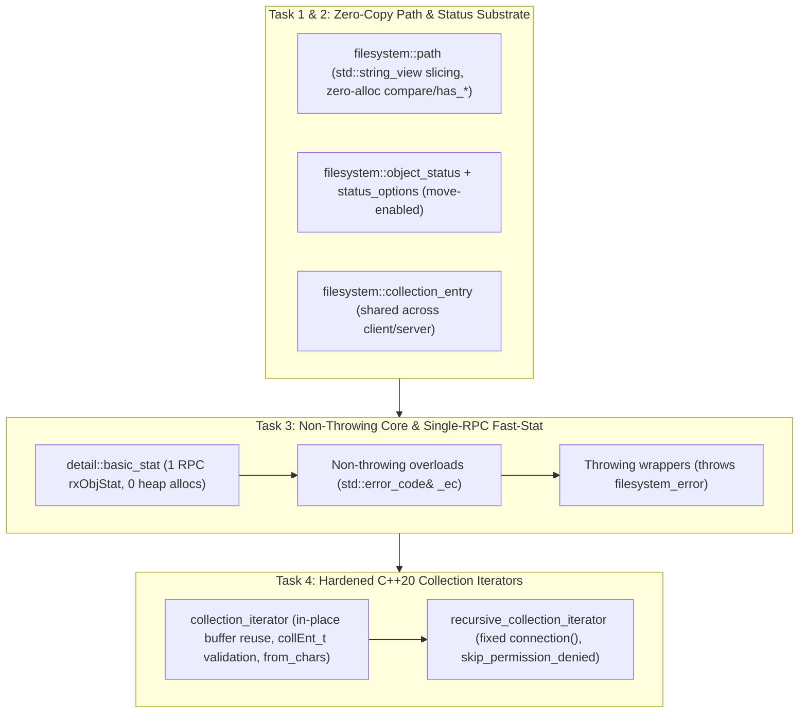

# Weapons-Grade `irods::experimental::filesystem` Implementation Plan

> **For agentic workers:** REQUIRED SUB-SKILL: Use superpowers:subagent-driven-development to implement this plan task-by-task. Steps use checkbox (`- [ ]`) syntax for tracking.

**Goal:** Refactor `irods::experimental::filesystem` (`/home/darkfell/dev/irods/lib/filesystem`) into a zero-copy, leak-free, non-throwing (`std::error_code`) and throwing C++20 library that eliminates the 3-RPC `status()` amplification and fixes all memory/buffer/logic defects while preserving 100% source compatibility.

**Architecture:** We replace by-value string copies and iterator-based path decomposition in `filesystem::path` with zero-allocation `std::string_view` slicing and component scanning. In the operational layer (`filesystem::client` and `filesystem::server`), we invert the implementation pyramid so every operation is implemented once as a non-throwing `std::error_code&` function backed by a single-RPC `basic_stat` fast path and zero-copy C-struct bindings, with throwing overloads acting as thin wrappers.

**Architecture Diagram:**



**Tech Stack:** C++20, Clang 16 (`irods-externals/clang16.0.6-0`), `fmt`, `nlohmann::json`, Catch2 (`irods_path_test`, `irods_filesystem_test`), Ninja, Project Insight (`l3kvg` CPG).

## Global Constraints

- Preserve 100% source compatibility for all existing callers of `irods::experimental::filesystem::client::*`, `irods::experimental::filesystem::server::*`, and `#define IRODS_FILESYSTEM_ENABLE_SERVER_SIDE_API`.
- Zero heap allocations in `path::compare()`, `path::has_*()`, `zone_name_view()`, and `has_prefix()`.
- Zero `std::strncpy(dst, src, std::strlen(src))` calls anywhere in `lib/filesystem`.
- All `rx_atomic_apply_metadata_operations` (`json_error_string`) and `rsRmColl` (`collOprStat_t*`) heap allocations must be freed via `irods::at_scope_exit`.
- Never run `cd` in shell commands; use `Cwd` or `-C`.

---

### Task 1: Zero-Copy `path`, `path_traits`, and `path_utilities` Modernization

**Files:**
- Modify: [`/home/darkfell/dev/irods/lib/filesystem/include/irods/filesystem/path_traits.hpp`](file:///home/darkfell/dev/irods/lib/filesystem/include/irods/filesystem/path_traits.hpp)
- Modify: [`/home/darkfell/dev/irods/lib/filesystem/include/irods/filesystem/path.hpp`](file:///home/darkfell/dev/irods/lib/filesystem/include/irods/filesystem/path.hpp)
- Modify: [`/home/darkfell/dev/irods/lib/filesystem/include/irods/filesystem/path_utilities.hpp`](file:///home/darkfell/dev/irods/lib/filesystem/include/irods/filesystem/path_utilities.hpp)
- Modify: [`/home/darkfell/dev/irods/lib/filesystem/src/path.cpp`](file:///home/darkfell/dev/irods/lib/filesystem/src/path.cpp)
- Test: [`/home/darkfell/dev/irods/unit_tests/src/filesystem/test_path.cpp`](file:///home/darkfell/dev/irods/unit_tests/src/filesystem/test_path.cpp)

**Interfaces:**
- Consumes: `MAX_NAME_LEN`, `USER_PATH_EXCEEDS_MAX`, `SYS_INVALID_INPUT_PARAM` from `irods/rodsDef.h` and `irods/rodsErrorTable.h`.
- Produces:
  - `path::path(std::string_view)`, `path::operator=(std::string_view)`, `path::operator/=(std::string_view)`
  - `path::native() const noexcept -> const string_type&`
  - `path::string() const noexcept -> const string_type&`
  - `path::string_view() const noexcept -> std::string_view`
  - `path::operator std::string_view() const noexcept`
  - `path::size() const noexcept -> std::size_t`
  - `path::root_collection_view() const noexcept -> std::string_view`
  - `path::relative_path_view() const noexcept -> std::string_view`
  - `path::parent_path_view() const noexcept -> std::string_view`
  - `path::object_name_view() const noexcept -> std::string_view`
  - `path::stem_view() const noexcept -> std::string_view`
  - `path::extension_view() const noexcept -> std::string_view`
  - `path::assign_concat(std::string_view _parent, std::string_view _child) -> path&`
  - `zone_name_view(const path& _p) noexcept -> std::optional<std::string_view>`
  - `validate_path_not_empty(const path& _p, std::error_code& _ec) noexcept -> bool`
  - `validate_path_length(std::string_view _p, std::error_code& _ec) noexcept -> bool`
  - `validate_path(const path& _p, std::error_code& _ec) noexcept -> bool`
  - `copy_to_c_array(char (&_dst)[N], std::string_view _src, std::error_code& _ec) noexcept -> bool`

- [ ] **Step 1: Add failing zero-copy and validation unit tests to [`test_path.cpp`](file:///home/darkfell/dev/irods/unit_tests/src/filesystem/test_path.cpp)**

Append the following `TEST_CASE` blocks to `/home/darkfell/dev/irods/unit_tests/src/filesystem/test_path.cpp`:

```cpp
TEST_CASE("path zero-copy string_view observers and decomposition", "[zero-copy][views]")
{
    const fs::path p{"/tempZone/home/rods/archive.tar.gz"};

    // string() and native() return references to the internal buffer (zero copy)
    REQUIRE(&p.string() == &p.native());
    REQUIRE(p.string().data() == p.c_str());
    REQUIRE(p.string_view().data() == p.c_str());
    REQUIRE(p.size() == std::strlen("/tempZone/home/rods/archive.tar.gz"));

    // Construct and append from std::string_view directly
    constexpr std::string_view sv = "/tempZone/home/rods";
    fs::path p_from_sv{sv};
    p_from_sv /= std::string_view{"sub/file.txt"};
    REQUIRE(p_from_sv == "/tempZone/home/rods/sub/file.txt");

    // Zero-allocation string_view decomposition views match path decomposition
    REQUIRE(p.root_collection_view() == "/");
    REQUIRE(p.relative_path_view() == "tempZone/home/rods/archive.tar.gz");
    REQUIRE(p.parent_path_view() == "/tempZone/home/rods");
    REQUIRE(p.object_name_view() == "archive.tar.gz");
    REQUIRE(p.stem_view() == "archive.tar");
    REQUIRE(p.extension_view() == ".gz");

    // Views point directly into p.c_str() buffer (zero allocation)
    REQUIRE(p.parent_path_view().data() == p.c_str());
    REQUIRE(p.object_name_view().data() == p.c_str() + std::strlen("/tempZone/home/rods/"));

    // Zone name view extracts zone without allocation
    const auto zv = fs::zone_name_view(p);
    REQUIRE(zv.has_value());
    REQUIRE(*zv == "tempZone");
    REQUIRE(zv->data() == p.c_str() + 1);
    REQUIRE(fs::zone_name(p) == std::optional<std::string>{"tempZone"});
    REQUIRE_FALSE(fs::zone_name_view(fs::path{"/"}).has_value());
    REQUIRE_FALSE(fs::zone_name_view(fs::path{}).has_value());

    // In-place assign_concat reuses buffer capacity
    fs::path reusable;
    reusable.assign_concat("/tempZone/home/rods", "data.bin");
    REQUIRE(reusable == "/tempZone/home/rods/data.bin");
    reusable.assign_concat("/tempZone/home/rods/", "next.bin");
    REQUIRE(reusable == "/tempZone/home/rods/next.bin");
}

TEST_CASE("non-throwing path validation and bounded C-array copy", "[validation][error_code]")
{
    std::error_code ec;

    REQUIRE_FALSE(fs::validate_path("", ec));
    REQUIRE(ec == irods::experimental::make_error_code(SYS_INVALID_INPUT_PARAM));

    const std::string too_long(MAX_NAME_LEN, 'a');
    REQUIRE_FALSE(fs::validate_path(fs::path{too_long}, ec));
    REQUIRE(ec == irods::experimental::make_error_code(USER_PATH_EXCEEDS_MAX));

    REQUIRE(fs::validate_path("/tempZone/home/rods", ec));
    REQUIRE_FALSE(ec);

    char buf[16];
    REQUIRE(fs::copy_to_c_array(buf, "/a/b/c", ec));
    REQUIRE_FALSE(ec);
    REQUIRE(std::string_view{buf} == "/a/b/c");

    REQUIRE_FALSE(fs::copy_to_c_array(buf, "0123456789abcdef", ec));
    REQUIRE(ec == irods::experimental::make_error_code(USER_PATH_EXCEEDS_MAX));
}
```

- [ ] **Step 2: Compile `irods_path_test` to verify the new test fails to compile**

Run: `ninja -C /home/darkfell/dev/irods/build unit_tests/CMakeFiles/irods_path_test.dir/src/filesystem/test_path.cpp.o`
Expected: FAIL with errors that `native`, `string_view`, `root_collection_view`, `zone_name_view`, `assign_concat`, `validate_path`, and `copy_to_c_array` are not declared.

- [ ] **Step 3: Implement zero-copy `path_traits.hpp`, `path.hpp`, `path_utilities.hpp`, and `path.cpp`**

Update [`/home/darkfell/dev/irods/lib/filesystem/include/irods/filesystem/path_traits.hpp`](file:///home/darkfell/dev/irods/lib/filesystem/include/irods/filesystem/path_traits.hpp) to add `std::string_view`:

```cpp
#ifndef IRODS_FILESYSTEM_PATH_TRAITS_HPP
#define IRODS_FILESYSTEM_PATH_TRAITS_HPP

#include <string>
#include <string_view>
#include <vector>
#include <list>

namespace irods::experimental::filesystem
{
    class collection_entry;

    namespace path_traits
    {
        template <typename>
        inline static constexpr bool is_pathable = false;

        // clang-format off
        template <> inline constexpr bool is_pathable<char*>             = true;
        template <> inline constexpr bool is_pathable<const char*>       = true;
        template <> inline constexpr bool is_pathable<std::string>       = true;
        template <> inline constexpr bool is_pathable<std::string_view>  = true;
        template <> inline constexpr bool is_pathable<std::vector<char>> = true;
        template <> inline constexpr bool is_pathable<std::list<char>>   = true;
        template <> inline constexpr bool is_pathable<collection_entry>  = true;
        // clang-format on
    } // namespace path_traits
} // namespace irods::experimental::filesystem

#endif // IRODS_FILESYSTEM_PATH_TRAITS_HPP
```

Update [`/home/darkfell/dev/irods/lib/filesystem/include/irods/filesystem/path.hpp`](file:///home/darkfell/dev/irods/lib/filesystem/include/irods/filesystem/path.hpp) to add `std::string_view` constructors/assignments, `const string_type&` return on `string()`/`native()`, `*_view()` observers, `size()`, `assign_concat()`, and `zone_name_view()`:

```cpp
// In path public constructors:
        path(std::string_view _source)
            : value_{_source}
        {
        }

// In path Assignments:
        auto operator=(std::string_view _source) -> path&
        {
            value_.assign(_source);
            return *this;
        }

        auto assign(std::string_view _source) -> path&
        {
            value_.assign(_source);
            return *this;
        }

// In path Appends:
        auto operator/=(std::string_view _p) -> path&;

        auto append(std::string_view _source) -> path&
        {
            return *this /= _source;
        }

        auto assign_concat(std::string_view _parent, std::string_view _child) -> path&;

// In path Format observers:
        // clang-format off
        auto c_str() const noexcept -> const value_type*     { return value_.c_str(); }
        auto native() const noexcept -> const string_type&   { return value_; }
        auto string() const noexcept -> const string_type&   { return value_; }
        auto string_view() const noexcept -> std::string_view { return value_; }
        operator string_type() const                         { return value_; }
        operator std::string_view() const noexcept           { return value_; }
        auto size() const noexcept -> string_type::size_type { return value_.size(); }
        // clang-format on

// In path Decomposition:
        auto root_collection_view() const noexcept -> std::string_view;
        auto relative_path_view() const noexcept -> std::string_view;
        auto parent_path_view() const noexcept -> std::string_view;
        auto object_name_view() const noexcept -> std::string_view;
        auto stem_view() const noexcept -> std::string_view;
        auto extension_view() const noexcept -> std::string_view;

        auto root_collection() const -> path;
        auto relative_path() const -> path;
        auto parent_path() const -> path;
        auto object_name() const -> path;
        auto stem() const -> path;
        auto extension() const -> path;

// In path Query:
        // clang-format off
        auto empty() const noexcept -> bool               { return value_.empty(); }
        auto has_root_collection() const noexcept -> bool { return !root_collection_view().empty(); }
        auto has_relative_path() const noexcept -> bool   { return !relative_path_view().empty(); }
        auto has_parent_path() const noexcept -> bool     { return !parent_path_view().empty(); }
        auto has_object_name() const noexcept -> bool     { return !object_name_view().empty(); }
        auto has_stem() const noexcept -> bool            { return !stem_view().empty(); }
        auto has_extension() const noexcept -> bool       { return !extension_view().empty(); }
        auto is_absolute() const noexcept -> bool         { return !empty() && preferred_separator == value_.front(); }
        auto is_relative() const noexcept -> bool         { return !is_absolute(); }
        // clang-format on

// At namespace scope in path.hpp:
    auto zone_name_view(const path& _p) noexcept -> std::optional<std::string_view>;
    auto zone_name(const path& _p) -> std::optional<std::string>;
```

Update [`/home/darkfell/dev/irods/lib/filesystem/include/irods/filesystem/path_utilities.hpp`](file:///home/darkfell/dev/irods/lib/filesystem/include/irods/filesystem/path_utilities.hpp) to add non-throwing validation and bounded C-array copy helpers:

```cpp
#ifndef IRODS_FILESYSTEM_PATH_UTILITIES_HPP
#define IRODS_FILESYSTEM_PATH_UTILITIES_HPP

#include "irods/filesystem/path.hpp"
#include "irods/filesystem/filesystem_error.hpp"

#include "irods/rodsDef.h"
#include "irods/rodsErrorTable.h"
#include "irods/system_error.hpp"

#include <cstddef>
#include <cstring>
#include <string_view>
#include <system_error>

namespace irods::experimental::filesystem
{
    inline constexpr auto is_separator(path::value_type _c) noexcept -> bool
    {
        return path::preferred_separator == _c;
    }

    inline auto validate_path_not_empty(const path& _p, std::error_code& _ec) noexcept -> bool
    {
        if (_p.empty()) {
            _ec = make_error_code(SYS_INVALID_INPUT_PARAM);
            return false;
        }
        _ec.clear();
        return true;
    }

    inline auto validate_path_length(std::string_view _p, std::error_code& _ec) noexcept -> bool
    {
        if (_p.size() >= MAX_NAME_LEN) {
            _ec = make_error_code(USER_PATH_EXCEEDS_MAX);
            return false;
        }
        if (_p.find('\0') != std::string_view::npos) {
            _ec = make_error_code(SYS_INVALID_INPUT_PARAM);
            return false;
        }
        _ec.clear();
        return true;
    }

    inline auto validate_path(const path& _p, std::error_code& _ec) noexcept -> bool
    {
        return validate_path_not_empty(_p, _ec) && validate_path_length(_p.string_view(), _ec);
    }

    template <std::size_t N>
    inline auto copy_to_c_array(char (&_dst)[N], std::string_view _src, std::error_code& _ec) noexcept -> bool
    {
        if (_src.size() >= N) {
            _ec = make_error_code(USER_PATH_EXCEEDS_MAX);
            return false;
        }
        if (_src.find('\0') != std::string_view::npos) {
            _ec = make_error_code(SYS_INVALID_INPUT_PARAM);
            return false;
        }
        if (!_src.empty()) {
            std::memcpy(_dst, _src.data(), _src.size());
        }
        _dst[_src.size()] = '\0';
        _ec.clear();
        return true;
    }

    inline auto throw_if_path_length_exceeds_limit(const path& _p) -> void
    {
        std::error_code ec;
        if (!validate_path_length(_p.string_view(), ec)) {
            throw filesystem_error{"path length cannot exceed max path size", _p, ec};
        }
    }

    inline auto throw_if_path_is_empty(const path& _p) -> void
    {
        std::error_code ec;
        if (!validate_path_not_empty(_p, ec)) {
            throw filesystem_error{"empty path", _p, ec};
        }
    }
} // namespace irods::experimental::filesystem

#endif // IRODS_FILESYSTEM_PATH_UTILITIES_HPP
```

Update [`/home/darkfell/dev/irods/lib/filesystem/src/path.cpp`](file:///home/darkfell/dev/irods/lib/filesystem/src/path.cpp) to implement the zero-allocation `*_view()` methods, `operator/=(std::string_view)`, `assign_concat`, zero-allocation `compare()`, and `zone_name_view()`.

- [ ] **Step 4: Compile and run `irods_path_test` to verify all existing and new tests pass**

Run: `ninja -C /home/darkfell/dev/irods/build irods_path_test && /home/darkfell/dev/irods/build/unit_tests/irods_path_test`
Expected: `All tests passed` (100% pass rate).

- [ ] **Step 5: Commit Task 1**

```bash
git add lib/filesystem/include/irods/filesystem/path_traits.hpp \
        lib/filesystem/include/irods/filesystem/path.hpp \
        lib/filesystem/include/irods/filesystem/path_utilities.hpp \
        lib/filesystem/src/path.cpp \
        unit_tests/src/filesystem/test_path.cpp
git commit -m "feat(filesystem): add zero-copy string_view path observers and bounded path validation"
```

---

### Task 2: `object_status`, `status_options`, and `collection_entry` Move Semantics & Unification

**Files:**
- Modify: [`/home/darkfell/dev/irods/lib/filesystem/include/irods/filesystem/object_status.hpp`](file:///home/darkfell/dev/irods/lib/filesystem/include/irods/filesystem/object_status.hpp)
- Modify: [`/home/darkfell/dev/irods/lib/filesystem/include/irods/filesystem/collection_entry.hpp`](file:///home/darkfell/dev/irods/lib/filesystem/include/irods/filesystem/collection_entry.hpp)
- Modify: [`/home/darkfell/dev/irods/lib/filesystem/include/irods/filesystem/config.hpp`](file:///home/darkfell/dev/irods/lib/filesystem/include/irods/filesystem/config.hpp)
- Test: [`/home/darkfell/dev/irods/unit_tests/src/filesystem/test_path.cpp`](file:///home/darkfell/dev/irods/unit_tests/src/filesystem/test_path.cpp)

**Interfaces:**
- Consumes: `entity_permission`, `perms` from `permissions.hpp`, `path` from `path.hpp`.
- Produces:
  - `enum class status_options : std::uint8_t { basic = 0, include_permissions = 1 << 0, include_inheritance = 1 << 1, full = include_permissions | include_inheritance }` and bitwise operators (`|`, `&`, `^`, `~`, `|=`, `&=`, `^=`).
  - `object_status(object_status&&) noexcept = default`, `operator=(object_status&&) noexcept -> object_status& = default`, and `object_status::permissions(std::vector<entity_permission>&& _perms) noexcept -> void`.
  - `irods::experimental::filesystem::collection_entry` aliased into `client::collection_entry` and `server::collection_entry`.

- [ ] **Step 1: Add unit test in [`test_path.cpp`](file:///home/darkfell/dev/irods/unit_tests/src/filesystem/test_path.cpp) for `object_status` move semantics and `status_options`**

Append to `/home/darkfell/dev/irods/unit_tests/src/filesystem/test_path.cpp`:

```cpp
#include "irods/filesystem/object_status.hpp"

TEST_CASE("object_status move semantics and status_options bitmask", "[object_status][zero-copy]")
{
    std::vector<fs::entity_permission> perms{
        {"rods", "tempZone", fs::perms::own, "rodsadmin"}
    };
    const auto* original_data_ptr = perms.data();

    fs::object_status st{fs::object_type::collection, std::move(perms)};
    REQUIRE(st.permissions().data() == original_data_ptr);

    fs::object_status moved_st{std::move(st)};
    REQUIRE(moved_st.permissions().data() == original_data_ptr);
    REQUIRE(moved_st.type() == fs::object_type::collection);

    constexpr auto opts = fs::status_options::include_permissions | fs::status_options::include_inheritance;
    STATIC_REQUIRE(opts == fs::status_options::full);
    STATIC_REQUIRE((opts & fs::status_options::include_permissions) == fs::status_options::include_permissions);
}
```

- [ ] **Step 2: Compile `irods_path_test` to verify the new test fails**

Run: `ninja -C /home/darkfell/dev/irods/build irods_path_test`
Expected: FAIL with `status_options` not declared.

- [ ] **Step 3: Update `object_status.hpp` and `collection_entry.hpp`**

Update [`/home/darkfell/dev/irods/lib/filesystem/include/irods/filesystem/object_status.hpp`](file:///home/darkfell/dev/irods/lib/filesystem/include/irods/filesystem/object_status.hpp) to add `status_options` with `constexpr` bitwise operators and move semantics for `object_status` (`object_status(object_status&&) noexcept = default`, rvalue `permissions(std::vector<entity_permission>&&) noexcept`).

Update [`/home/darkfell/dev/irods/lib/filesystem/include/irods/filesystem/collection_entry.hpp`](file:///home/darkfell/dev/irods/lib/filesystem/include/irods/filesystem/collection_entry.hpp) so `collection_entry` is defined once in `irods::experimental::filesystem` and aliased into `NAMESPACE_IMPL` (`client` and `server`).

- [ ] **Step 4: Compile and run `irods_path_test`**

Run: `ninja -C /home/darkfell/dev/irods/build irods_path_test && /home/darkfell/dev/irods/build/unit_tests/irods_path_test`
Expected: `All tests passed`.

- [ ] **Step 5: Commit Task 2**

```bash
git add lib/filesystem/include/irods/filesystem/object_status.hpp \
        lib/filesystem/include/irods/filesystem/collection_entry.hpp \
        unit_tests/src/filesystem/test_path.cpp
git commit -m "feat(filesystem): add status_options bitmask and zero-copy move semantics to object_status"
```

---

### Task 3: Non-Throwing (`std::error_code&`) Core, Single-RPC `basic_stat`, RPC Deduplication, & Bug/Leak Fixes in `filesystem.hpp` & `filesystem.cpp`

**Files:**
- Modify: [`/home/darkfell/dev/irods/lib/filesystem/include/irods/filesystem/filesystem.hpp`](file:///home/darkfell/dev/irods/lib/filesystem/include/irods/filesystem/filesystem.hpp)
- Modify: [`/home/darkfell/dev/irods/lib/filesystem/src/filesystem.cpp`](file:///home/darkfell/dev/irods/lib/filesystem/src/filesystem.cpp)
- Test: [`/home/darkfell/dev/irods/unit_tests/src/filesystem/test_filesystem.cpp`](file:///home/darkfell/dev/irods/unit_tests/src/filesystem/test_filesystem.cpp)

**Interfaces:**
- Consumes: `path`, `validate_path`, `copy_to_c_array`, `object_status`, `status_options`.
- Produces:
  - Non-throwing `std::error_code& _ec` overloads for all operational functions in `filesystem::client` and `filesystem::server`:
    - `copy`, `copy_data_object`, `create_collection`, `create_collections`, `exists`, `is_collection_registered`, `is_data_object_registered`, `equivalent`, `data_object_size`, `is_collection`, `is_special_collection`, `is_empty`, `is_other`, `is_data_object`, `last_write_time` (getter & setter), `remove`, `remove_all`, `permissions` (normal & `admin`), `enable_inheritance` (normal & `admin`), `rename`, `move`, `status` (with & without `status_options`), `data_object_checksum`, `get_metadata`, `set_metadata`, `add_metadata`, `remove_metadata`, `add_metadata_atomic`, `remove_metadata_atomic`.
  - Leak-free `detail::do_metadata_op` (`irods::at_scope_exit` freeing `json_error_string`) using single-RPC `status(_comm, _path, status_options::basic, _ec)`.
  - Leak-free `remove_impl` freeing `collOprStat_t* stat`.
  - Fixed `remove_all` handling single data objects and exact collection prefix (`COLL_NAME = '<p>'` and `COLL_NAME like '<p>/%'`).

- [ ] **Step 1: Add unit tests to [`test_filesystem.cpp`](file:///home/darkfell/dev/irods/unit_tests/src/filesystem/test_filesystem.cpp) for `std::error_code` overloads, `status_options::basic`, and `remove_all` bug fixes**

Add a new `SECTION` in `/home/darkfell/dev/irods/unit_tests/src/filesystem/test_filesystem.cpp`:

```cpp
    SECTION("non-throwing error_code overloads, status_options::basic, and remove_all edge cases")
    {
        std::error_code ec;

        // status_options::basic fetches type without querying ACLs
        const auto basic_st = fs::client::status(conn, sandbox, fs::status_options::basic, ec);
        REQUIRE_FALSE(ec);
        REQUIRE(fs::client::exists(basic_st));
        REQUIRE(fs::client::is_collection(basic_st));
        REQUIRE(basic_st.permissions().empty());

        // Non-existent path sets not_found and clears ec
        const auto missing_st = fs::client::status(conn, sandbox / "does_not_exist", fs::status_options::basic, ec);
        REQUIRE_FALSE(ec);
        REQUIRE(missing_st.type() == fs::object_type::not_found);
        REQUIRE_FALSE(fs::client::exists(conn, sandbox / "does_not_exist", ec));
        REQUIRE_FALSE(ec);

        // remove_all on a single data object removes it and returns 1
        const auto single_obj = sandbox / "single_remove_all.txt";
        {
            default_transport tp{conn};
            odstream{tp, single_obj} << "payload";
        }
        REQUIRE(fs::client::exists(conn, single_obj, ec));
        REQUIRE(fs::client::remove_all(conn, single_obj, fs::remove_options::no_trash, ec) == 1);
        REQUIRE_FALSE(ec);
        REQUIRE_FALSE(fs::client::exists(conn, single_obj, ec));

        // remove_all on /dir does not miscount sibling /dir_sibling
        const auto dir_a = sandbox / "prefix_dir";
        const auto dir_b = sandbox / "prefix_dir_sibling";
        REQUIRE(fs::client::create_collection(conn, dir_a, ec));
        REQUIRE_FALSE(ec);
        REQUIRE(fs::client::create_collection(conn, dir_b, ec));
        REQUIRE_FALSE(ec);
        {
            default_transport tp{conn};
            odstream{tp, dir_b / "keep_me.txt"} << "sibling";
        }
        REQUIRE(fs::client::remove_all(conn, dir_a, fs::remove_options::no_trash, ec) == 1);
        REQUIRE_FALSE(ec);
        REQUIRE(fs::client::exists(conn, dir_b / "keep_me.txt", ec));
    }
```

- [ ] **Step 2: Compile `irods_filesystem_test` to confirm it fails before implementation**

Run: `ninja -C /home/darkfell/dev/irods/build unit_tests/CMakeFiles/irods_filesystem_test.dir/src/filesystem/test_filesystem.cpp.o`
Expected: FAIL with missing `status_options` / `std::error_code&` overloads in `fs::client`.

- [ ] **Step 3: Implement all non-throwing overloads, single-RPC `basic_stat`, RPC deduplication, zero-copy SQL escaping, and memory leak fixes in [`filesystem.hpp`](file:///home/darkfell/dev/irods/lib/filesystem/include/irods/filesystem/filesystem.hpp) and [`filesystem.cpp`](file:///home/darkfell/dev/irods/lib/filesystem/src/filesystem.cpp)**

1. In [`filesystem.hpp`](file:///home/darkfell/dev/irods/lib/filesystem/include/irods/filesystem/filesystem.hpp):
   - Add `std::error_code& _ec` overloads alongside every throwing function.
   - Add `status(rxComm& _comm, const path& _p, status_options _opts)` and `status(rxComm& _comm, const path& _p, status_options _opts, std::error_code& _ec)`.
   - In `detail::do_metadata_op`:
     - Add non-throwing `do_metadata_op(bool _add_admin_flag, rxComm& _comm, const path& _path, Iterator _first, Iterator _last, std::string_view _op, std::error_code& _ec) -> bool` that uses `status(_comm, _path, status_options::basic, _ec)` (1 RPC instead of 3!) and guards `char* json_error_string{}` with `irods::at_scope_exit free_error_string{[&json_error_string] { std::free(json_error_string); }};`.
     - Have the throwing `detail::do_metadata_op` delegate to the `std::error_code&` overload.
2. In [`filesystem.cpp`](file:///home/darkfell/dev/irods/lib/filesystem/src/filesystem.cpp):
   - Replace `single_quotes_to_hex` with a zero-copy `fmt::formatter<sql_escaped_view>` that writes `std::string_view` directly into the format buffer (escaping `'` to `\x27` inline without intermediate heap allocations).
   - Implement `basic_stat(rxComm& _comm, const path& _p, std::error_code& _ec) noexcept -> stat_result` using `copy_to_c_array(input.objPath, _p.string_view(), _ec)` and `rxObjStat` (1 RPC, 0 heap allocations, freeing ` rodsObjStat_t*` via `irods::at_scope_exit`).
   - Implement `status(_comm, _p, _opts, _ec)`: only call `get_inheritance` when `(_opts & status_options::include_inheritance)` and `set_permissions` when `(_opts & status_options::include_permissions)`, and move `std::move(prms)` into `object_status`.
   - Implement all operational functions (`exists`, `is_collection`, `is_data_object`, `is_other`, `is_empty`, `equivalent`, `copy`, `copy_data_object`, `create_collection`, `create_collections`, `remove`, `remove_all`, `rename`, `move`, `permissions`, `enable_inheritance`, `data_object_size`, `data_object_checksum`, `last_write_time`, `get_metadata`, `set_metadata`, `add_metadata`, `remove_metadata`) with `std::error_code& _ec` core implementations using `basic_stat`, and thin throwing wrappers.
   - Fix `remove_impl` server-side `collOprStat_t* stat{}` leak with `irods::at_scope_exit{[&stat] { std::free(stat); }}`.
   - Fix `remove_all` to call `basic_stat` first: if `not_found`, return `0`; if `data_object`, call `remove_impl` and return `1`; if `collection`, count `COLL_NAME = '<_p>'` + `COLL_NAME like '<_p>/%'` before calling `remove_impl`.

- [ ] **Step 4: Compile `irods_filesystem_client` and `irods_filesystem_server` to verify zero warnings/errors**

Run: `ninja -C /home/darkfell/dev/irods/build irods_filesystem_client irods_filesystem_server`
Expected: Compiles cleanly with 0 warnings and 0 errors.

- [ ] **Step 5: Commit Task 3**

```bash
git add lib/filesystem/include/irods/filesystem/filesystem.hpp \
        lib/filesystem/src/filesystem.cpp \
        unit_tests/src/filesystem/test_filesystem.cpp
git commit -m "feat(filesystem): implement non-throwing error_code core, single-RPC basic_stat, and leak/bug fixes"
```

---

### Task 4: Hardened, Zero-Copy `collection_iterator` and `recursive_collection_iterator`

**Files:**
- Modify: [`/home/darkfell/dev/irods/lib/filesystem/include/irods/filesystem/collection_iterator.hpp`](file:///home/darkfell/dev/irods/lib/filesystem/include/irods/filesystem/collection_iterator.hpp)
- Modify: [`/home/darkfell/dev/irods/lib/filesystem/src/collection_iterator.cpp`](file:///home/darkfell/dev/irods/lib/filesystem/src/collection_iterator.cpp)
- Modify: [`/home/darkfell/dev/irods/lib/filesystem/include/irods/filesystem/recursive_collection_iterator.hpp`](file:///home/darkfell/dev/irods/lib/filesystem/include/irods/filesystem/recursive_collection_iterator.hpp)
- Modify: [`/home/darkfell/dev/irods/lib/filesystem/src/recursive_collection_iterator.cpp`](file:///home/darkfell/dev/irods/lib/filesystem/src/recursive_collection_iterator.cpp)
- Test: [`/home/darkfell/dev/irods/unit_tests/src/filesystem/test_filesystem.cpp`](file:///home/darkfell/dev/irods/unit_tests/src/filesystem/test_filesystem.cpp)

**Interfaces:**
- Consumes: `path::assign_concat`, `copy_to_c_array`, `irods::is_valid_collection_entry` (`irods/collection_entry_validation.hpp`).
- Produces:
  - `collection_iterator(rxComm&, const path&, std::error_code&)`
  - `collection_iterator(rxComm&, const path&, collection_options, std::error_code&)`
  - `collection_iterator::increment(std::error_code&) -> collection_iterator&`
  - `collection_iterator::operator++(int)`
  - `collection_iterator::operator==(std::default_sentinel_t) const noexcept -> bool`
  - `recursive_collection_iterator(rxComm&, const path&, std::error_code&)`
  - `recursive_collection_iterator(rxComm&, const path&, collection_options, std::error_code&)`
  - `recursive_collection_iterator::increment(std::error_code&) -> recursive_collection_iterator&`
  - `recursive_collection_iterator::operator++(int)`
  - `recursive_collection_iterator::operator==(std::default_sentinel_t) const noexcept -> bool`
  - Fixed `recursive_collection_iterator::connection() const noexcept -> rxComm*`

- [ ] **Step 1: Add iterator unit tests to [`test_filesystem.cpp`](file:///home/darkfell/dev/irods/unit_tests/src/filesystem/test_filesystem.cpp)**

Add to `/home/darkfell/dev/irods/unit_tests/src/filesystem/test_filesystem.cpp`:

```cpp
    SECTION("collection_iterator and recursive_collection_iterator non-throwing, post-increment, and connection()")
    {
        std::error_code ec;
        const auto iter_root = sandbox / "iter_test";
        REQUIRE(fs::client::create_collections(conn, iter_root / "sub", ec));
        REQUIRE_FALSE(ec);

        {
            default_transport tp{conn};
            odstream{tp, iter_root / "a.txt"} << "a";
            odstream{tp, iter_root / "sub/b.txt"} << "b";
        }

        fs::client::recursive_collection_iterator rec_it{conn, iter_root, ec};
        REQUIRE_FALSE(ec);
        REQUIRE(rec_it != fs::client::recursive_collection_iterator{});
        REQUIRE(rec_it != std::default_sentinel);
        // Verify connection() does not infinitely recurse
        REQUIRE(rec_it.connection() == static_cast<rcComm_t*>(conn));

        int count = 0;
        while (rec_it != std::default_sentinel) {
            auto prev = rec_it++;
            REQUIRE_FALSE(prev->path().empty());
            ++count;
        }
        REQUIRE(count == 3);

        // Non-throwing open on non-existent collection sets ec and returns end iterator
        fs::client::collection_iterator bad_it{conn, iter_root / "missing", ec};
        REQUIRE(ec);
        REQUIRE(bad_it == std::default_sentinel);
    }
```

- [ ] **Step 2: Compile `irods_filesystem_test` to confirm it fails before implementation**

Run: `ninja -C /home/darkfell/dev/irods/build unit_tests/CMakeFiles/irods_filesystem_test.dir/src/filesystem/test_filesystem.cpp.o`
Expected: FAIL with missing `std::error_code&` iterator constructor, `operator++(int)`, and `std::default_sentinel`.

- [ ] **Step 3: Implement hardened, zero-copy `collection_iterator` and `recursive_collection_iterator`**

1. In [`collection_iterator.hpp`](file:///home/darkfell/dev/irods/lib/filesystem/include/irods/filesystem/collection_iterator.hpp) and [`collection_iterator.cpp`](file:///home/darkfell/dev/irods/lib/filesystem/src/collection_iterator.cpp):
   - Lift `enum class collection_options` into `irods::experimental::filesystem` and alias into `NAMESPACE_IMPL`.
   - Add `std::error_code& _ec` constructors, `increment(std::error_code& _ec)`, post-increment `operator++(int)`, and `operator==(std::default_sentinel_t) const noexcept`.
   - Honor `collection_options::skip_permission_denied` when opening or reading returns `CAT_NO_ACCESS_PERMISSION` or `SYS_NO_API_PRIV`.
   - Validate every `collEnt_t` with `irods::is_valid_collection_entry(*e)` (`irods/collection_entry_validation.hpp`), setting `_ec = make_error_code(SYS_INVALID_FILE_PATH)` if invalid.
   - Parse `e->createTime` and `e->modifyTime` with `std::from_chars` instead of `std::stoll`.
   - Reuse string buffers in `ctx_->entry` (`entry.path_.assign_concat(ctx_->path.string_view(), e->dataName)` for data objects, `entry.path_.assign(std::string_view{e->collName})` for collections, and `.assign()`/`.clear()` for `data_id_`, `checksum_`, `owner_`, `data_type_`).
2. In [`recursive_collection_iterator.hpp`](file:///home/darkfell/dev/irods/lib/filesystem/include/irods/filesystem/recursive_collection_iterator.hpp) and [`recursive_collection_iterator.cpp`](file:///home/darkfell/dev/irods/lib/filesystem/src/recursive_collection_iterator.cpp):
   - Fix `connection() const noexcept -> rxComm*` to return `(ctx_ && !ctx_->stack.empty()) ? ctx_->stack.top().connection() : nullptr;`.
   - Store `_opts` in `ctx_->opts` (previously `ctx_->opts` was never initialized from the constructor argument `_opts`!).
   - Add `std::error_code& _ec` constructors, `increment(std::error_code& _ec)`, post-increment `operator++(int)`, and `operator==(std::default_sentinel_t) const noexcept`.
   - In `increment(std::error_code& _ec)`, use non-throwing `is_empty(*conn, iter->path(), _ec)` and honor `collection_options::skip_permission_denied`.

- [ ] **Step 4: Compile `irods_filesystem_client`, `irods_filesystem_server`, and `irods_filesystem_test`**

Run: `ninja -C /home/darkfell/dev/irods/build irods_filesystem_client irods_filesystem_server irods_filesystem_test`
Expected: Compiles cleanly with 0 warnings and 0 errors.

- [ ] **Step 5: Commit Task 4**

```bash
git add lib/filesystem/include/irods/filesystem/collection_iterator.hpp \
        lib/filesystem/src/collection_iterator.cpp \
        lib/filesystem/include/irods/filesystem/recursive_collection_iterator.hpp \
        lib/filesystem/src/recursive_collection_iterator.cpp \
        unit_tests/src/filesystem/test_filesystem.cpp
git commit -m "feat(filesystem): harden collection iterators with zero-copy buffer reuse, entry validation, and error_code support"
```

---

### Task 5: Full Build, Unit Test Execution, & Project Insight CPG Verification

**Files:**
- Verify: `/home/darkfell/dev/irods/lib/filesystem/*`
- Verify: `/home/darkfell/dev/irods/unit_tests/src/filesystem/*`

**Interfaces:**
- Consumes: All modified files in `lib/filesystem` and `unit_tests/src/filesystem`.
- Produces: Verified build artifacts and synchronized Project Insight CPG database (`/home/darkfell/dev/irods/.insight/l3kvg`).

- [ ] **Step 1: Build all filesystem libraries, unit tests, and server/plugin dependents**

Run: `ninja -C /home/darkfell/dev/irods/build irods_filesystem_path irods_filesystem_client irods_filesystem_server irods_path_test irods_filesystem_test`
Expected: 100% build success with zero warnings.

- [ ] **Step 2: Run `irods_path_test`**

Run: `/home/darkfell/dev/irods/build/unit_tests/irods_path_test`
Expected: `All tests passed`.

- [ ] **Step 3: Synchronize modified translation units in Project Insight CPG and verify ownership invariants**

Run: `/home/darkfell/dev/project_insight/build/insight ingest -p /home/darkfell/dev/irods/compile_commands.json --store /home/darkfell/dev/irods/.insight/l3kvg -j 16`
Expected: Incremental CPG re-index of modified files completes with `0 failed`.
