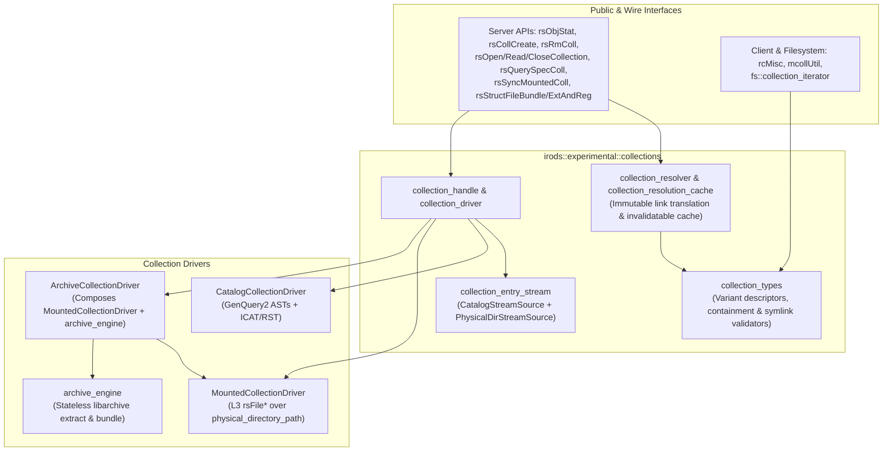

# Uniform Collection Architecture (`simply_collections`) Implementation Plan

> **For agentic workers:** REQUIRED SUB-SKILL: Use superpowers:subagent-driven-development to implement this plan task-by-task. Steps use checkbox (`- [ ]`) syntax for tracking.

**Goal:** Unify catalog, soft-linked, mounted physical directory, and mounted archive (`tar`) collections behind a strongly-typed C++17 `irods::experimental::collections` architecture while retiring dead `HAAW`/`MSSO` types and orphaned `iphybun` (`bundleResc`) staging code.

**Architecture:** We introduce a value-typed collection descriptor and path/link resolution model (`collection_types`, `collection_resolver`) paired with a stateless `libarchive` streaming engine (`archive_engine`), a unified entry stream (`collection_entry_stream`), and polymorphic drivers (`CatalogCollectionDriver`, `MountedCollectionDriver`, and `ArchiveCollectionDriver` composing `MountedCollectionDriver`). Existing C APIs (`rsObjStat`, `rsCollCreate`, `rsRmColl`, `rsOpenCollection`, `rsReadCollection`, `rsCloseCollection`, `rsQuerySpecColl`, `rsSyncMountedColl`, `specColl.cpp`, `rcMisc.cpp`) become clean, backwards-compatible adapters over this uniform layer.

**Architecture Diagram:**



**Tech Stack:** C++17 (`std::variant`, `std::optional`, `std::string_view`, `std::filesystem`), `irods::experimental::filesystem::path`, GenQuery2 AST builder (`irods::experimental::genquery2::builder`), `libarchive`, `fmt`, Catch2.

## Global Constraints

- C++17 standard across all client and server libraries; use `std::filesystem` for local/physical paths and `irods::experimental::filesystem::path` for logical iRODS paths.
- Preserve 100% wire and ABI compatibility for public C API structs (`specColl_t`, `collEnt_t`, `rodsObjStat_t`, `dataObjInfo_t`, `collInp_t`, `genQueryOut_t`) and server RPC numbers.
- Retire `HAAW_STRUCT_FILE_T` and `MSSO_STRUCT_FILE_T` operational branches (`SYS_UNMATCHED_SPEC_COLL_TYPE`) while keeping enum values in `objInfo.h` for header compatibility.
- Remove orphaned `iphybun` / `bundleResc` lazy-staging code (`rsPhyBundleColl` was removed in `#3603`), keeping `rsUnbunAndRegPhyBunfile` as a backwards-compatible stub returning `SYS_NOT_SUPPORTED`.

---

### Task 1: Strongly-Typed Collection Descriptors, `R_COLL_MAIN` Serialization, & Containment/Link Validators (`lib/core`)

**Files:**
- Create: [`lib/core/include/irods/collection_types.hpp`](file:///home/darkfell/dev/irods/lib/core/include/irods/collection_types.hpp)
- Create: [`lib/core/src/collection_types.cpp`](file:///home/darkfell/dev/irods/lib/core/src/collection_types.cpp)
- Modify: [`lib/core/src/rcMisc.cpp`](file:///home/darkfell/dev/irods/lib/core/src/rcMisc.cpp#L3269-L3428)
- Modify: [`lib/core/src/mcollUtil.cpp`](file:///home/darkfell/dev/irods/lib/core/src/mcollUtil.cpp#L85-L125)
- Modify: [`lib/core/CMakeLists.txt`](file:///home/darkfell/dev/irods/lib/core/CMakeLists.txt)
- Create: [`unit_tests/src/test_collection_types.cpp`](file:///home/darkfell/dev/irods/unit_tests/src/test_collection_types.cpp)
- Create: [`unit_tests/cmake/test_config/irods_collection_types.cmake`](file:///home/darkfell/dev/irods/unit_tests/cmake/test_config/irods_collection_types.cmake)
- Modify: [`unit_tests/CMakeLists.txt`](file:///home/darkfell/dev/irods/unit_tests/CMakeLists.txt)

**Interfaces:**
- Consumes: `specColl_t` ([`objInfo.h`](file:///home/darkfell/dev/irods/lib/core/include/irods/objInfo.h)), `irods::hierarchy_parser` ([`irods_hierarchy_parser.hpp`](file:///home/darkfell/dev/irods/lib/core/include/irods/irods_hierarchy_parser.hpp)), `irods::experimental::filesystem::path` ([`path.hpp`](file:///home/darkfell/dev/irods/lib/filesystem/include/irods/filesystem/path.hpp))
- Produces:
  - `irods::experimental::collections::archive_format`
  - `irods::experimental::collections::catalog_collection_info`
  - `irods::experimental::collections::linked_collection_info`
  - `irods::experimental::collections::mounted_collection_info`
  - `irods::experimental::collections::archive_collection_info`
  - `irods::experimental::collections::collection_info_variant`
  - `irods::experimental::collections::parse_special_collection_info(...)`
  - `irods::experimental::collections::format_cached_archive_info2(...)`
  - `irods::experimental::collections::parse_cached_archive_info2(...)`
  - `irods::experimental::collections::populate_legacy_spec_coll(...)`
  - `irods::experimental::collections::from_legacy_spec_coll(...)`
  - `irods::experimental::collections::compose_contained_physical_path(...)`
  - `irods::experimental::collections::validate_cache_path_no_links(...)`
  - `irods::experimental::collections::project_linked_logical_path(...)`

- [ ] **Step 1: Write the failing unit test (`unit_tests/src/test_collection_types.cpp` and CMake config)**

Create [`unit_tests/cmake/test_config/irods_collection_types.cmake`](file:///home/darkfell/dev/irods/unit_tests/cmake/test_config/irods_collection_types.cmake):
```cmake
set(IRODS_TEST_TARGET irods_collection_types)

set(IRODS_TEST_SOURCE_FILES
  ${CMAKE_CURRENT_SOURCE_DIR}/src/test_collection_types.cpp
)

set(IRODS_TEST_INCLUDE_PATH
  ${IRODS_EXTERNALS_FULLPATH_BOOST}/include
)

set(IRODS_TEST_LINK_LIBRARIES
  irods_common
  irods_client
  fmt::fmt
)
```

Create [`unit_tests/src/test_collection_types.cpp`](file:///home/darkfell/dev/irods/unit_tests/src/test_collection_types.cpp):
```cpp
#include <catch2/catch_all.hpp>

#include "irods/collection_types.hpp"
#include "irods/rcMisc.h"
#include "irods/rodsErrorTable.h"

#include <filesystem>
#include <fstream>
#include <variant>

namespace colls = irods::experimental::collections;
namespace fs = irods::experimental::filesystem;

TEST_CASE("collection_types parses and serializes R_COLL_MAIN special collection encodings", "[collections][types]")
{
    SECTION("Normal catalog collection")
    {
        colls::collection_info_variant info;
        REQUIRE(colls::parse_special_collection_info("/tempZone/home/rods", "", "", "", info) == 0);
        REQUIRE(std::holds_alternative<colls::catalog_collection_info>(info));
    }

    SECTION("Linked collection (linkPoint)")
    {
        colls::collection_info_variant info;
        REQUIRE(colls::parse_special_collection_info(
                    "/tempZone/home/rods/link", LINK_POINT_STR, "/tempZone/home/rods/target", "", info) == 0);
        REQUIRE(std::holds_alternative<colls::linked_collection_info>(info));
        const auto& link = std::get<colls::linked_collection_info>(info);
        CHECK(link.target_collection_path.string() == "/tempZone/home/rods/target");

        specColl_t legacy{};
        colls::populate_legacy_spec_coll("/tempZone/home/rods/link", info, legacy);
        CHECK(legacy.collClass == LINKED_COLL);
        CHECK(std::string_view{legacy.collection} == "/tempZone/home/rods/link");
        CHECK(std::string_view{legacy.phyPath} == "/tempZone/home/rods/target");
    }

    SECTION("Mounted collection (mountPoint)")
    {
        colls::collection_info_variant info;
        REQUIRE(colls::parse_special_collection_info(
                    "/tempZone/home/rods/mnt", MOUNT_POINT_STR, "/var/lib/irods/mnt", "ptResc;unixResc", info) == 0);
        REQUIRE(std::holds_alternative<colls::mounted_collection_info>(info));
        const auto& mnt = std::get<colls::mounted_collection_info>(info);
        CHECK(mnt.physical_directory_path == "/var/lib/irods/mnt");
        CHECK(mnt.resource_hierarchy == "ptResc;unixResc");
        CHECK(mnt.root_resource == "ptResc");

        specColl_t legacy{};
        colls::populate_legacy_spec_coll("/tempZone/home/rods/mnt", info, legacy);
        CHECK(legacy.collClass == MOUNTED_COLL);
        CHECK(std::string_view{legacy.phyPath} == "/var/lib/irods/mnt");
        CHECK(std::string_view{legacy.rescHier} == "ptResc;unixResc");
        CHECK(std::string_view{legacy.resource} == "ptResc");
    }

    SECTION("Archive collection (tarStructFile) round-trips collInfo2")
    {
        colls::collection_info_variant info;
        REQUIRE(colls::parse_special_collection_info(
                    "/tempZone/home/rods/tar_mnt",
                    TAR_STRUCT_FILE_STR,
                    "/tempZone/home/rods/archive.tar",
                    "/vault/archive.tar.cacheDir0;;;ptResc;unixResc;;;1",
                    info) == 0);
        REQUIRE(std::holds_alternative<colls::archive_collection_info>(info));
        const auto& arch = std::get<colls::archive_collection_info>(info);
        CHECK(arch.archive_logical_path.string() == "/tempZone/home/rods/archive.tar");
        CHECK(arch.cache_directory_path == "/vault/archive.tar.cacheDir0");
        CHECK(arch.resource_hierarchy == "ptResc;unixResc");
        CHECK(arch.root_resource == "ptResc");
        CHECK(arch.cache_dirty);
        CHECK(colls::format_cached_archive_info2(arch) == "/vault/archive.tar.cacheDir0;;;ptResc;unixResc;;;1");
    }

    SECTION("Dead HAAW and MSSO types are rejected")
    {
        colls::collection_info_variant info;
        CHECK(colls::parse_special_collection_info(
                  "/tempZone/home/rods/haaw", HAAW_STRUCT_FILE_STR, "/tempZone/home/rods/f", "", info) ==
              SYS_UNMATCHED_SPEC_COLL_TYPE);
        CHECK(colls::parse_special_collection_info(
                  "/tempZone/home/rods/msso", MSSO_STRUCT_FILE_STR, "/tempZone/home/rods/f", "", info) ==
              SYS_UNMATCHED_SPEC_COLL_TYPE);
    }
}

TEST_CASE("collection_types enforces physical path containment and symlink/hardlink rejection", "[collections][security]")
{
    SECTION("compose_contained_physical_path maps valid subpaths and rejects traversal")
    {
        std::filesystem::path phys;
        REQUIRE(colls::compose_contained_physical_path(
                    "/vault/cacheDir0", "/tempZone/home/rods/mnt", "/tempZone/home/rods/mnt", phys) == 0);
        CHECK(phys == "/vault/cacheDir0");

        REQUIRE(colls::compose_contained_physical_path(
                    "/vault/cacheDir0", "/tempZone/home/rods/mnt", "/tempZone/home/rods/mnt/sub/file.txt", phys) == 0);
        CHECK(phys == "/vault/cacheDir0/sub/file.txt");

        CHECK(colls::compose_contained_physical_path(
                  "/vault/cacheDir0", "/tempZone/home/rods/mnt", "/tempZone/home/rods/mnt_other/file.txt", phys) ==
              SYS_STRUCT_FILE_PATH_ERR);
        CHECK(colls::compose_contained_physical_path(
                  "/vault/cacheDir0", "/tempZone/home/rods/mnt", "/tempZone/home/rods/mnt/../../etc/passwd", phys) ==
              SYS_STRUCT_FILE_PATH_ERR);
    }

    SECTION("project_linked_logical_path maps canonical paths back to link path")
    {
        CHECK(colls::project_linked_logical_path(
                  "/tempZone/home/rods/link", "/tempZone/home/rods/target", "/tempZone/home/rods/target/sub/a") ==
              "/tempZone/home/rods/link/sub/a");
        CHECK(colls::project_linked_logical_path(
                  "/tempZone/home/rods/link", "/tempZone/home/rods/target", "/tempZone/home/rods/target") ==
              "/tempZone/home/rods/link");
    }

    SECTION("validate_cache_path_no_links detects symlinks and hardlinks")
    {
        const auto tmp_base = std::filesystem::temp_directory_path() / "irods_test_coll_types_cache";
        std::filesystem::remove_all(tmp_base);
        std::filesystem::create_directories(tmp_base / "sub");

        const auto reg_file = tmp_base / "sub" / "regular.txt";
        {
            std::ofstream out{reg_file};
            out << "hello";
        }
        CHECK(colls::validate_cache_path_no_links(tmp_base, "sub/regular.txt") == 0);

        const auto sym_file = tmp_base / "sub" / "sym.txt";
        std::filesystem::create_symlink(reg_file, sym_file);
        CHECK(colls::validate_cache_path_no_links(tmp_base, "sub/sym.txt") == SYS_STRUCT_FILE_PATH_ERR);

        const auto hard_file = tmp_base / "sub" / "hard.txt";
        std::filesystem::create_hard_link(reg_file, hard_file);
        CHECK(colls::validate_cache_path_no_links(tmp_base, "sub/hard.txt") == SYS_STRUCT_FILE_PATH_ERR);

        std::filesystem::remove_all(tmp_base);
    }
}
```

- [ ] **Step 2: Create `lib/core/include/irods/collection_types.hpp` and `lib/core/src/collection_types.cpp` and wire into `lib/core/CMakeLists.txt` and `rcMisc.cpp` / `mcollUtil.cpp`**

Implement `collection_types.hpp` and `collection_types.cpp`, delegate `resolveSpecCollType`, `parseCachedStructFileStr`, and `makeCachedStructFileStr` in [`rcMisc.cpp`](file:///home/darkfell/dev/irods/lib/core/src/rcMisc.cpp#L3269-L3393) to `irods::experimental::collections`, and remove the dead `"haaw"` / `"msso"` branches in [`mcollUtil.cpp`](file:///home/darkfell/dev/irods/lib/core/src/mcollUtil.cpp#L105-L117).

- [ ] **Step 3: Build and run `irods_collection_types` unit test**

Run: `ninja -C /home/darkfell/dev/build_irods irods_collection_types && /home/darkfell/dev/build_irods/unit_tests/irods_collection_types`
Expected: `All tests passed`.

- [ ] **Step 4: Commit Task 1**

```bash
git add lib/core/include/irods/collection_types.hpp lib/core/src/collection_types.cpp lib/core/src/rcMisc.cpp lib/core/src/mcollUtil.cpp lib/core/CMakeLists.txt unit_tests/src/test_collection_types.cpp unit_tests/cmake/test_config/irods_collection_types.cmake unit_tests/CMakeLists.txt
git commit -m "feat(collections): add strongly-typed collection descriptors and containment validators"
```

---

### Task 2: Invalidatable Collection Resolution Cache & Immutable Path/Link Resolver (`server/core`)

**Files:**
- Create: [`server/core/include/irods/collection_resolver.hpp`](file:///home/darkfell/dev/irods/server/core/include/irods/collection_resolver.hpp)
- Create: [`server/core/src/collection_resolver.cpp`](file:///home/darkfell/dev/irods/server/core/src/collection_resolver.cpp)
- Modify: [`server/core/src/specColl.cpp`](file:///home/darkfell/dev/irods/server/core/src/specColl.cpp)
- Modify: [`server/api/src/rsModColl.cpp`](file:///home/darkfell/dev/irods/server/api/src/rsModColl.cpp)
- Modify: [`server/core/CMakeLists.txt`](file:///home/darkfell/dev/irods/server/core/CMakeLists.txt)
- Modify: [`unit_tests/src/test_collection_types.cpp`](file:///home/darkfell/dev/irods/unit_tests/src/test_collection_types.cpp)

**Interfaces:**
- Consumes: `collection_info_variant` and helpers from Task 1
- Produces:
  - `irods::experimental::collections::link_resolution_mode` (`follow_links`, `do_not_follow_link`)
  - `irods::experimental::collections::resolved_path`
  - `irods::experimental::collections::collection_resolution_cache` (with `lookup`, `store_positive`, `store_negative`, `invalidate`, `clear`, and pure lookup functor support for unit testing)
  - `irods::experimental::collections::resolve_collection_path(RsComm&, std::string_view, link_resolution_mode)`
  - `irods::experimental::collections::invalidate_collection_cache(std::string_view)`

- [ ] **Step 1: Add unit tests for link-chain resolution, cycle detection, max depth, and cache invalidation in `unit_tests/src/test_collection_types.cpp`**

Test pure resolution logic with a mock catalog lookup functor covering:
1. Multi-hop `LINKED_COLL` chains (`link1 -> link2 -> mounted_coll/sub`).
2. `do_not_follow_link` stopping at the link collection itself when targeting the link root, while still translating parent links.
3. Cycle detection (`linkA -> linkB -> linkA`) returning `SYS_COLL_LINK_PATH_ERR` after `MAX_LINK_CNT`.
4. `invalidate("/tempZone/home/rods/mnt")` evicting both positive and negative cached entries under `/tempZone/home/rods/mnt`.

- [ ] **Step 2: Implement `collection_resolver.hpp` and `collection_resolver.cpp`, and wire cache invalidation into `specColl.cpp` and `rsModColl.cpp`**

Refactor [`specColl.cpp`](file:///home/darkfell/dev/irods/server/core/src/specColl.cpp) so `resolveLinkedPath`, `getSpecCollCache`, `querySpecColl`, and `modCollInfo2` use `collection_resolver` and `collection_resolution_cache`, and update [`rsModColl.cpp`](file:///home/darkfell/dev/irods/server/api/src/rsModColl.cpp) to invalidate the resolution cache whenever a collection's type or info columns are modified.

- [ ] **Step 3: Build and run unit tests**

Run: `ninja -C /home/darkfell/dev/build_irods irods_collection_types irods_server && /home/darkfell/dev/build_irods/unit_tests/irods_collection_types`
Expected: `All tests passed`.

- [ ] **Step 4: Commit Task 2**

```bash
git add server/core/include/irods/collection_resolver.hpp server/core/src/collection_resolver.cpp server/core/src/specColl.cpp server/api/src/rsModColl.cpp server/core/CMakeLists.txt unit_tests/src/test_collection_types.cpp
git commit -m "feat(collections): add immutable path/link resolver and invalidatable resolution cache"
```

---

### Task 3: Stateless `archive_engine` (`libarchive`) & `structfile.cpp` / `ibun` Modernization

**Files:**
- Create: [`server/core/include/irods/archive_engine.hpp`](file:///home/darkfell/dev/irods/server/core/include/irods/archive_engine.hpp)
- Create: [`server/core/src/archive_engine.cpp`](file:///home/darkfell/dev/irods/server/core/src/archive_engine.cpp)
- Modify: [`plugins/resources/src/structfile.cpp`](file:///home/darkfell/dev/irods/plugins/resources/src/structfile.cpp)
- Modify: [`server/api/src/rsStructFileBundle.cpp`](file:///home/darkfell/dev/irods/server/api/src/rsStructFileBundle.cpp)
- Modify: [`server/api/src/rsStructFileExtAndReg.cpp`](file:///home/darkfell/dev/irods/server/api/src/rsStructFileExtAndReg.cpp)
- Modify: [`server/core/CMakeLists.txt`](file:///home/darkfell/dev/irods/server/core/CMakeLists.txt)

**Interfaces:**
- Consumes: `collection_types.hpp`, `libarchive` (`<archive.h>`, `<archive_entry.h>`), `rsFileOpen` / `rsFileCreate` / `rsFileRead` / `rsFileWrite` / `rsFileClose` / `rsFileMkdir` / `rsFileRmdir` / `rsFileStat`
- Produces:
  - `irods::experimental::collections::archive_engine::extract_to_directory(...)`
  - `irods::experimental::collections::archive_engine::bundle_from_directory(...)`
  - `irods::experimental::collections::archive_engine::stage_archive_collection(...)`
  - `irods::experimental::collections::archive_engine::sync_archive_collection(...)`

- [ ] **Step 1: Implement `archive_engine.hpp` and `archive_engine.cpp`**

Extract and modernize the `libarchive` streaming extraction and bundling logic into `server/core/src/archive_engine.cpp` using C++17 `std::filesystem`, RAII `archive` handles, and `collection_types` containment/symlink validation.

- [ ] **Step 2: Refactor `plugins/resources/src/structfile.cpp`, `rsStructFileBundle.cpp`, and `rsStructFileExtAndReg.cpp` to use `archive_engine` and `std::filesystem`**

Replace the duplicate `extract_file`, `bundle_cache_dir`, `compose_cache_dir_physical_path`, `reject_linked_cache_paths`, and `boost::filesystem` usages in [`plugins/resources/src/structfile.cpp`](file:///home/darkfell/dev/irods/plugins/resources/src/structfile.cpp) with calls to `irods::experimental::collections::compose_contained_physical_path`, `validate_cache_path_no_links`, and `archive_engine`. Update [`rsStructFileBundle.cpp`](file:///home/darkfell/dev/irods/server/api/src/rsStructFileBundle.cpp) (`phyBundle`) to delegate cleanly without heap-allocating raw `specColl_t` structs.

- [ ] **Step 3: Build server and `structfile` resource plugin and run unit tests**

Run: `ninja -C /home/darkfell/dev/build_irods irods_server structfile irods_collection_types && /home/darkfell/dev/build_irods/unit_tests/irods_collection_types`
Expected: Build succeeds with 0 errors and all unit tests pass.

- [ ] **Step 4: Commit Task 3**

```bash
git add server/core/include/irods/archive_engine.hpp server/core/src/archive_engine.cpp server/core/CMakeLists.txt plugins/resources/src/structfile.cpp server/api/src/rsStructFileBundle.cpp server/api/src/rsStructFileExtAndReg.cpp
git commit -m "feat(collections): extract stateless libarchive engine and modernize structfile plugin"
```

---

### Task 4: Polymorphic Collection Drivers (`Catalog`, `Mounted`, `Archive`), `collection_entry_stream`, & Server Collection APIs

**Files:**
- Create: [`server/core/include/irods/collection_entry_stream.hpp`](file:///home/darkfell/dev/irods/server/core/include/irods/collection_entry_stream.hpp)
- Create: [`server/core/src/collection_entry_stream.cpp`](file:///home/darkfell/dev/irods/server/core/src/collection_entry_stream.cpp)
- Create: [`server/core/include/irods/collection_driver.hpp`](file:///home/darkfell/dev/irods/server/core/include/irods/collection_driver.hpp)
- Create: [`server/core/src/collection_driver.cpp`](file:///home/darkfell/dev/irods/server/core/src/collection_driver.cpp)
- Modify: [`server/core/CMakeLists.txt`](file:///home/darkfell/dev/irods/server/core/CMakeLists.txt)
- Modify: [`server/api/src/rsObjStat.cpp`](file:///home/darkfell/dev/irods/server/api/src/rsObjStat.cpp)
- Modify: [`server/api/src/rsCollCreate.cpp`](file:///home/darkfell/dev/irods/server/api/src/rsCollCreate.cpp)
- Modify: [`server/api/src/rsRmColl.cpp`](file:///home/darkfell/dev/irods/server/api/src/rsRmColl.cpp)
- Modify: [`server/api/src/rsSyncMountedColl.cpp`](file:///home/darkfell/dev/irods/server/api/src/rsSyncMountedColl.cpp)
- Modify: [`server/api/src/rsQuerySpecColl.cpp`](file:///home/darkfell/dev/irods/server/api/src/rsQuerySpecColl.cpp)

**Interfaces:**
- Consumes: `collection_types`, `collection_resolver`, `archive_engine`
- Produces:
  - `irods::experimental::collections::collection_entry_stream`
  - `irods::experimental::collections::collection_driver` (`CatalogCollectionDriver`, `MountedCollectionDriver`, `ArchiveCollectionDriver`)
  - `irods::experimental::collections::collection_handle`
  - `irods::experimental::collections::resolve_handle(RsComm&, std::string_view, link_resolution_mode)`

- [ ] **Step 1: Implement `collection_entry_stream.hpp/.cpp` and `collection_driver.hpp/.cpp`**

Implement `CatalogCollectionDriver`, `MountedCollectionDriver`, and `ArchiveCollectionDriver` (composing `MountedCollectionDriver` + `archive_engine`), along with `collection_handle` and `collection_entry_stream`.

- [ ] **Step 2: Route `rsObjStat`, `rsCollCreate`, `rsRmColl`, `rsSyncMountedColl`, and `rsQuerySpecColl` through `collection_handle`**

Simplify the server collection APIs to resolve and dispatch via `collection_handle` while preserving all static/dynamic PEPs, remote-zone redirects, and wire return codes.

- [ ] **Step 3: Build and run unit tests**

Run: `ninja -C /home/darkfell/dev/build_irods all-unit_tests irods_server irods_client && ctest --test-dir /home/darkfell/dev/build_irods --output-on-failure -R "irods_collection_types|irods_chl_coll_modern|irods_genquery2"`
Expected: 100% pass.

- [ ] **Step 4: Commit Task 4**

```bash
git add server/core/include/irods/collection_entry_stream.hpp server/core/src/collection_entry_stream.cpp server/core/include/irods/collection_driver.hpp server/core/src/collection_driver.cpp server/core/CMakeLists.txt server/api/src/rsObjStat.cpp server/api/src/rsCollCreate.cpp server/api/src/rsRmColl.cpp server/api/src/rsSyncMountedColl.cpp server/api/src/rsQuerySpecColl.cpp
git commit -m "feat(collections): unify collection stat, CRUD, sync, and query behind collection_handle drivers"
```

---

### Task 5: Retire Orphaned `iphybun` (`bundleResc`) Staging Remnants & Dead `HAAW`/`MSSO` Types

**Files:**
- Modify: [`server/api/src/rsDataObjOpen.cpp`](file:///home/darkfell/dev/irods/server/api/src/rsDataObjOpen.cpp)
- Modify: [`server/api/include/irods/rsDataObjRepl.hpp`](file:///home/darkfell/dev/irods/server/api/include/irods/rsDataObjRepl.hpp)
- Modify: [`server/api/src/rsDataObjRepl.cpp`](file:///home/darkfell/dev/irods/server/api/src/rsDataObjRepl.cpp)
- Modify: [`server/api/src/rsDataObjUnlink.cpp`](file:///home/darkfell/dev/irods/server/api/src/rsDataObjUnlink.cpp)
- Modify: [`server/api/src/rsDataObjChksum.cpp`](file:///home/darkfell/dev/irods/server/api/src/rsDataObjChksum.cpp)
- Modify: [`server/api/src/rsDataObjTruncate.cpp`](file:///home/darkfell/dev/irods/server/api/src/rsDataObjTruncate.cpp)
- Modify: [`server/core/src/physPath.cpp`](file:///home/darkfell/dev/irods/server/core/src/physPath.cpp)
- Modify: [`server/api/src/rsUnbunAndRegPhyBunfile.cpp`](file:///home/darkfell/dev/irods/server/api/src/rsUnbunAndRegPhyBunfile.cpp)
- Modify: [`lib/core/src/lsUtil.cpp`](file:///home/darkfell/dev/irods/lib/core/src/lsUtil.cpp)
- Modify: [`plugins/api/src/register_physical_path.cpp`](file:///home/darkfell/dev/irods/plugins/api/src/register_physical_path.cpp)
- Modify: [`server/core/src/irods_structured_object.cpp`](file:///home/darkfell/dev/irods/server/core/src/irods_structured_object.cpp)

**Interfaces:**
- Consumes: `archive_engine`, `collection_types`
- Produces: Clean removal of orphaned `bundleResc` / `RESOURCE_CLASS_BUNDLE` staging hooks and dead `HAAW` / `MSSO` branches.

- [ ] **Step 1: Remove orphaned `bundleResc` staging functions and branches**

Remove `leaf_resource_is_bundleresc` and `stage_bundled_data_to_cache_directory` from [`rsDataObjOpen.cpp`](file:///home/darkfell/dev/irods/server/api/src/rsDataObjOpen.cpp), `unbunAndStageBunfileObj` and `_unbunAndStageBunfileObj` from [`rsDataObjRepl.cpp`](file:///home/darkfell/dev/irods/server/api/src/rsDataObjRepl.cpp), `getNumSubfilesInBunfileObj` and `BUNDLE_STR` unbundling from [`rsDataObjUnlink.cpp`](file:///home/darkfell/dev/irods/server/api/src/rsDataObjUnlink.cpp), `leaf_resource_is_bundleresc` from [`rsDataObjChksum.cpp`](file:///home/darkfell/dev/irods/server/api/src/rsDataObjChksum.cpp), `BUNDLE_RESC` checks from [`rsDataObjTruncate.cpp`](file:///home/darkfell/dev/irods/server/api/src/rsDataObjTruncate.cpp) and [`physPath.cpp`](file:///home/darkfell/dev/irods/server/core/src/physPath.cpp), and simplify [`rsUnbunAndRegPhyBunfile.cpp`](file:///home/darkfell/dev/irods/server/api/src/rsUnbunAndRegPhyBunfile.cpp).

- [ ] **Step 2: Remove dead `HAAW` and `MSSO` branches in `register_physical_path.cpp` and `irods_structured_object.cpp`**

Remove `HAAW_STRUCT_FILE_STR` and `MSSO_STRUCT_FILE_STR` branches from [`register_physical_path.cpp`](file:///home/darkfell/dev/irods/plugins/api/src/register_physical_path.cpp) and [`irods_structured_object.cpp`](file:///home/darkfell/dev/irods/server/core/src/irods_structured_object.cpp).

- [ ] **Step 3: Build full server, client, plugins, and unit tests, and run test suite**

Run: `ninja -C /home/darkfell/dev/build_irods all-unit_tests irods_server irods_client && ctest --test-dir /home/darkfell/dev/build_irods --output-on-failure -R "irods_collection|irods_chl_|irods_genquery|irods_DelayHints|irods_capped|irods_fixed"`
Expected: 100% build and unit test pass.

- [ ] **Step 4: Commit Task 5**

```bash
git add server/api/src/rsDataObjOpen.cpp server/api/include/irods/rsDataObjRepl.hpp server/api/src/rsDataObjRepl.cpp server/api/src/rsDataObjUnlink.cpp server/api/src/rsDataObjChksum.cpp server/api/src/rsDataObjTruncate.cpp server/core/src/physPath.cpp server/api/src/rsUnbunAndRegPhyBunfile.cpp lib/core/src/lsUtil.cpp plugins/api/src/register_physical_path.cpp server/core/src/irods_structured_object.cpp
git commit -m "refactor(collections): retire orphaned bundleResc staging remnants and dead HAAW/MSSO types"
```
