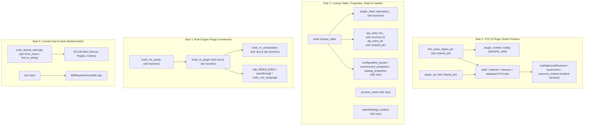

# Plugin & First-Class Object Framework C++17 Modernization Implementation Plan

> **For agentic workers:** REQUIRED SUB-SKILL: Use superpowers:subagent-driven-development to implement this plan task-by-task. Steps use checkbox (`- [ ]`) syntax for tracking.

**Goal:** Eliminate `boost::shared_ptr`, `boost::dynamic_pointer_cast`, `boost::pointer_cast`, `boost::any`, `boost::function`, `boost::lexical_cast`, and `boost::hash` across the iRODS codebase in favor of C++17 standard library vocabulary types (`std::shared_ptr`, `std::dynamic_pointer_cast`, `std::any`, `std::function`, `std::from_chars`, `fmt::to_string`, and `std::hash`).

**Architecture:** We replace legacy Boost smart pointers and type-erased containers across four cohesive subsystems: (1) the First-Class Object (FCO) and plugin pointer hierarchy (`first_class_object_ptr`, `plugin_ptr`, `auth_object_ptr`, `network_object_ptr`, `resource_object_ptr`, `database_object_ptr`), upgrading `plugin_context::valid<OBJ_TYPE>()` to a zero-allocation `dynamic_cast<OBJ_TYPE*>(fco_.get())` check and eliminating 100+ redundant derived-to-base `dynamic_pointer_cast<first_class_object>` upcasts; (2) `irods::lookup_table`, `plugin_base`, `apiHandler`, `process_stash`, configuration/environment/catalog properties, and `lib/hasher`; (3) the Rule Engine Plugin Framework (`effect_handler`, `rule_engine_vars_t`, `irods_re_serialization`, `microservice_table`, and all rule engine plugins); and (4) `irods::lexical_cast` (`std::from_chars` / `fmt::to_string`) and remaining `boost::lexical_cast` / `boost::hash` call sites.

**Architecture Diagram:**



**Tech Stack:** C++17 (`<memory>`, `<any>`, `<functional>`, `<charconv>`, `<type_traits>`), `{fmt}` (`<fmt/format.h>`), Catch2, CMake / Ninja.

## Global Constraints

- Zero occurrences of `boost::shared_ptr`, `boost::dynamic_pointer_cast`, `boost::pointer_cast`, `boost::any`, `boost::any_cast`, `boost::bad_any_cast`, `boost::function`, `boost::lexical_cast`, `boost::bad_lexical_cast`, or `boost::hash` may remain in `lib/`, `server/`, `plugins/`, `clients/`, or `unit_tests/`.
- Cross-DSO `std::any_cast` safety must be preserved (`libstdc++` uses `__GXX_MERGED_TYPEINFO_NAMES == 0`, comparing `type_info` names via `strcmp`).
- `process_stash::find` must return `std::any{}` (`!has_value()`) when a handle is not found, and callers checking `.empty()` on `boost::any` must be updated to `!.has_value()`.
- Preserve all existing comments and docstrings unrelated to the changes.

---

### Task 1: First-Class Object (FCO) & Plugin Smart Pointer Modernization (`std::shared_ptr`)

**Files:**
- Modify: [`lib/core/include/irods/irods_first_class_object.hpp`](file:///home/darkfell/dev/irods/lib/core/include/irods/irods_first_class_object.hpp)
- Modify: [`lib/core/include/irods/irods_plugin_base.hpp`](file:///home/darkfell/dev/irods/lib/core/include/irods/irods_plugin_base.hpp)
- Modify: [`lib/core/include/irods/irods_plugin_context.hpp`](file:///home/darkfell/dev/irods/lib/core/include/irods/irods_plugin_context.hpp)
- Modify: [`lib/core/include/irods/irods_auth_types.hpp`](file:///home/darkfell/dev/irods/lib/core/include/irods/irods_auth_types.hpp), [`irods_auth_object.hpp`](file:///home/darkfell/dev/irods/lib/core/include/irods/irods_auth_object.hpp), [`irods_auth_plugin.hpp`](file:///home/darkfell/dev/irods/lib/core/include/irods/irods_auth_plugin.hpp), [`irods_auth_factory.hpp`](file:///home/darkfell/dev/irods/lib/core/include/irods/irods_auth_factory.hpp), [`irods_generic_auth_object.hpp`](file:///home/darkfell/dev/irods/lib/core/include/irods/irods_generic_auth_object.hpp), [`irods_native_auth_object.hpp`](file:///home/darkfell/dev/irods/lib/core/include/irods/irods_native_auth_object.hpp), [`irods_pam_auth_object.hpp`](file:///home/darkfell/dev/irods/lib/core/include/irods/irods_pam_auth_object.hpp), [`irods_generic_auth_object.cpp`](file:///home/darkfell/dev/irods/lib/core/src/irods_generic_auth_object.cpp), [`irods_native_auth_object.cpp`](file:///home/darkfell/dev/irods/lib/core/src/irods_native_auth_object.cpp), [`irods_pam_auth_object.cpp`](file:///home/darkfell/dev/irods/lib/core/src/irods_pam_auth_object.cpp)
- Modify: [`lib/core/include/irods/irods_network_types.hpp`](file:///home/darkfell/dev/irods/lib/core/include/irods/irods_network_types.hpp), [`irods_network_object.hpp`](file:///home/darkfell/dev/irods/lib/core/include/irods/irods_network_object.hpp), [`irods_network_factory.hpp`](file:///home/darkfell/dev/irods/lib/core/include/irods/irods_network_factory.hpp), [`irods_network_manager.hpp`](file:///home/darkfell/dev/irods/lib/core/include/irods/irods_network_manager.hpp), [`irods_tcp_object.hpp`](file:///home/darkfell/dev/irods/lib/core/include/irods/irods_tcp_object.hpp), [`irods_ssl_object.hpp`](file:///home/darkfell/dev/irods/lib/core/include/irods/irods_ssl_object.hpp), [`irods_tcp_object.cpp`](file:///home/darkfell/dev/irods/lib/core/src/irods_tcp_object.cpp), [`irods_ssl_object.cpp`](file:///home/darkfell/dev/irods/lib/core/src/irods_ssl_object.cpp), [`irods_client_server_negotiation.hpp`](file:///home/darkfell/dev/irods/lib/core/include/irods/irods_client_server_negotiation.hpp), [`irods_client_negotiation.cpp`](file:///home/darkfell/dev/irods/lib/core/src/irods_client_negotiation.cpp), [`sockComm.cpp`](file:///home/darkfell/dev/irods/lib/core/src/sockComm.cpp)
- Modify: [`server/core/include/irods/irods_resource_types.hpp`](file:///home/darkfell/dev/irods/server/core/include/irods/irods_resource_types.hpp), [`irods_resource_plugin.hpp`](file:///home/darkfell/dev/irods/server/core/include/irods/irods_resource_plugin.hpp), [`irods_data_object.hpp`](file:///home/darkfell/dev/irods/server/core/include/irods/irods_data_object.hpp), [`irods_file_object.hpp`](file:///home/darkfell/dev/irods/server/core/include/irods/irods_file_object.hpp), [`irods_collection_object.hpp`](file:///home/darkfell/dev/irods/server/core/include/irods/irods_collection_object.hpp), [`irods_structured_object.hpp`](file:///home/darkfell/dev/irods/server/core/include/irods/irods_structured_object.hpp), [`objDesc.hpp`](file:///home/darkfell/dev/irods/server/core/include/irods/objDesc.hpp), [`irods_resource_plugin.cpp`](file:///home/darkfell/dev/irods/server/core/src/irods_resource_plugin.cpp), [`irods_file_object.cpp`](file:///home/darkfell/dev/irods/server/core/src/irods_file_object.cpp), [`irods_collection_object.cpp`](file:///home/darkfell/dev/irods/server/core/src/irods_collection_object.cpp), [`irods_structured_object.cpp`](file:///home/darkfell/dev/irods/server/core/src/irods_structured_object.cpp), [`irods_resource_backport.cpp`](file:///home/darkfell/dev/irods/server/core/src/irods_resource_backport.cpp), [`irods_resource_redirect.cpp`](file:///home/darkfell/dev/irods/server/core/src/irods_resource_redirect.cpp), [`irods_resource_manager.cpp`](file:///home/darkfell/dev/irods/server/core/src/irods_resource_manager.cpp), [`irods_server_negotiation.cpp`](file:///home/darkfell/dev/irods/server/core/src/irods_server_negotiation.cpp), [`voting.cpp`](file:///home/darkfell/dev/irods/server/core/src/voting.cpp), [`dataObjOpr.cpp`](file:///home/darkfell/dev/irods/server/core/src/dataObjOpr.cpp), [`replica_state_table.cpp`](file:///home/darkfell/dev/irods/server/core/src/replica_state_table.cpp), [`fileDriver.cpp`](file:///home/darkfell/dev/irods/server/drivers/src/fileDriver.cpp)
- Modify: [`server/core/include/irods/irods_database_types.hpp`](file:///home/darkfell/dev/irods/server/core/include/irods/irods_database_types.hpp), [`irods_database_object.hpp`](file:///home/darkfell/dev/irods/server/core/include/irods/irods_database_object.hpp), [`irods_database_factory.hpp`](file:///home/darkfell/dev/irods/server/core/include/irods/irods_database_factory.hpp), [`irods_postgres_object.hpp`](file:///home/darkfell/dev/irods/server/core/include/irods/irods_postgres_object.hpp), [`irods_mysql_object.hpp`](file:///home/darkfell/dev/irods/server/core/include/irods/irods_mysql_object.hpp), [`irods_oracle_object.hpp`](file:///home/darkfell/dev/irods/server/core/include/irods/irods_oracle_object.hpp), [`irods_generic_database_object.hpp`](file:///home/darkfell/dev/irods/server/core/include/irods/irods_generic_database_object.hpp), [`irods_postgres_object.cpp`](file:///home/darkfell/dev/irods/server/core/src/irods_postgres_object.cpp), [`irods_mysql_object.cpp`](file:///home/darkfell/dev/irods/server/core/src/irods_mysql_object.cpp), [`irods_oracle_object.cpp`](file:///home/darkfell/dev/irods/server/core/src/irods_oracle_object.cpp), [`irods_generic_database_object.cpp`](file:///home/darkfell/dev/irods/server/core/src/irods_generic_database_object.cpp), [`icatHighLevelRoutines.cpp`](file:///home/darkfell/dev/irods/server/icat/src/icatHighLevelRoutines.cpp)
- Modify: [`server/api/src/rsAuthPluginRequest.cpp`](file:///home/darkfell/dev/irods/server/api/src/rsAuthPluginRequest.cpp), [`rsAuthRequest.cpp`](file:///home/darkfell/dev/irods/server/api/src/rsAuthRequest.cpp), [`rsAuthResponse.cpp`](file:///home/darkfell/dev/irods/server/api/src/rsAuthResponse.cpp), [`rsRegReplica.cpp`](file:///home/darkfell/dev/irods/server/api/src/rsRegReplica.cpp), [`rsStructFileExtract.cpp`](file:///home/darkfell/dev/irods/server/api/src/rsStructFileExtract.cpp), [`rsStructFileSync.cpp`](file:///home/darkfell/dev/irods/server/api/src/rsStructFileSync.cpp), [`plugins/api/src/register_physical_path.cpp`](file:///home/darkfell/dev/irods/plugins/api/src/register_physical_path.cpp)
- Modify: [`plugins/auth_legacy/src/native.cpp`](file:///home/darkfell/dev/irods/plugins/auth_legacy/src/native.cpp), [`plugins/auth_legacy/src/pam.cpp`](file:///home/darkfell/dev/irods/plugins/auth_legacy/src/pam.cpp), [`plugins/network/src/tcp.cpp`](file:///home/darkfell/dev/irods/plugins/network/src/tcp.cpp), [`plugins/network/src/ssl.cpp`](file:///home/darkfell/dev/irods/plugins/network/src/ssl.cpp), [`plugins/database/src/db_plugin.cpp`](file:///home/darkfell/dev/irods/plugins/database/src/db_plugin.cpp)
- Modify: [`plugins/resources/src/compound.cpp`](file:///home/darkfell/dev/irods/plugins/resources/src/compound.cpp), [`deferred.cpp`](file:///home/darkfell/dev/irods/plugins/resources/src/deferred.cpp), [`load_balanced.cpp`](file:///home/darkfell/dev/irods/plugins/resources/src/load_balanced.cpp), [`mockarchive.cpp`](file:///home/darkfell/dev/irods/plugins/resources/src/mockarchive.cpp), [`nonblocking.cpp`](file:///home/darkfell/dev/irods/plugins/resources/src/nonblocking.cpp), [`passthru.cpp`](file:///home/darkfell/dev/irods/plugins/resources/src/passthru.cpp), [`random.cpp`](file:///home/darkfell/dev/irods/plugins/resources/src/random.cpp), [`structfile.cpp`](file:///home/darkfell/dev/irods/plugins/resources/src/structfile.cpp), [`univmss.cpp`](file:///home/darkfell/dev/irods/plugins/resources/src/univmss.cpp), [`plugins/resources/replication/src/irods_repl_rebalance.cpp`](file:///home/darkfell/dev/irods/plugins/resources/replication/src/irods_repl_rebalance.cpp), [`plugins/resources/replication/src/librepl.cpp`](file:///home/darkfell/dev/irods/plugins/resources/replication/src/librepl.cpp), [`plugins/resources/unixfilesystem/src/unixfilesystem.cpp`](file:///home/darkfell/dev/irods/plugins/resources/unixfilesystem/src/unixfilesystem.cpp), [`plugins/microservices/src/update_unixfilesystem_resource_free_space.cpp`](file:///home/darkfell/dev/irods/plugins/microservices/src/update_unixfilesystem_resource_free_space.cpp)

**Interfaces:**
- Produces:
  - `using first_class_object_ptr = std::shared_ptr<first_class_object>;`
  - `using plugin_ptr = std::shared_ptr<plugin_base>;`
  - `using auth_object_ptr = std::shared_ptr<auth_object>;` (and derived `generic_auth_object_ptr`, `native_auth_object_ptr`, `pam_auth_object_ptr`, `auth_ptr`)
  - `using network_object_ptr = std::shared_ptr<network_object>;` (and derived `tcp_object_ptr`, `ssl_object_ptr`, `network_ptr`)
  - `using resource_ptr = std::shared_ptr<resource>;` (and `data_object_ptr`, `file_object_ptr`, `collection_object_ptr`, `structured_object_ptr`)
  - `using database_object_ptr = std::shared_ptr<database_object>;` (and `postgres_object_ptr`, `mysql_object_ptr`, `oracle_object_ptr`, `generic_database_object_ptr`, `database_ptr`)
  - `plugin_context::valid<OBJ_TYPE>()` using `dynamic_cast<OBJ_TYPE*>(fco_.get()) == nullptr`

- [ ] **Step 1: Update `irods_first_class_object.hpp` and `irods_plugin_context.hpp`**

```diff
--- a/lib/core/include/irods/irods_first_class_object.hpp
+++ b/lib/core/include/irods/irods_first_class_object.hpp
@@ -3,7 +3,7 @@
 
 #include "irods/irods_error.hpp"
 #include "irods/rodsDef.h"
-#include <boost/shared_ptr.hpp>
+#include <memory>
 
 namespace irods {
     /// =-=-=-=-=-=-=-
@@ -33,7 +33,7 @@ namespace irods {
     /// =-=-=-=-=-=-=-
     /// @brief typedef for managed first class object pointer
     /// =-=-=-=-=-=-=-
-    typedef boost::shared_ptr<first_class_object> first_class_object_ptr;
+    using first_class_object_ptr = std::shared_ptr<first_class_object>;
 
 } // namespace irods
```

```diff
--- a/lib/core/include/irods/irods_plugin_context.hpp
+++ b/lib/core/include/irods/irods_plugin_context.hpp
@@ -1,7 +1,7 @@
 #ifndef __IRODS_PLUGIN_CONTEXT_HPP__
 #define __IRODS_PLUGIN_CONTEXT_HPP__
 
-// =-=-=-=-=-=-=-
-#include <boost/pointer_cast.hpp>
+#include <memory>
+#include <utility>
 
 // =-=-=-=-=-=-=-
 // irods includes
@@ -84,8 +84,7 @@ namespace irods {
             // =-=-=-=-=-=-=-
             // check if the pointer is valid and if it is legible as the template type
             template < typename OBJ_TYPE >
             error valid() {
                 // case of incorrect type for first class object
-                if ( fco_.get() == NULL ||
-                        boost::dynamic_pointer_cast< OBJ_TYPE >( fco_.get() ) == NULL ) {
+                if ( dynamic_cast< OBJ_TYPE* >( fco_.get() ) == nullptr ) {
                     return ERROR( INVALID_FIRST_CLASS_OBJECT, "the first class object is not valid" );
                 }
```

- [ ] **Step 2: Update all Auth, Network, Resource, and Database FCO/plugin headers & implementations**
  - Replace `<boost/shared_ptr.hpp>` with `<memory>`.
  - Replace `boost::shared_ptr` with `std::shared_ptr`.
  - Replace `boost::dynamic_pointer_cast` with `std::dynamic_pointer_cast` for base-to-derived downcasts.
  - Remove redundant `boost::dynamic_pointer_cast<irods::first_class_object>(ptr)` upcasts in [`icatHighLevelRoutines.cpp`](file:///home/darkfell/dev/irods/server/icat/src/icatHighLevelRoutines.cpp), [`sockComm.cpp`](file:///home/darkfell/dev/irods/lib/core/src/sockComm.cpp), and [`irods_resource_redirect.cpp`](file:///home/darkfell/dev/irods/server/core/src/irods_resource_redirect.cpp) by relying on implicit `std::shared_ptr<Derived>` to `std::shared_ptr<first_class_object>` conversion.

---

### Task 2: `irods::lookup_table`, `plugin_base`, `apiHandler`, `process_stash`, Properties & `lib/hasher` (`std::any` & `std::function`)

**Files:**
- Modify: [`lib/core/include/irods/irods_lookup_table.hpp`](file:///home/darkfell/dev/irods/lib/core/include/irods/irods_lookup_table.hpp)
- Modify: [`lib/core/include/irods/irods_plugin_base.hpp`](file:///home/darkfell/dev/irods/lib/core/include/irods/irods_plugin_base.hpp)
- Modify: [`lib/core/include/irods/apiHandler.hpp`](file:///home/darkfell/dev/irods/lib/core/include/irods/apiHandler.hpp), [`lib/api/include/irods/apiTable.hpp`](file:///home/darkfell/dev/irods/lib/api/include/irods/apiTable.hpp), [`lib/core/src/procApiRequest.cpp`](file:///home/darkfell/dev/irods/lib/core/src/procApiRequest.cpp), [`server/core/src/irods_api_calling_functions.cpp`](file:///home/darkfell/dev/irods/server/core/src/irods_api_calling_functions.cpp), [`plugins/api/src/helloworld.cpp`](file:///home/darkfell/dev/irods/plugins/api/src/helloworld.cpp)
- Modify: [`lib/core/include/irods/authentication_plugin_framework.hpp`](file:///home/darkfell/dev/irods/lib/core/include/irods/authentication_plugin_framework.hpp), [`lib/core/include/irods/experimental_plugin_framework.hpp`](file:///home/darkfell/dev/irods/lib/core/include/irods/experimental_plugin_framework.hpp), [`plugins/authentication/src/pam_password.cpp`](file:///home/darkfell/dev/irods/plugins/authentication/src/pam_password.cpp)
- Modify: [`lib/core/include/irods/irods_configuration_parser.hpp`](file:///home/darkfell/dev/irods/lib/core/include/irods/irods_configuration_parser.hpp), [`lib/core/src/irods_configuration_parser.cpp`](file:///home/darkfell/dev/irods/lib/core/src/irods_configuration_parser.cpp), [`lib/core/include/irods/irods_environment_properties.hpp`](file:///home/darkfell/dev/irods/lib/core/include/irods/irods_environment_properties.hpp), [`lib/core/src/irods_environment_properties.cpp`](file:///home/darkfell/dev/irods/lib/core/src/irods_environment_properties.cpp), [`lib/core/src/irods_server_properties.cpp`](file:///home/darkfell/dev/irods/lib/core/src/irods_server_properties.cpp), [`lib/core/src/getRodsEnv.cpp`](file:///home/darkfell/dev/irods/lib/core/src/getRodsEnv.cpp), [`plugins/database/include/irods/private/irods_catalog_properties.hpp`](file:///home/darkfell/dev/irods/plugins/database/include/irods/private/irods_catalog_properties.hpp), [`plugins/database/src/irods_catalog_properties.cpp`](file:///home/darkfell/dev/irods/plugins/database/src/irods_catalog_properties.cpp), [`server/api/src/rsClientHints.cpp`](file:///home/darkfell/dev/irods/server/api/src/rsClientHints.cpp), [`server/api/src/rsServerReport.cpp`](file:///home/darkfell/dev/irods/server/api/src/rsServerReport.cpp)
- Modify: [`lib/core/include/irods/process_stash.hpp`](file:///home/darkfell/dev/irods/lib/core/include/irods/process_stash.hpp), [`lib/core/src/process_stash.cpp`](file:///home/darkfell/dev/irods/lib/core/src/process_stash.cpp), [`unit_tests/src/test_process_stash.cpp`](file:///home/darkfell/dev/irods/unit_tests/src/test_process_stash.cpp), [`plugins/microservices/src/json_common.hpp`](file:///home/darkfell/dev/irods/plugins/microservices/src/json_common.hpp), [`json_compare.cpp`](file:///home/darkfell/dev/irods/plugins/microservices/src/json_compare.cpp), [`json_contains.cpp`](file:///home/darkfell/dev/irods/plugins/microservices/src/json_contains.cpp), [`json_dump.cpp`](file:///home/darkfell/dev/irods/plugins/microservices/src/json_dump.cpp), [`json_handles.cpp`](file:///home/darkfell/dev/irods/plugins/microservices/src/json_handles.cpp), [`json_names.cpp`](file:///home/darkfell/dev/irods/plugins/microservices/src/json_names.cpp), [`json_size.cpp`](file:///home/darkfell/dev/irods/plugins/microservices/src/json_size.cpp), [`json_type.cpp`](file:///home/darkfell/dev/irods/plugins/microservices/src/json_type.cpp), [`json_value.cpp`](file:///home/darkfell/dev/irods/plugins/microservices/src/json_value.cpp), [`server/re/src/msi_genquery2.cpp`](file:///home/darkfell/dev/irods/server/re/src/msi_genquery2.cpp)
- Modify: [`lib/hasher/include/irods/HashStrategy.hpp`](file:///home/darkfell/dev/irods/lib/hasher/include/irods/HashStrategy.hpp), [`Hasher.hpp`](file:///home/darkfell/dev/irods/lib/hasher/include/irods/Hasher.hpp), [`ADLER32Strategy.hpp`](file:///home/darkfell/dev/irods/lib/hasher/include/irods/ADLER32Strategy.hpp), [`CRC64NVMEStrategy.hpp`](file:///home/darkfell/dev/irods/lib/hasher/include/irods/CRC64NVMEStrategy.hpp), [`MD5Strategy.hpp`](file:///home/darkfell/dev/irods/lib/hasher/include/irods/MD5Strategy.hpp), [`SHA1Strategy.hpp`](file:///home/darkfell/dev/irods/lib/hasher/include/irods/SHA1Strategy.hpp), [`SHA256Strategy.hpp`](file:///home/darkfell/dev/irods/lib/hasher/include/irods/SHA256Strategy.hpp), [`SHA512Strategy.hpp`](file:///home/darkfell/dev/irods/lib/hasher/include/irods/SHA512Strategy.hpp), [`ADLER32Strategy.cpp`](file:///home/darkfell/dev/irods/lib/hasher/src/ADLER32Strategy.cpp), [`CRC64NVMEStrategy.cpp`](file:///home/darkfell/dev/irods/lib/hasher/src/CRC64NVMEStrategy.cpp), [`MD5Strategy.cpp`](file:///home/darkfell/dev/irods/lib/hasher/src/MD5Strategy.cpp), [`SHA1Strategy.cpp`](file:///home/darkfell/dev/irods/lib/hasher/src/SHA1Strategy.cpp), [`SHA256Strategy.cpp`](file:///home/darkfell/dev/irods/lib/hasher/src/SHA256Strategy.cpp), [`SHA512Strategy.cpp`](file:///home/darkfell/dev/irods/lib/hasher/src/SHA512Strategy.cpp), [`irods_hasher_factory.cpp`](file:///home/darkfell/dev/irods/lib/hasher/src/irods_hasher_factory.cpp)

- [ ] **Step 1: Migrate `irods_lookup_table.hpp` to `<any>` (`std::any`, `std::any_cast`, `std::bad_any_cast`)**

```diff
--- a/lib/core/include/irods/irods_lookup_table.hpp
+++ b/lib/core/include/irods/irods_lookup_table.hpp
@@ -1,7 +1,7 @@
 #ifndef __IRODS_LOOKUP_TABLE_HPP__
 #define __IRODS_LOOKUP_TABLE_HPP__
 
-#include <boost/any.hpp>
+#include <any>
 #include <string>
 
 #include "irods/irods_hash.hpp"
@@ -11,10 +11,10 @@ namespace irods {
 
     template < typename T >
     T& any_extract(
-        boost::any& _p ) {
-        return *boost::any_cast< T >( &_p );
+        std::any& _p ) {
+        return *std::any_cast< T >( &_p );
     }
 
     template < typename T >
     const T& any_extract(
-        const boost::any& _p ) {
-        return *boost::any_cast< T >( &_p );
+        const std::any& _p ) {
+        return *std::any_cast< T >( &_p );
     }
```

- [ ] **Step 2: Migrate `irods_plugin_base.hpp`, `apiHandler.hpp`, `authentication_plugin_framework.hpp`, and `experimental_plugin_framework.hpp` to `std::any`, `std::function`, and `std::shared_ptr`**
  - In `plugin_base`: `operations_` stores `std::function<error(plugin_context&, ...)>` inside `lookup_table<std::any>`.
  - In `apiHandler.hpp`: `fcn_` stores `std::function`, `api_entry_ptr` is `std::shared_ptr<api_entry>`.
  - In `authentication_plugin_framework.hpp` and `experimental_plugin_framework.hpp`: `operations_` stores `std::function<json(RsComm*, const json&)>` inside `lookup_table<std::any>`.

- [ ] **Step 3: Migrate `process_stash`, configuration/environment/catalog properties, and `lib/hasher` to `std::any`**
  - Update [`process_stash.hpp`](file:///home/darkfell/dev/irods/lib/core/include/irods/process_stash.hpp), [`process_stash.cpp`](file:///home/darkfell/dev/irods/lib/core/src/process_stash.cpp), [`test_process_stash.cpp`](file:///home/darkfell/dev/irods/unit_tests/src/test_process_stash.cpp), [`msi_genquery2.cpp`](file:///home/darkfell/dev/irods/server/re/src/msi_genquery2.cpp), and `plugins/microservices/src/json_*.cpp`.
  - Update [`HashStrategy.hpp`](file:///home/darkfell/dev/irods/lib/hasher/include/irods/HashStrategy.hpp), [`Hasher.hpp`](file:///home/darkfell/dev/irods/lib/hasher/include/irods/Hasher.hpp), and all 6 strategy implementations (`ADLER32`, `CRC64NVME`, `MD5`, `SHA1`, `SHA256`, `SHA512`) to use `std::any` and `std::any_cast`.

- [ ] **Step 4: Run `irods_process_stash` unit test to verify Task 2**
  - Run: `ninja -C /home/darkfell/dev/build_irods irods_process_stash && /home/darkfell/dev/build_irods/unit_tests/irods_process_stash`
  - Expected: All assertions pass.

---

### Task 3: Rule Engine Plugin Framework (`std::any` & `std::function`)

**Files:**
- Modify: [`server/re/include/irods/irods_re_plugin.hpp`](file:///home/darkfell/dev/irods/server/re/include/irods/irods_re_plugin.hpp), [`server/re/src/irods_re_plugin.cpp`](file:///home/darkfell/dev/irods/server/re/src/irods_re_plugin.cpp)
- Modify: [`server/re/include/irods/irods_re_serialization.hpp`](file:///home/darkfell/dev/irods/server/re/include/irods/irods_re_serialization.hpp), [`server/re/src/irods_re_serialization.cpp`](file:///home/darkfell/dev/irods/server/re/src/irods_re_serialization.cpp)
- Modify: [`server/re/include/irods/irods_ms_plugin.hpp`](file:///home/darkfell/dev/irods/server/re/include/irods/irods_ms_plugin.hpp), [`server/re/src/irods_ms_plugin.cpp`](file:///home/darkfell/dev/irods/server/re/src/irods_ms_plugin.cpp)
- Modify: [`server/re/include/irods/irods_re_structs.hpp`](file:///home/darkfell/dev/irods/server/re/include/irods/irods_re_structs.hpp), [`server/re/src/irods_re_structs.cpp`](file:///home/darkfell/dev/irods/server/re/src/irods_re_structs.cpp)
- Modify: [`plugins/rule_engines/src/cpp_default_policy.cpp`](file:///home/darkfell/dev/irods/plugins/rule_engines/src/cpp_default_policy.cpp), [`plugins/rule_engines/src/passthrough.cpp`](file:///home/darkfell/dev/irods/plugins/rule_engines/src/passthrough.cpp), [`plugins/rule_engines/irods_rule_language/src/irods_rule_language.cpp`](file:///home/darkfell/dev/irods/plugins/rule_engines/irods_rule_language/src/irods_rule_language.cpp), [`plugins/rule_engines/irods_rule_language/src/arithmetics.cpp`](file:///home/darkfell/dev/irods/plugins/rule_engines/irods_rule_language/src/arithmetics.cpp)

- [ ] **Step 1: Migrate `irods_re_plugin.hpp`, `irods_re_serialization.hpp`, `irods_ms_plugin.hpp`, and `irods_re_structs.hpp` to `std::any` and `std::function`**
  - Replace `<boost/any.hpp>` and `<boost/function.hpp>` with `<any>` and `<functional>`.
  - Update `effect_handler`, `default_ms_ctx`, `rule_engine_vars_t` (`irods::lookup_table<std::any>`), `serializable_types_t` (`std::map<std::type_index, std::function<error(std::any, serialized_parameter_t&)>>`), and `ms_table_entry`.
  - Update all `boost::any_cast` / `boost::bad_any_cast` in [`irods_re_serialization.cpp`](file:///home/darkfell/dev/irods/server/re/src/irods_re_serialization.cpp), [`cpp_default_policy.cpp`](file:///home/darkfell/dev/irods/plugins/rule_engines/src/cpp_default_policy.cpp), [`passthrough.cpp`](file:///home/darkfell/dev/irods/plugins/rule_engines/src/passthrough.cpp), [`irods_rule_language.cpp`](file:///home/darkfell/dev/irods/plugins/rule_engines/irods_rule_language/src/irods_rule_language.cpp), and [`arithmetics.cpp`](file:///home/darkfell/dev/irods/plugins/rule_engines/irods_rule_language/src/arithmetics.cpp) to `std::any_cast` / `std::bad_any_cast`.

---

### Task 4: `irods::lexical_cast` (`std::from_chars` / `fmt::to_string`) & `boost::hash` Removal

**Files:**
- Modify: [`lib/core/include/irods/irods_lexical_cast.hpp`](file:///home/darkfell/dev/irods/lib/core/include/irods/irods_lexical_cast.hpp)
- Modify: [`lib/filesystem/src/path.cpp`](file:///home/darkfell/dev/irods/lib/filesystem/src/path.cpp)
- Modify: [`server/re/src/irods_re_serialization.cpp`](file:///home/darkfell/dev/irods/server/re/src/irods_re_serialization.cpp)
- Modify: [`lib/core/src/irods_error.cpp`](file:///home/darkfell/dev/irods/lib/core/src/irods_error.cpp), [`lib/core/src/irods_parse_command_line_options.cpp`](file:///home/darkfell/dev/irods/lib/core/src/irods_parse_command_line_options.cpp), [`lib/core/src/putUtil.cpp`](file:///home/darkfell/dev/irods/lib/core/src/putUtil.cpp), [`lib/core/src/rcMisc.cpp`](file:///home/darkfell/dev/irods/lib/core/src/rcMisc.cpp)
- Modify: [`server/api/src/rsBulkDataObjPut.cpp`](file:///home/darkfell/dev/irods/server/api/src/rsBulkDataObjPut.cpp), [`server/api/src/rsProcStat.cpp`](file:///home/darkfell/dev/irods/server/api/src/rsProcStat.cpp), [`server/core/src/miscServerFunct.cpp`](file:///home/darkfell/dev/irods/server/core/src/miscServerFunct.cpp), [`server/main_server/src/main.cpp`](file:///home/darkfell/dev/irods/server/main_server/src/main.cpp), [`server/re/src/reIn2p3SysRule.cpp`](file:///home/darkfell/dev/irods/server/re/src/reIn2p3SysRule.cpp)
- Modify: [`clients/icommands/src/iadmin.cpp`](file:///home/darkfell/dev/irods/clients/icommands/src/iadmin.cpp), [`clients/icommands/src/iinit.cpp`](file:///home/darkfell/dev/irods/clients/icommands/src/iinit.cpp), [`clients/icommands/src/irule.cpp`](file:///home/darkfell/dev/irods/clients/icommands/src/irule.cpp)

- [ ] **Step 1: Replace `boost::lexical_cast` inside `irods_lexical_cast.hpp` with `std::from_chars` / `fmt::to_string` / `std::stringstream`**
  - Use `std::from_chars` for integral string-to-number conversions (fast, locale-independent, zero-allocation).
  - Use `fmt::to_string` for number-to-string conversions.
  - Fall back to `std::stringstream` for any other streamable types.

- [ ] **Step 2: Replace all direct `boost::lexical_cast` calls in [`irods_re_serialization.cpp`](file:///home/darkfell/dev/irods/server/re/src/irods_re_serialization.cpp) and the 27 other files with `fmt::to_string`, `std::to_string`, or `irods::lexical_cast`**
  - In [`irods_re_serialization.cpp`](file:///home/darkfell/dev/irods/server/re/src/irods_re_serialization.cpp), replace all `boost::lexical_cast<std::string>(...)` with `fmt::to_string(...)` (for arithmetic/enum types) or `std::string(...)`, and remove `<boost/lexical_cast.hpp>` and `catch (const boost::bad_lexical_cast&)`.

- [ ] **Step 3: Replace `boost::hash<std::string>` in [`lib/filesystem/src/path.cpp`](file:///home/darkfell/dev/irods/lib/filesystem/src/path.cpp) with `std::hash<std::string>`**

```diff
--- a/lib/filesystem/src/path.cpp
+++ b/lib/filesystem/src/path.cpp
@@ -16,7 +16,7 @@
 #include <cstring>
 #include <iterator>
 #include <stdexcept>
-#include <boost/functional/hash.hpp>
+#include <functional>
 
 namespace irods::filesystem
 {
@@ -683,7 +683,7 @@ namespace irods::filesystem
 
     auto hash_value(const path& _p) noexcept -> std::size_t
     {
-        boost::hash<std::string> hasher;
-        return hasher(_p.object_path());
+        return std::hash<std::string>{}(_p.object_path());
     }
```

- [ ] **Step 4: Build all targets, run unit tests, and verify zero remaining occurrences**
  - Run: `ninja -C /home/darkfell/dev/build_irods all unit-tests`
  - Run all standalone unit tests in `/home/darkfell/dev/build_irods/unit_tests/`
  - Verify `rg "boost::(shared_ptr|dynamic_pointer_cast|pointer_cast|any|bad_any_cast|any_cast|function|lexical_cast|bad_lexical_cast|hash)|boost/(shared_ptr|pointer_cast|any|function|lexical_cast)" lib/ server/ plugins/ clients/ unit_tests/` returns 0 matches.
  - Commit all changes to `simply_collections`.
