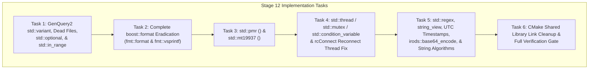

# Stage 12: C++17/20 Standard Library Modernization & Legacy Boost Elimination Implementation Plan

> **For agentic workers:** REQUIRED SUB-SKILL: Use superpowers:subagent-driven-development to implement this plan task-by-task. Steps use checkbox (`- [ ]`) syntax for tracking.

**Goal:** Eliminate legacy pre-C++17/20 Boost libraries (`boost::variant`, `boost::optional`, `boost::format`, `boost::container::pmr`, `boost::random`, `boost::thread`/`mutex`/`condition_variable`, `boost::regex`, `boost::tokenizer`, `boost::posix_time`, `boost::archive`, `boost::safe_numerics`, `boost::numeric_cast`, `boost::make_function_input_iterator`, `boost::preprocessor`, and `boost/algorithm/string`) across `lib/`, `server/`, `plugins/`, `clients/`, and `unit_tests/`, and remove `libboost_thread.so`, `libboost_regex.so`, `libboost_random.so`, `libboost_chrono.so`, and `libboost_container.so` link dependencies from CMake.

**Architecture:** We systematically replace legacy Boost components with their C++17/20 standard library (`<variant>`, `<optional>`, `<memory_resource>`, `<random>`, `<thread>`, `<mutex>`, `<condition_variable>`, `<regex>`, `<string_view>`, `<ctime>`, `<iomanip>`, `<utility>`) and `fmt` (`<fmt/format.h>`, `<fmt/printf.h>`, `<fmt/args.h>`) counterparts across 6 self-contained tasks. In addition, migrating `rcConnect.cpp` from `boost::thread` to `std::thread` resolves a latent disconnect hang/use-after-free in `cliReconnManager`, and migrating `genquery2_ast_types.hpp` from `boost::variant` to `std::variant` resolves `TODO(#7679)` in `server/genquery2/dsl/parser.y`.

**Architecture Diagram:**



**Tech Stack:** C++20, CMake, `{fmt}` (`fmt::format`, `fmt::vsprintf`), Catch2, Bison (GenQuery2 DSL parser).

## Global Constraints

- C++20 standard compliance across all targets in `/home/darkfell/dev/irods/build`.
- Preserve all unrelated comments and docstrings.
- Ensure no `std::thread` object is destroyed while `joinable()`.
- Zero occurrences of `boost::variant`, `boost::optional`, `boost::format`, `boost::container::pmr`, `boost::random`, `boost::thread`, `boost::mutex`, `boost::condition_variable`, `boost::scoped_thread`, `boost::regex`, `boost::tokenizer`, `boost::posix_time`, or `boost::archive` may remain in `lib/`, `server/`, `plugins/`, `clients/`, or `unit_tests/`.

---

### Task 1: GenQuery2 AST `std::variant` (`TODO(#7679)`), Dead Boost Files, `std::optional`, & `std::in_range`

**Files:**
- Delete: [`lib/core/include/irods/microservice.hpp`](file:///home/darkfell/dev/irods/lib/core/include/irods/microservice.hpp)
- Delete: [`lib/core/src/irods_threads.cpp`](file:///home/darkfell/dev/irods/lib/core/src/irods_threads.cpp)
- Modify: [`lib/core/CMakeLists.txt`](file:///home/darkfell/dev/irods/lib/core/CMakeLists.txt)
- Modify: [`lib/core/include/irods/genquery2_ast_types.hpp`](file:///home/darkfell/dev/irods/lib/core/include/irods/genquery2_ast_types.hpp)
- Modify: [`lib/core/include/irods/genquery2_builder.hpp`](file:///home/darkfell/dev/irods/lib/core/include/irods/genquery2_builder.hpp)
- Modify: [`server/genquery2/src/genquery2_sql.cpp`](file:///home/darkfell/dev/irods/server/genquery2/src/genquery2_sql.cpp)
- Modify: [`server/genquery2/dsl/parser.y`](file:///home/darkfell/dev/irods/server/genquery2/dsl/parser.y)
- Modify: [`lib/core/include/irods/irods_load_plugin.hpp`](file:///home/darkfell/dev/irods/lib/core/include/irods/irods_load_plugin.hpp)
- Modify: [`lib/core/include/irods/irods_buffer_encryption.hpp`](file:///home/darkfell/dev/irods/lib/core/include/irods/irods_buffer_encryption.hpp)
- Modify: [`lib/core/include/irods/chrono.hpp`](file:///home/darkfell/dev/irods/lib/core/include/irods/chrono.hpp)
- Modify: [`lib/core/include/irods/irods_logger.hpp`](file:///home/darkfell/dev/irods/lib/core/include/irods/irods_logger.hpp)
- Modify: [`lib/core/src/irods_plugin_name_generator.cpp`](file:///home/darkfell/dev/irods/lib/core/src/irods_plugin_name_generator.cpp)
- Modify: [`server/main_server/src/agent_main.cpp`](file:///home/darkfell/dev/irods/server/main_server/src/agent_main.cpp)
- Modify: [`server/icat/include/irods/icatHighLevelRoutines.hpp`](file:///home/darkfell/dev/irods/server/icat/include/irods/icatHighLevelRoutines.hpp)
- Modify: [`server/re/src/irods_re_serialization.cpp`](file:///home/darkfell/dev/irods/server/re/src/irods_re_serialization.cpp)
- Modify: [`server/core/src/atomic_apply_database_operations.cpp`](file:///home/darkfell/dev/irods/server/core/src/atomic_apply_database_operations.cpp)
- Modify: [`plugins/microservices/src/json_common.hpp`](file:///home/darkfell/dev/irods/plugins/microservices/src/json_common.hpp)
- Modify: [`plugins/microservices/src/json_handles.cpp`](file:///home/darkfell/dev/irods/plugins/microservices/src/json_handles.cpp)
- Modify: [`plugins/resources/replication/src/irods_repl_retry.cpp`](file:///home/darkfell/dev/irods/plugins/resources/replication/src/irods_repl_retry.cpp)
- Modify: [`lib/core/include/irods/irods_error.hpp`](file:///home/darkfell/dev/irods/lib/core/include/irods/irods_error.hpp)
- Modify: [`lib/core/src/irods_error.cpp`](file:///home/darkfell/dev/irods/lib/core/src/irods_error.cpp)
- Modify: [`lib/core/src/sockComm.cpp`](file:///home/darkfell/dev/irods/lib/core/src/sockComm.cpp)
- Modify: [`server/core/src/initServer.cpp`](file:///home/darkfell/dev/irods/server/core/src/initServer.cpp)
- Modify: [`clients/icommands/src/imeta.cpp`](file:///home/darkfell/dev/irods/clients/icommands/src/imeta.cpp)
- Modify: [`clients/icommands/src/irule.cpp`](file:///home/darkfell/dev/irods/clients/icommands/src/irule.cpp)

**Interfaces:**
- Consumes: `<variant>`, `<optional>`, `<utility>` (`std::in_range`), `<cassert>`
- Produces: Pure `std::variant`-based GenQuery2 AST (`projection`, `condition_expression`, `condition_wrapper`) and `std::optional`-based `irods::error`.

- [ ] **Step 1: Migrate `genquery2_ast_types.hpp`, `genquery2_builder.hpp`, `genquery2_sql.cpp`, and `parser.y` from `boost::variant` to `std::variant`**

In [`lib/core/include/irods/genquery2_ast_types.hpp`](file:///home/darkfell/dev/irods/lib/core/include/irods/genquery2_ast_types.hpp):
```cpp
#include <memory>
#include <string>
#include <string_view>
#include <utility>
#include <variant>
#include <vector>
```
Replace `condition_expression`, `condition_operator_not`, `projection`, and `condition_wrapper` with `std::variant`:
```cpp
    struct condition_operator_not;

    struct condition_expression
        : std::variant<condition_like,
                       condition_in,
                       condition_between,
                       condition_equal,
                       condition_not_equal,
                       condition_less_than,
                       condition_less_than_or_equal_to,
                       condition_greater_than,
                       condition_greater_than_or_equal_to,
                       condition_is_null,
                       condition_is_not_null,
                       condition_operator_not>
    // Wait: since condition_operator_not contains condition_expression, wrap condition_expression or condition_operator_not!
```
Specifically, define a small copyable `recursive_box<T>` in `irods::experimental::genquery2`:
```cpp
    template <typename T>
    class recursive_box
    {
    public:
        recursive_box()
            : ptr_{std::make_unique<T>()}
        {
        }

        recursive_box(T _val)
            : ptr_{std::make_unique<T>(std::move(_val))}
        {
        }

        recursive_box(const recursive_box& _other)
            : ptr_{std::make_unique<T>(*_other.ptr_)}
        {
        }

        recursive_box(recursive_box&&) noexcept = default;

        auto operator=(const recursive_box& _other) -> recursive_box&
        {
            if (this != &_other) {
                *ptr_ = *_other.ptr_;
            }
            return *this;
        }

        auto operator=(recursive_box&&) noexcept -> recursive_box& = default;

        auto get() noexcept -> T& { return *ptr_; }
        auto get() const noexcept -> const T& { return *ptr_; }
        operator T&() noexcept { return *ptr_; }
        operator const T&() const noexcept { return *ptr_; }

    private:
        std::unique_ptr<T> ptr_;
    }; // class recursive_box
```
And define `projection` and `condition_wrapper`:
```cpp
    using projection = std::variant<column, function>;
    using projections = std::vector<projection>;

    struct condition_wrapper;
    using conditions = std::vector<condition_wrapper>;

    struct logical_and
    {
        conditions condition;
    }; // struct logical_and

    struct logical_or
    {
        conditions condition;
    }; // struct logical_or

    struct logical_not
    {
        conditions condition;
    }; // struct logical_not

    struct logical_grouping
    {
        conditions conditions;
    }; // struct logical_grouping

    struct condition_wrapper : std::variant<logical_and, logical_or, logical_not, logical_grouping, condition>
    {
        using base_type = std::variant<logical_and, logical_or, logical_not, logical_grouping, condition>;
        using base_type::base_type;
        using base_type::operator=;
    }; // struct condition_wrapper
```
Update `genquery2_builder.hpp` and `genquery2_sql.cpp` to use `std::visit` and `std::get_if` instead of `boost::static_visitor`, `boost::apply_visitor`, and `boost::get`, and simplify `sort_expression` and `group_expression` in `server/genquery2/dsl/parser.y` to use `projection` directly!
Also replace `boost::make_function_input_iterator` in [`server/genquery2/src/genquery2_sql.cpp`](file:///home/darkfell/dev/irods/server/genquery2/src/genquery2_sql.cpp#L1419-L1422) and [`server/core/src/atomic_apply_database_operations.cpp`](file:///home/darkfell/dev/irods/server/core/src/atomic_apply_database_operations.cpp#L1103-L1105) with `std::vector<std::string_view>(count, "?")`.

- [ ] **Step 2: Remove dead files (`microservice.hpp`, `irods_threads.cpp`) and dead Boost includes/macros, and migrate `boost::optional` & `std::in_range`**

1. Delete `lib/core/include/irods/microservice.hpp` (and remove from `lib/core/CMakeLists.txt`) and `lib/core/src/irods_threads.cpp`.
2. Replace `BOOST_STATIC_ASSERT` with `static_assert` in [`irods_load_plugin.hpp`](file:///home/darkfell/dev/irods/lib/core/include/irods/irods_load_plugin.hpp), `BOOST_ASSERT` with `assert` (`<cassert>`) in [`irods_plugin_name_generator.cpp`](file:///home/darkfell/dev/irods/lib/core/src/irods_plugin_name_generator.cpp), and remove unused `<boost/numeric/ublas/storage.hpp>`, `<boost/chrono.hpp>`, `<boost/tuple/tuple.hpp>`, `<boost/range/iterator_range_core.hpp>`, and `<boost/range/adaptors.hpp>`.
3. Replace `boost::safe_numerics::safe<To>{_value}` in [`plugins/microservices/src/json_common.hpp`](file:///home/darkfell/dev/irods/plugins/microservices/src/json_common.hpp) with `return !std::in_range<To>(_value);` (`<utility>`), and replace `boost::numeric_cast` in [`plugins/resources/replication/src/irods_repl_retry.cpp`](file:///home/darkfell/dev/irods/plugins/resources/replication/src/irods_repl_retry.cpp) with `std::in_range`.
4. Migrate `boost::optional` to `std::optional` in [`irods_error.hpp`](file:///home/darkfell/dev/irods/lib/core/include/irods/irods_error.hpp), [`irods_error.cpp`](file:///home/darkfell/dev/irods/lib/core/src/irods_error.cpp), [`sockComm.cpp`](file:///home/darkfell/dev/irods/lib/core/src/sockComm.cpp), [`initServer.cpp`](file:///home/darkfell/dev/irods/server/core/src/initServer.cpp), and [`imeta.cpp`](file:///home/darkfell/dev/irods/clients/icommands/src/imeta.cpp), and replace `boost::bad_any_cast` with `std::bad_any_cast` in [`irule.cpp`](file:///home/darkfell/dev/irods/clients/icommands/src/irule.cpp).

- [ ] **Step 3: Build & run GenQuery2 unit tests**

Run: `cmake --build /home/darkfell/dev/irods/build --target irods_genquery2_parser -j$(nproc) && /home/darkfell/dev/irods/build/unit_tests/irods_genquery2_parser`
Expected: PASS (`All tests passed`)

---

### Task 2: Complete `boost::format` Eradication (`fmt::format` & `fmt::vsprintf`)

**Files:**
- Modify: [`lib/core/include/irods/irods_error.hpp`](file:///home/darkfell/dev/irods/lib/core/include/irods/irods_error.hpp)
- Modify: [`lib/core/src/irods_error.cpp`](file:///home/darkfell/dev/irods/lib/core/src/irods_error.cpp)
- Modify: [`lib/core/include/irods/irods_exception.hpp`](file:///home/darkfell/dev/irods/lib/core/include/irods/irods_exception.hpp)
- Modify: [`lib/core/src/irods_exception.cpp`](file:///home/darkfell/dev/irods/lib/core/src/irods_exception.cpp)
- Modify: [`lib/core/include/irods/experimental_plugin_framework.hpp`](file:///home/darkfell/dev/irods/lib/core/include/irods/experimental_plugin_framework.hpp)
- Modify: [`lib/core/src/irods_hierarchy_parser.cpp`](file:///home/darkfell/dev/irods/lib/core/src/irods_hierarchy_parser.cpp)
- Modify: [`lib/core/src/irods_socket_information.cpp`](file:///home/darkfell/dev/irods/lib/core/src/irods_socket_information.cpp)
- Modify: [`lib/core/src/rcMisc.cpp`](file:///home/darkfell/dev/irods/lib/core/src/rcMisc.cpp)
- Modify: [`server/core/src/physPath.cpp`](file:///home/darkfell/dev/irods/server/core/src/physPath.cpp)
- Modify: [`server/re/src/irods_re_structs.cpp`](file:///home/darkfell/dev/irods/server/re/src/irods_re_structs.cpp)
- Modify: [`server/api/src/rsServerReport.cpp`](file:///home/darkfell/dev/irods/server/api/src/rsServerReport.cpp)
- Modify: [`server/api/src/rsModDataObjMeta.cpp`](file:///home/darkfell/dev/irods/server/api/src/rsModDataObjMeta.cpp)
- Modify: [`server/api/src/rsGenQuery.cpp`](file:///home/darkfell/dev/irods/server/api/src/rsGenQuery.cpp)
- Modify: [`server/api/src/rsZoneReport.cpp`](file:///home/darkfell/dev/irods/server/api/src/rsZoneReport.cpp)
- Modify: [`server/api/src/rsDataObjCopy.cpp`](file:///home/darkfell/dev/irods/server/api/src/rsDataObjCopy.cpp)
- Modify: [`plugins/network/src/tcp.cpp`](file:///home/darkfell/dev/irods/plugins/network/src/tcp.cpp)
- Modify: [`plugins/database/src/db_plugin.cpp`](file:///home/darkfell/dev/irods/plugins/database/src/db_plugin.cpp)
- Modify: [`plugins/resources/src/compound.cpp`](file:///home/darkfell/dev/irods/plugins/resources/src/compound.cpp)
- Modify: [`plugins/resources/unixfilesystem/src/unixfilesystem.cpp`](file:///home/darkfell/dev/irods/plugins/resources/unixfilesystem/src/unixfilesystem.cpp)
- Modify: [`plugins/resources/replication/src/irods_repl_rebalance.cpp`](file:///home/darkfell/dev/irods/plugins/resources/replication/src/irods_repl_rebalance.cpp)
- Modify: [`plugins/resources/replication/src/librepl.cpp`](file:///home/darkfell/dev/irods/plugins/resources/replication/src/librepl.cpp)
- Modify: [`clients/icommands/src/iqstat.cpp`](file:///home/darkfell/dev/irods/clients/icommands/src/iqstat.cpp)
- Modify: [`clients/icommands/src/iuserinfo.cpp`](file:///home/darkfell/dev/irods/clients/icommands/src/iuserinfo.cpp)
- Modify: [`clients/icommands/src/iquest.cpp`](file:///home/darkfell/dev/irods/clients/icommands/src/iquest.cpp)
- Modify: [`unit_tests/src/irods_error_enum_matcher.hpp`](file:///home/darkfell/dev/irods/unit_tests/src/irods_error_enum_matcher.hpp)

**Interfaces:**
- Consumes: `<fmt/format.h>`, `<fmt/printf.h>`, `<fmt/args.h>`
- Produces: `irods::error` and `irods::exception` headers completely free of `<boost/format.hpp>`.

- [ ] **Step 1: Remove `boost::format` constructor overloads from `irods::error` and `irods::exception`**

In [`lib/core/include/irods/irods_error.hpp`](file:///home/darkfell/dev/irods/lib/core/include/irods/irods_error.hpp) and [`lib/core/include/irods/irods_exception.hpp`](file:///home/darkfell/dev/irods/lib/core/include/irods/irods_exception.hpp), remove `#include <boost/format.hpp>` and the `boost::format` constructor declarations, and remove their definitions from [`irods_error.cpp`](file:///home/darkfell/dev/irods/lib/core/src/irods_error.cpp) and [`irods_exception.cpp`](file:///home/darkfell/dev/irods/lib/core/src/irods_exception.cpp).

- [ ] **Step 2: Migrate all compile-time `boost::format` callers to `fmt::format` and runtime `printf` callers (`iquest.cpp`, `rcMisc.cpp`) to `fmt::vsprintf`**

In [`clients/icommands/src/iquest.cpp`](file:///home/darkfell/dev/irods/clients/icommands/src/iquest.cpp#L98-L109):
```cpp
void printFormatted(char* format, char* args[], int nargs)
{
    try {
        fmt::dynamic_format_arg_store<fmt::printf_context> store;
        for (int i = 0; i < nargs; i++) {
            store.push_back(args[i]);
        }
        std::cout << fmt::vsprintf(format, store);
    }
    catch (const fmt::format_error& _e) {
        std::cout << _e.what() << std::endl;
    }
}
```
And in [`lib/core/src/rcMisc.cpp`](file:///home/darkfell/dev/irods/lib/core/src/rcMisc.cpp#L3163-L3175):
```cpp
            else {
                fmt::dynamic_format_arg_store<fmt::printf_context> store;
                for (int j = 0; j < n; j++) {
                    store.push_back( static_cast<const char*>(&v[j]->value[v[j]->len * i]) );
                }
                const auto formatted = fmt::vsprintf(format, store);
                fprintf( fd, "%s\n", formatted.c_str() );
            }
```
Also remove `namespace boost { void assertion_failed(...); }` from `rcMisc.cpp`.

- [ ] **Step 3: Build & test `irods_error` and `irods_hierarchy_parser`**

Run: `cmake --build /home/darkfell/dev/irods/build --target irods_error irods_hierarchy_parser -j$(nproc) && /home/darkfell/dev/irods/build/unit_tests/irods_error && /home/darkfell/dev/irods/build/unit_tests/irods_hierarchy_parser`
Expected: PASS

---

### Task 3: `boost::container::pmr` $\rightarrow$ `std::pmr` (`<memory_resource>`) & `boost::random` $\rightarrow$ `<random>`

**Files:**
- Modify: [`lib/core/include/irods/fixed_buffer_resource.hpp`](file:///home/darkfell/dev/irods/lib/core/include/irods/fixed_buffer_resource.hpp)
- Modify: [`lib/core/include/irods/capped_memory_resource.hpp`](file:///home/darkfell/dev/irods/lib/core/include/irods/capped_memory_resource.hpp)
- Modify: [`server/core/include/irods/irods_delay_queue.hpp`](file:///home/darkfell/dev/irods/server/core/include/irods/irods_delay_queue.hpp)
- Modify: [`unit_tests/src/test_fixed_buffer_resource.cpp`](file:///home/darkfell/dev/irods/unit_tests/src/test_fixed_buffer_resource.cpp)
- Modify: [`unit_tests/src/test_capped_memory_resource.cpp`](file:///home/darkfell/dev/irods/unit_tests/src/test_capped_memory_resource.cpp)
- Modify: [`lib/core/src/irods_random.cpp`](file:///home/darkfell/dev/irods/lib/core/src/irods_random.cpp)

**Interfaces:**
- Consumes: `<memory_resource>` (`std::pmr::memory_resource`, `std::pmr::vector`, `std::pmr::string`, `std::pmr::new_delete_resource`), `<random>` (`std::mt19937`, `std::uniform_int_distribution`)
- Produces: `irods::experimental::pmr::fixed_buffer_resource` and `capped_memory_resource` deriving from `std::pmr::memory_resource`.

- [ ] **Step 1: Migrate `fixed_buffer_resource.hpp`, `capped_memory_resource.hpp`, `irods_delay_queue.hpp`, and unit tests to `std::pmr`**

In [`fixed_buffer_resource.hpp`](file:///home/darkfell/dev/irods/lib/core/include/irods/fixed_buffer_resource.hpp) and [`capped_memory_resource.hpp`](file:///home/darkfell/dev/irods/lib/core/include/irods/capped_memory_resource.hpp):
Replace `#include <boost/container/pmr/memory_resource.hpp>` with `#include <memory_resource>`, and replace `boost::container::pmr::memory_resource` with `std::pmr::memory_resource`.
In [`irods_delay_queue.hpp`](file:///home/darkfell/dev/irods/server/core/include/irods/irods_delay_queue.hpp):
Replace `<boost/container/pmr/...>` with `#include <memory_resource>`, `#include <string>`, `#include <vector>`, and use `std::pmr::memory_resource`, `std::pmr::vector<std::pmr::string>`, and `std::pmr::new_delete_resource()`.
In [`test_fixed_buffer_resource.cpp`](file:///home/darkfell/dev/irods/unit_tests/src/test_fixed_buffer_resource.cpp) and [`test_capped_memory_resource.cpp`](file:///home/darkfell/dev/irods/unit_tests/src/test_capped_memory_resource.cpp):
Replace `boost::container::pmr::vector<int>` with `std::pmr::vector<int>`.

- [ ] **Step 2: Migrate `irods_random.cpp` from `<boost/random.hpp>` to `<random>`**

In [`lib/core/src/irods_random.cpp`](file:///home/darkfell/dev/irods/lib/core/src/irods_random.cpp#L34-L43):
```cpp
void irods::getRandomBytes(void* buf, int bytes)
{
    if (RAND_bytes(static_cast<unsigned char*>(buf), bytes) != 1) {
        static std::mt19937 generator(static_cast<std::mt19937::result_type>(std::time(nullptr) ^ (getpid() << 16)));
        static std::uniform_int_distribution<unsigned int> byte_range(0, 0xff);
        auto* out = static_cast<unsigned char*>(buf);
        for (int i = 0; i < bytes; i++) {
            out[i] = static_cast<unsigned char>(byte_range(generator));
        }
    }
}
```

- [ ] **Step 3: Build & run PMR unit tests**

Run: `cmake --build /home/darkfell/dev/irods/build --target irods_fixed_buffer_resource irods_capped_memory_resource -j$(nproc) && /home/darkfell/dev/irods/build/unit_tests/irods_fixed_buffer_resource && /home/darkfell/dev/irods/build/unit_tests/irods_capped_memory_resource`
Expected: PASS (`All tests passed`)

---

### Task 4: `boost::thread` / `mutex` / `condition_variable` / `scoped_thread` $\rightarrow$ `<thread>`, `<mutex>`, `<condition_variable>`

**Files:**
- Modify: [`lib/core/include/irods/irods_threads.hpp`](file:///home/darkfell/dev/irods/lib/core/include/irods/irods_threads.hpp)
- Modify: [`lib/core/src/rcConnect.cpp`](file:///home/darkfell/dev/irods/lib/core/src/rcConnect.cpp)
- Modify: [`lib/core/src/rcPortalOpr.cpp`](file:///home/darkfell/dev/irods/lib/core/src/rcPortalOpr.cpp)
- Modify: [`server/core/src/initServer.cpp`](file:///home/darkfell/dev/irods/server/core/src/initServer.cpp)
- Modify: [`server/core/src/miscServerFunct.cpp`](file:///home/darkfell/dev/irods/server/core/src/miscServerFunct.cpp)
- Modify: [`server/core/src/rsApiHandler.cpp`](file:///home/darkfell/dev/irods/server/core/src/rsApiHandler.cpp)
- Modify: [`server/api/src/rsExecCmd.cpp`](file:///home/darkfell/dev/irods/server/api/src/rsExecCmd.cpp)

**Interfaces:**
- Consumes: `<thread>`, `<mutex>`, `<condition_variable>`, `<chrono>`, `<system_error>`
- Produces: Standard C++ thread primitives in `struct thread_context` and portal/server worker threads.

- [ ] **Step 1: Update `irods_threads.hpp` to `std::thread`, `std::mutex`, `std::condition_variable`**

In [`lib/core/include/irods/irods_threads.hpp`](file:///home/darkfell/dev/irods/lib/core/include/irods/irods_threads.hpp):
```cpp
#ifndef IRODS_THREADS_HPP
#define IRODS_THREADS_HPP

#include <condition_variable>
#include <mutex>
#include <thread>

struct thread_context {
    std::thread*             reconnThr;
    std::mutex*              lock;
    std::condition_variable* cond;
};

#endif // IRODS_THREADS_HPP
```

- [ ] **Step 2: Migrate `rcConnect.cpp` and fix `cliReconnManager` / `rcDisconnect` lifecycle**

In [`lib/core/src/rcConnect.cpp`](file:///home/darkfell/dev/irods/lib/core/src/rcConnect.cpp):
- Replace `new boost::mutex`, `new boost::condition_variable`, `new boost::thread(cliReconnManager, conn)` with `std::mutex`, `std::condition_variable`, `std::thread`, catching `const std::system_error&`.
- In `rcDisconnect`:
```cpp
    _conn->exit_flg = true;
    if (_conn->thread_ctx) {
        if (_conn->thread_ctx->lock && _conn->thread_ctx->cond) {
            std::lock_guard<std::mutex> lock{*_conn->thread_ctx->lock};
            _conn->exit_flg = true;
            _conn->thread_ctx->cond->notify_all();
        }
        if (_conn->thread_ctx->reconnThr && _conn->thread_ctx->reconnThr->joinable()) {
            try {
                _conn->thread_ctx->reconnThr->join();
            }
            catch (const std::system_error&) {
                rodsLog(LOG_ERROR, "System error joining reconnect thread.");
                status = SYS_INTERNAL_ERR;
            }
        }
    }
```
- In `cleanRcComm`: if `conn->thread_ctx->reconnThr && conn->thread_ctx->reconnThr->joinable()`, call `conn->thread_ctx->reconnThr->detach()` before `delete conn->thread_ctx->reconnThr`.
- In `cliReconnManager`: acquire `std::unique_lock<std::mutex> boost_lock(*conn->thread_ctx->lock)` at the start of the `while (!conn->exit_flg)` loop and wait via `conn->thread_ctx->cond->wait_for(boost_lock, std::chrono::seconds(conn->reconnTime - curTime), [conn] { return conn->exit_flg != 0; })` so `rcDisconnect` wakes it immediately.

- [ ] **Step 3: Migrate `rcPortalOpr.cpp`, `initServer.cpp`, `miscServerFunct.cpp`, `rsApiHandler.cpp`, and `rsExecCmd.cpp`**

- In [`rcPortalOpr.cpp`](file:///home/darkfell/dev/irods/lib/core/src/rcPortalOpr.cpp) and [`miscServerFunct.cpp`](file:///home/darkfell/dev/irods/server/core/src/miscServerFunct.cpp): replace `boost::scoped_thread<>` and `boost::thread` with `std::thread` (using `irods::at_scope_exit` to join any joinable threads on early return).
- In [`initServer.cpp`](file:///home/darkfell/dev/irods/server/core/src/initServer.cpp): construct `std::mutex`, `std::condition_variable`, `std::thread(reconnManager, rsComm)` and call `rsComm->thread_ctx->reconnThr->detach()` (as `reconnManager` is an agent-lifetime daemon loop).
- In [`rsApiHandler.cpp`](file:///home/darkfell/dev/irods/server/core/src/rsApiHandler.cpp) and [`miscServerFunct.cpp`](file:///home/darkfell/dev/irods/server/core/src/miscServerFunct.cpp): replace `boost::unique_lock<boost::mutex>` with `std::unique_lock<std::mutex>`.
- In [`rsExecCmd.cpp`](file:///home/darkfell/dev/irods/server/api/src/rsExecCmd.cpp): replace `boost::mutex ExecCmdMutex` with `std::mutex ExecCmdMutex`.

- [ ] **Step 4: Build & run `irods_rc_connect` unit test**

Run: `cmake --build /home/darkfell/dev/irods/build --target irods_rc_connect -j$(nproc) && /home/darkfell/dev/irods/build/unit_tests/irods_rc_connect`
Expected: PASS (`All tests passed`)

---

### Task 5: `std::regex`, `std::string_view`, UTC Timestamps, `irods::base64_encode`, & String Algorithms

**Files:**
- Modify: [`server/re/include/irods/irods_re_ruleexistshelper.hpp`](file:///home/darkfell/dev/irods/server/re/include/irods/irods_re_ruleexistshelper.hpp)
- Modify: [`server/re/src/irods_re_ruleexistshelper.cpp`](file:///home/darkfell/dev/irods/server/re/src/irods_re_ruleexistshelper.cpp)
- Modify: [`lib/core/src/stringOpr.cpp`](file:///home/darkfell/dev/irods/lib/core/src/stringOpr.cpp)
- Modify: [`lib/core/src/irods_serialization.cpp`](file:///home/darkfell/dev/irods/lib/core/src/irods_serialization.cpp)
- Modify: [`plugins/database/src/db_plugin.cpp`](file:///home/darkfell/dev/irods/plugins/database/src/db_plugin.cpp)
- Modify: [`server/api/src/rsGenQuery.cpp`](file:///home/darkfell/dev/irods/server/api/src/rsGenQuery.cpp)
- Modify: [`server/api/src/rsGeneralAdmin.cpp`](file:///home/darkfell/dev/irods/server/api/src/rsGeneralAdmin.cpp)
- Modify: [`clients/icommands/src/iticket.cpp`](file:///home/darkfell/dev/irods/clients/icommands/src/iticket.cpp)
- Modify: [`clients/icommands/src/iadmin.cpp`](file:///home/darkfell/dev/irods/clients/icommands/src/iadmin.cpp)
- Modify: [`server/api/src/rsClientHints.cpp`](file:///home/darkfell/dev/irods/server/api/src/rsClientHints.cpp)
- Modify: [`server/api/src/rsServerReport.cpp`](file:///home/darkfell/dev/irods/server/api/src/rsServerReport.cpp)
- Modify: [`server/icat/src/icatHighLevelRoutines.cpp`](file:///home/darkfell/dev/irods/server/icat/src/icatHighLevelRoutines.cpp)
- Modify: [`server/re/src/reDataObjOpr.cpp`](file:///home/darkfell/dev/irods/server/re/src/reDataObjOpr.cpp)
- Modify: [`plugins/rule_engines/irods_rule_language/src/functions.cpp`](file:///home/darkfell/dev/irods/plugins/rule_engines/irods_rule_language/src/functions.cpp)

**Interfaces:**
- Consumes: `<regex>`, `<string_view>`, `<ctime>`, `<iomanip>`, `irods::base64_encode` (`irods/base64.hpp`)
- Produces: Zero `boost::regex`, `boost::tokenizer`, `boost::posix_time`, or `boost::archive` usages across the codebase.

- [ ] **Step 1: Migrate `boost::regex` to `std::regex` (`<regex>`)**

Update [`irods_re_ruleexistshelper.hpp`](file:///home/darkfell/dev/irods/server/re/include/irods/irods_re_ruleexistshelper.hpp), [`irods_re_ruleexistshelper.cpp`](file:///home/darkfell/dev/irods/server/re/src/irods_re_ruleexistshelper.cpp), [`stringOpr.cpp`](file:///home/darkfell/dev/irods/lib/core/src/stringOpr.cpp), [`irods_serialization.cpp`](file:///home/darkfell/dev/irods/lib/core/src/irods_serialization.cpp), and [`db_plugin.cpp`](file:///home/darkfell/dev/irods/plugins/database/src/db_plugin.cpp) to use `std::regex`, `std::regex_match`, and `std::regex_replace`. Remove unused `<boost/regex.hpp>` / `<boost/regex.h>` from `icatHighLevelRoutines.cpp`, `reDataObjOpr.cpp`, and `functions.cpp`.

- [ ] **Step 2: Migrate `boost::tokenizer` in `rsGenQuery.cpp` to `std::string_view`**

In [`server/api/src/rsGenQuery.cpp`](file:///home/darkfell/dev/irods/server/api/src/rsGenQuery.cpp#L556-L600), extract the first non-empty `/` component via `std::string_view`:
```cpp
static auto extract_zone_from_hint(std::string_view _zone_hint) -> std::string_view
{
    const auto start = _zone_hint.find_first_not_of('/');
    if (start == std::string_view::npos) {
        return {};
    }
    const auto end = _zone_hint.find('/', start);
    return _zone_hint.substr(start, end - start);
}
```

- [ ] **Step 3: Migrate `boost::posix_time` in `rsGeneralAdmin.cpp`, `db_plugin.cpp`, `iticket.cpp`, and `iadmin.cpp` to `gmtime_r` / `timegm` / `std::get_time` / `std::put_time`**

1. In [`rsGeneralAdmin.cpp`](file:///home/darkfell/dev/irods/server/api/src/rsGeneralAdmin.cpp#L261-L271):
```cpp
    auto get_unit_for_rebalance_avu() -> std::string
    {
        const std::time_t now = std::time(nullptr);
        std::tm utc_tm{};
        gmtime_r(&now, &utc_tm);
        std::ostringstream stream;
        stream << std::put_time(&utc_tm, "%Y%m%dT%H%M%SZ");
        return stream.str();
    }
```
2. In [`db_plugin.cpp`](file:///home/darkfell/dev/irods/plugins/database/src/db_plugin.cpp#L11760-L11772) (and lines 12381–12393):
```cpp
                        std::istringstream ss{_arg4};
                        std::tm tm{};
                        if (!(ss >> std::get_time(&tm, "%Y-%m-%d.%H:%M:%S"))) {
                            return ERROR(SYS_INTERNAL_ERR, "Could not parse timestamp string into appropriate object.");
                        }
                        ticket_expiration_string = fmt::format("{:011}", timegm(&tm));
```
3. In [`iticket.cpp`](file:///home/darkfell/dev/irods/clients/icommands/src/iticket.cpp#L58-L65) and [`iadmin.cpp`](file:///home/darkfell/dev/irods/clients/icommands/src/iadmin.cpp#L1060-L1067):
```cpp
        std::tm utc_tm{};
        gmtime_r(&tt, &utc_tm);
        std::ostringstream ss;
        ss << std::put_time(&utc_tm, "%Y-%m-%d.%H:%M:%S");
        return ss.str();
```

- [ ] **Step 4: Migrate `boost::archive::iterators::base64_from_binary` in `rsServerReport.cpp` to `irods::base64_encode`**

In [`server/api/src/rsServerReport.cpp`](file:///home/darkfell/dev/irods/server/api/src/rsServerReport.cpp#L335-L368):
Include `"irods/base64.hpp"` and encode `in_s`:
```cpp
irods::error get_file_contents(const std::string& _fn, std::string& _cont)
{
    std::ifstream f(_fn.c_str());
    std::stringstream ss;
    ss << f.rdbuf();
    f.close();

    const std::string in_s = ss.str();
    if (in_s.empty()) {
        _cont.clear();
        return SUCCESS();
    }

    unsigned long out_len = ((in_s.size() + 2) / 3) * 4 + 1;
    std::vector<unsigned char> out_buf(out_len, 0);
    const int ec = irods::base64_encode(
        reinterpret_cast<const unsigned char*>(in_s.data()),
        in_s.size(),
        out_buf.data(),
        &out_len);
    if (ec != 0) {
        return ERROR(ec, "Failed to base64 encode file contents");
    }

    _cont.assign(reinterpret_cast<const char*>(out_buf.data()), out_len);
    return SUCCESS();
}
```
Also remove the unused `<boost/archive/iterators/...>` headers from [`rsClientHints.cpp`](file:///home/darkfell/dev/irods/server/api/src/rsClientHints.cpp).

---

### Task 6: CMake Shared Library Link Cleanup & Full Verification Gate

**Files:**
- Modify: [`lib/CMakeLists.txt`](file:///home/darkfell/dev/irods/lib/CMakeLists.txt)
- Modify: [`lib/core/CMakeLists.txt`](file:///home/darkfell/dev/irods/lib/core/CMakeLists.txt)
- Modify: [`server/CMakeLists.txt`](file:///home/darkfell/dev/irods/server/CMakeLists.txt)
- Modify: [`server/core/CMakeLists.txt`](file:///home/darkfell/dev/irods/server/core/CMakeLists.txt)
- Modify: [`server/api/CMakeLists.txt`](file:///home/darkfell/dev/irods/server/api/CMakeLists.txt)
- Modify: [`server/re/CMakeLists.txt`](file:///home/darkfell/dev/irods/server/re/CMakeLists.txt)
- Modify: [`server/icat/CMakeLists.txt`](file:///home/darkfell/dev/irods/server/icat/CMakeLists.txt)
- Modify: [`server/drivers/CMakeLists.txt`](file:///home/darkfell/dev/irods/server/drivers/CMakeLists.txt)
- Modify: [`server/main_server/CMakeLists.txt`](file:///home/darkfell/dev/irods/server/main_server/CMakeLists.txt)
- Modify: [`server/delay_server/CMakeLists.txt`](file:///home/darkfell/dev/irods/server/delay_server/CMakeLists.txt)
- Modify: [`server/harness/CMakeLists.txt`](file:///home/darkfell/dev/irods/server/harness/CMakeLists.txt)
- Modify: [`server/hostname_resolves_to_local_address/CMakeLists.txt`](file:///home/darkfell/dev/irods/server/hostname_resolves_to_local_address/CMakeLists.txt)
- Modify: [`plugins/database/CMakeLists.txt`](file:///home/darkfell/dev/irods/plugins/database/CMakeLists.txt)
- Modify: [`unit_tests/cmake/test_config/irods_fixed_buffer_resource.cmake`](file:///home/darkfell/dev/irods/unit_tests/cmake/test_config/irods_fixed_buffer_resource.cmake)
- Modify: [`unit_tests/cmake/test_config/irods_capped_memory_resource.cmake`](file:///home/darkfell/dev/irods/unit_tests/cmake/test_config/irods_capped_memory_resource.cmake)
- Modify: [`test/c_api_test/CMakeLists.txt`](file:///home/darkfell/dev/irods/test/c_api_test/CMakeLists.txt)

- [ ] **Step 1: Remove `libboost_{random,regex,chrono,thread,container}.so` from CMake files**

Remove all `${IRODS_EXTERNALS_FULLPATH_BOOST}/lib/libboost_(random|regex|chrono|thread|container).so` lines across the 16 CMake files above.

- [ ] **Step 2: Build 100% of targets and run standalone unit test suite**

Run: `cmake --build /home/darkfell/dev/irods/build -j$(nproc)`
Expected: `[100%] Built target ...` with 0 errors.

- [ ] **Step 3: Run CPG verification gate (`scripts/verify_refactoring.sh`) and commit**

Run: `/home/darkfell/dev/irods/scripts/verify_refactoring.sh`
Expected: `[Gate Passed] All Dialectic Verification checks succeeded!`
