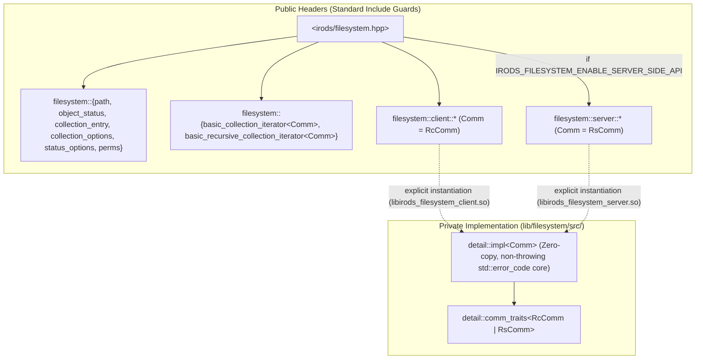

# Weapons-Grade `irods::experimental::filesystem` — Architecture & Refactoring Specification

- **Date**: 2026-10-18
- **Target Branch**: `feature/filesystem-modernization` (based on `origin/main` / `5.1.0` `e85b069e0`)
- **Stage**: Stage 1 of 3 (Stage 1: `irods::experimental::filesystem` → Stage 2: Transport Layer (`dstream`, `default_transport`, `parallel_transfer_engine`) → Stage 3: System-Wide iRODS Refactoring)
- **Target Component**: `/home/darkfell/dev/irods/lib/filesystem` (`irods_filesystem_path`, `irods_filesystem_client`, `irods_filesystem_server`)

---

## 1. Executive Summary & Goals

`irods::experimental::filesystem` is the foundational C++ abstraction for logical path manipulation, collection iteration, object status inspection, ACL/inheritance management, and AVU metadata operations across both client and server code.

An audit of `/home/darkfell/dev/irods/lib/filesystem` revealed critical performance, safety, and architectural defects:
1. **Severe N+1 RPC/Query Amplification**: Every call to `status(comm, p)` unconditionally executes **3 separate catalog roundtrips** (`rxObjStat` + `get_inheritance` GenQuery1 + `set_permissions` SpecificQuery/GenQuery1). Internal helpers (`exists`, `is_data_object`, `is_collection`, `copy`, `rename`, `remove`, `get_metadata`, `do_metadata_op`) call `status()` repeatedly on the same paths—causing a single `copy_data_object()` call to execute up to **18 catalog roundtrips** before `rxDataObjCopy` is even invoked.
2. **Avoidable Heap Allocations & Copies (Zero-Copy Violations)**:
   - `path::string()` returns a by-value `std::string` copy on every call (including inside `hash_value`, `operator<<`, and separator checks).
   - `path::compare()`, `path::parent_path()`, `path::object_name()`, `zone_name()`, and `has_*()` queries iterate using `path::iterator`, which heap-allocates a new `std::string` for every path component at every step.
   - `single_quotes_to_hex()` copies `path` to `std::string` and runs `boost::replace_all_copy` even when no single quotes exist (99.99% of paths).
   - `object_status` lacks move constructors/assignments and `object_status::permissions()` only accepts `const std::vector<entity_permission>&`, forcing deep vector copies on every `status()` call.
   - `collection_iterator::operator++()` allocates temporary `path` and `std::string` objects on every directory entry instead of reusing buffer capacity in-place.
   - `do_metadata_op()` and `set_permissions()` copy already null-terminated `std::string` buffers into 4 KB stack arrays (`char[MAX_NAME_LEN]`) for pointer-based C APIs (`modAVUMetadataInp_t`, `modAccessControlInp_t`).
3. **Memory Leaks & Buffer/Pointer Safety Bugs**:
   - `detail::do_metadata_op` (`filesystem.hpp:551-556`) leaks `char* json_error_string` allocated by `rx_atomic_apply_metadata_operations`.
   - `remove_impl` (`filesystem.cpp:81-85`) leaks `collOprStat_t* stat` allocated by `rsRmColl` when `_opts.progress` is true.
   - Unsafe `std::strncpy(dst, src, std::strlen(src))` calls throughout `filesystem.cpp` and `collection_iterator.cpp` pass the *source* length as the bound instead of `sizeof(dst) - 1`, with `stat()` (`filesystem.cpp:208`) omitting `throw_if_path_length_exceeds_limit` entirely.
   - `recursive_collection_iterator::connection()` (`recursive_collection_iterator.hpp:54`) contains unconditional infinite recursion (`(*this).connection()`).
   - `remove_all()` (`filesystem.cpp:912-986`) uses `COLL_NAME like '<path>%'` without a trailing slash (matching unrelated sibling collections with a shared prefix) and silently returns `0` without deleting anything when called on a single data object.
   - `collection_iterator` ignores `collection_options::skip_permission_denied` and does not validate `collEnt_t` entries with `irods::is_valid_collection_entry` (`collection_entry_validation.hpp`).
4. **Macro Re-Inclusion Soup & Missing Non-Throwing API**:
   - `config.hpp` `#undef`s and redefines 18 unprefixed macros (`NAMESPACE_IMPL`, `rxComm`, `rxObjStat`, etc.) without standard include guards.
   - No `std::error_code&` non-throwing overloads exist, forcing exception-driven control flow for routine filesystem checks.

---

## 2. Core Architecture

### 2.1 Policy/Traits-Based Client & Server Unification (Eliminating Macro Re-Inclusion)

All headers in `lib/filesystem/include/irods/filesystem/` will use standard `#ifndef` include guards and zero global `rx*` / `NAMESPACE_IMPL` macros:



- **Shared Types in `irods::experimental::filesystem`**:
  - `path`, `object_status`, `object_type`, `status_options`, `perms`, `entity_permission`, `copy_options`, `remove_options`, `extended_remove_options`, `collection_options`, `collection_entry`, `metadata`, `metadata_op`, `admin_tag`, `filesystem_error`.
  - `collection_entry` and `collection_options` are lifted to `irods::experimental::filesystem` and aliased into `client::` and `server::` (`using collection_entry = filesystem::collection_entry;`) for 100% source compatibility.
- **Templated Iterators with Explicit Instantiation**:
  - `template <typename Comm> class basic_collection_iterator;`
  - `template <typename Comm> class basic_recursive_collection_iterator;`
  - `client::collection_iterator = basic_collection_iterator<RcComm>`
  - `server::collection_iterator = basic_collection_iterator<RsComm>`
  - Explicitly instantiated (`extern template class basic_collection_iterator<RcComm>;` / `<RsComm>`) in `libirods_filesystem_client.so` and `libirods_filesystem_server.so`.
- **Dual-Inclusion Backwards Compatibility**:
  - Some existing translation units `#include "irods/filesystem.hpp"` for client declarations and later `#define IRODS_FILESYSTEM_ENABLE_SERVER_SIDE_API` and `#include "irods/filesystem.hpp"` again.
  - To preserve 100% source compatibility without macro re-inclusion, `<irods/filesystem/filesystem.hpp>` separates its client namespace declarations (`#ifndef IRODS_FILESYSTEM_CLIENT_API_DEFINED`) from its server namespace declarations (`#if defined(IRODS_FILESYSTEM_ENABLE_SERVER_SIDE_API) && !defined(IRODS_FILESYSTEM_SERVER_API_DEFINED)`), where both namespaces simply delegate to the shared `detail::` template declarations instantiated for `RcComm` and `RsComm`.

### 2.2 Non-Throwing (`std::error_code&`) Core + Thin Throwing Wrappers

Every operational function in `client::` and `server::` provides both:
1. **Non-throwing overload** (`(..., std::error_code& _ec) noexcept` where possible, only throwing `std::bad_alloc`):
   - Calls `_ec.clear()` at entry.
   - Populates `_ec = make_error_code(irods_err)` on failure and returns the `std::filesystem`-standard error sentinel:
     - `bool` functions: return `false`.
     - `data_object_size`, `remove_all`: return `static_cast<std::uintmax_t>(-1)`.
     - `last_write_time`: return `object_time_type::min()`.
     - `status`: return `object_status{object_type::none}` on error; return `object_status{object_type::not_found}` with `_ec.clear()` when the path does not exist.
     - `data_object_checksum`: return `{}`.
     - `get_metadata`: return `{}`.
     - `basic_collection_iterator(Comm&, const path&, std::error_code&)`: returns end iterator `{}` on error.
2. **Throwing overload**:
   - Calls the `std::error_code&` overload and throws `filesystem_error` if `_ec` is set.

---

## 3. Zero-Copy Design Principles & Optimizations

Every layer of `lib/filesystem` is designed around zero-copy `std::string_view` slicing, buffer reuse, and move semantics:

### 3.1 Zero-Copy `path` Observers, Decomposition, & Comparison
1. **Eliminate By-Value `std::string` Copies in Observers**:
   - `path::native() const noexcept -> const string_type& { return value_; }`
   - `path::string() const noexcept -> const string_type& { return value_; }` (previously returned `string_type` by value, causing full heap copies in `hash_value()`, `operator<<`, `collection_iterator`, and `rename()`).
   - `path::string_view() const noexcept -> std::string_view { return value_; }`
   - `path::operator std::string_view() const noexcept { return value_; }`
   - `path::size() const noexcept -> std::size_t { return value_.size(); }`
   - `path::back() const noexcept -> value_type { return value_.back(); }` / `front() const noexcept -> value_type`
   - `path_traits::is_pathable<std::string_view> = true` and `path(std::string_view)` / `operator=(std::string_view)` / `operator/=(std::string_view)` so `std::string_view` arguments copy directly in one contiguous memcpy instead of char-by-char iterator construction.
2. **Zero-Allocation `std::string_view` Decomposition & Queries**:
   - Add zero-copy view observers on `path`:
     - `root_collection_view() const noexcept -> std::string_view`
     - `relative_path_view() const noexcept -> std::string_view`
     - `parent_path_view() const noexcept -> std::string_view`
     - `object_name_view() const noexcept -> std::string_view`
     - `stem_view() const noexcept -> std::string_view`
     - `extension_view() const noexcept -> std::string_view`
   - Rewrite `has_root_collection()`, `has_relative_path()`, `has_parent_path()`, `has_object_name()`, `has_stem()`, and `has_extension()` to inspect the `*_view()` methods in $O(1)$ / $O(N)$ character scan **with zero heap allocations** (previously each `has_*()` constructed and destroyed temporary `path` objects via `join()`).
   - Rewrite `parent_path()`, `relative_path()`, `object_name()`, `stem()`, and `extension()` to construct their returned `path` from a single `*_view()` slice instead of iterating and appending via `join(begin(), --end())`.
3. **Zero-Allocation Component Scanner for `compare()`, `has_prefix()`, and `zone_name()`**:
   - Add an internal lightweight `detail::path_component_iter` that yields `std::string_view` tokens across `value_` without allocating `path` objects.
   - `path::compare(const path&)`, `has_prefix(const path&, const path&)`, `zone_name_view(const path&) -> std::optional<std::string_view>`, and `zone_name(const path&)` use this `std::string_view` scanner, reducing comparisons and zone extraction to **0 heap allocations**.

### 3.2 Zero-Copy SQL Escaping & Query Construction
- Replace `single_quotes_to_hex(const std::string&)` (which converted `path` to `std::string` and unconditionally allocated a second `std::string` via `boost::replace_all_copy`) with a zero-copy `fmt` formatter `detail::sql_escaped_view{std::string_view}`:
  - Scans the `std::string_view` directly; if no `'` character is present (the common case), formats the `std::string_view` slice directly into the query buffer with **zero intermediate string allocations**.
  - Combined with `_p.parent_path_view()`, `_p.object_name_view()`, and `zone_name_view(_p)`, every GenQuery in `lib/filesystem` allocates only the final query string itself.

### 3.3 Zero-Copy C-Struct Input Binding & Safe Bounded Buffers
- **Pointer-Based C Structs (`modAVUMetadataInp_t`, `modAccessControlInp_t`, `rclOpenCollection`)**:
  - Previously, `do_metadata_op` copied `_p`, `_metadata.attribute`, `_metadata.value`, and `_metadata.units` into four `char[MAX_NAME_LEN]` (4 KB) stack buffers even though `modAVUMetadataInp_t::arg0..arg5` are `char*` pointers and `std::string::c_str()` is already null-terminated.
  - Now, after validating `str.size() < MAX_NAME_LEN` (and embedded-null absence), we bind `const_cast<char*>(str.c_str())` directly—zero stack buffer zeroing and zero string copying.
- **Embedded-Array C Structs (`dataObjInp_t::objPath`, `collInp_t::collName`)**:
  - Where the C struct embeds a fixed `char[MAX_NAME_LEN]` array, avoid `char buf[MAX_NAME_LEN]{}` zero-initialization of all 1088 bytes followed by `std::strncpy(buf, src, std::strlen(src))`.
  - Instead, use `detail::copy_to_c_array(char (&dst)[N], std::string_view src, std::error_code& ec) noexcept`:
    - Validates `!src.empty()`, `src.size() < N`, and `src.find('\0') == std::string_view::npos`.
    - Copies exactly `src.size()` bytes via `std::memcpy(dst, src.data(), src.size())` and writes `dst[src.size()] = '\0'` (touching only `src.size() + 1` bytes instead of zeroing 1088 bytes + scanning twice with `strlen` and `strncpy`).

### 3.4 Move Semantics & Buffer Reuse in `object_status` and `collection_iterator`
- **`object_status`**:
  - Add defaulted move constructor `object_status(object_status&&) noexcept = default;` and move assignment `operator=(object_status&&) noexcept = default;`.
  - Add `explicit object_status(object_type _type, std::vector<entity_permission>&& _perms) noexcept` and `permissions(std::vector<entity_permission>&& _perms) noexcept` so `status()` moves `s.prms` in $O(1)$ without copying the `std::vector<entity_permission>`.
- **`basic_collection_iterator<Comm>::operator++()`**:
  - Reuse `ctx_->entry` string capacities in-place (`entry.data_id_.assign(...)`, `entry.checksum_.assign(...)`, `entry.owner_.assign(...)`, `entry.data_type_.assign(...)`, and `entry.path_.assign_concat(ctx_->path.string_view(), e->dataName)`), achieving **zero heap allocations per iteration** once string capacities warm up.
  - Parse `e->createTime` and `e->modifyTime` with `std::from_chars` on the raw `const char*` buffer instead of `std::stoll`.

---

## 4. Eliminating N+1 RPCs & Redundant Catalog Queries

### 4.1 `status_options` & Single-RPC `basic_stat`
```cpp
enum class status_options : std::uint8_t
{
    basic               = 0,
    include_permissions = 1 << 0,
    include_inheritance = 1 << 1,
    full                = include_permissions | include_inheritance
};
```
- **Public API**:
  - `status(Comm& _comm, const path& _p, status_options _opts = status_options::full) -> object_status`
  - `status(Comm& _comm, const path& _p, std::error_code& _ec) noexcept -> object_status` (uses `status_options::full`)
  - `status(Comm& _comm, const path& _p, status_options _opts, std::error_code& _ec) noexcept -> object_status`
- **Internal Fast-Stat (`detail::basic_stat`)**:
  - Calls only `comm_traits<Comm>::obj_stat` (`rxObjStat`), returning a stack-allocated `detail::stat_info` (`int error`, `int type`, `std::int64_t id`, `std::int64_t size`, `std::int64_t mtime`, `bool is_special_coll`) in **1 RPC** with **0 heap allocations**.
  - Used by `exists`, `is_data_object`, `is_collection`, `is_other`, `is_empty`, `equivalent`, `remove`, `remove_all`, `copy`, `copy_data_object`, `rename`, `create_collection`, `enable_inheritance`, `data_object_size`, `data_object_checksum`, `last_write_time`, `get_metadata`, and `do_metadata_op`.

### 4.2 Deduplicated Pre-Checks in Compound Operations
- **`copy` & `copy_data_object`**:
  - `copy` fetches `basic_stat` for `_from` and `_to` once and passes them directly into `detail::copy_data_object_impl(_comm, _from, from_stat, _to, to_stat, _options, _ec)`.
  - Equivalence check uses `from_stat.id == to_stat.id` directly from the already-fetched `stat_info` (eliminating 2 extra `rxObjStat` calls).
  - Total pre-check cost for `copy_data_object`: **2 `rxObjStat` RPCs** (down from **18 RPCs/queries**).
- **`rename`**:
  - Fetches `basic_stat` for `_old_p` and `_new_p` once (2 RPCs instead of 9–12 RPCs/queries), checks `old_stat.id == new_stat.id` in-memory for equivalence, and only stats `_new_p.parent_path()` if `_new_p` does not exist.
- **`create_collection(_comm, _p)`**:
  - Uses `basic_stat` (2 RPCs instead of 6 RPCs/queries).

---

## 5. Bug, Memory Leak, & Security Fixes

| ID | Location | Defect | Resolution |
|---|---|---|---|
| **BUG-1** | `filesystem.hpp:551-556` | `char* json_error_string` leaked on every call to `detail::do_metadata_op` (`rx_atomic_apply_metadata_operations`). | Guard `json_error_string` with `irods::at_scope_exit{[&] { std::free(json_error_string); }}`. |
| **BUG-2** | `filesystem.cpp:81-85` | `collOprStat_t* stat` leaked in server-side `rsRmColl` when `_opts.progress` is true. | Guard `stat` with `irods::at_scope_exit{[&] { std::free(stat); }}`. |
| **BUG-3** | `filesystem.cpp:208,265,282,321,398,465-478` & `collection_iterator.cpp:36` | `std::strncpy(dst, src, std::strlen(src))` passes source length instead of destination capacity; `stat()` omits length validation entirely. | Replace all with `detail::copy_to_c_array` (validates `0 < len < N`, no embedded `\0`, copies via `std::memcpy` + null terminator) or direct `c_str()` binding for pointer fields. |
| **BUG-4** | `recursive_collection_iterator.hpp:54` | `connection()` calls `(*this).connection()`, causing infinite recursion / stack overflow. | Return `ctx_ && !ctx_->stack.empty() ? ctx_->stack.top().connection() : nullptr`. |
| **BUG-5** | `filesystem.cpp:912-986` | `remove_all` uses `COLL_NAME like '<_p>%'` (matches sibling collections `/dir_other` when removing `/dir`, and returns `0` without removing anything when `_p` is a data object). | Run `basic_stat(_comm, _p)` first: if `not_found`, return `0`; if `data_object`, remove and return `1`; if `collection`, count exact `COLL_NAME = '<_p>'` + descendants `COLL_NAME like '<_p>/%'` (handling root `/` cleanly), then remove recursively. |
| **BUG-6** | `collection_iterator.cpp:23` & `recursive_collection_iterator.cpp:27` | `collection_options::skip_permission_denied` is accepted in constructors and completely ignored. | Honor `collection_options::skip_permission_denied` on open/advance when error is `CAT_NO_ACCESS_PERMISSION` or `SYS_NO_API_PRIV`. |
| **BUG-7** | `collection_iterator.cpp:98-124` | `collection_iterator::operator++` does not validate `collEnt_t` with `irods::is_valid_collection_entry` (upstream `#9079`) and uses throwing `std::stoll`. | Validate every `collEnt_t` via `irods::is_valid_collection_entry(*e)` (returning `SYS_INVALID_FILE_PATH` on invalid entry) and parse integer fields via non-throwing `std::from_chars`. |

---

## 6. C++20 Iterator & Range Ergonomics

- Both `basic_collection_iterator<Comm>` and `basic_recursive_collection_iterator<Comm>` gain:
  - Non-throwing constructors: `basic_collection_iterator(Comm&, const path&, std::error_code&)`, `basic_collection_iterator(Comm&, const path&, collection_options, std::error_code&)`.
  - Non-throwing `increment(std::error_code&) -> basic_collection_iterator&` member function (matching `std::filesystem::directory_iterator::increment(ec)`).
  - Post-increment `operator++(int)` so they satisfy C++20 `std::input_iterator`.
  - `operator==(std::default_sentinel_t) const noexcept` for `std::ranges` compatibility.

---

## 7. Verification Strategy

1. **Build & CPG Synchronization**:
   - Compile `irods_filesystem_path`, `irods_filesystem_client`, `irods_filesystem_server`, and all dependent targets cleanly with zero warnings.
   - Synchronize modified files with `project_insight` (`insight_notify_files_changed` / incremental ingest) and verify 0 memory/ownership anomalies via `insight_infer_ownership`.
2. **Unit Test Suite (`unit_tests/src/filesystem/test_path.cpp` & `test_filesystem.cpp`)**:
   - Existing unit tests in `test_path.cpp` and `test_filesystem.cpp` pass 100% without modification (verifying source compatibility).
   - New unit tests covering:
     - Zero-copy `std::string_view` observers (`parent_path_view`, `object_name_view`, `stem_view`, `extension_view`, `zone_name_view`) and `path(std::string_view)` construction.
     - Non-throwing `std::error_code&` overloads across all operations (`status`, `exists`, `create_collection`, `remove`, `remove_all`, `copy`, `rename`, `permissions`, `metadata`, `collection_iterator`).
     - `status_options::basic` vs `status_options::full`.
     - Regression tests for `remove_all` on single data objects and sibling collections with shared prefixes (`/dir` vs `/dir_sibling`).
     - Regression tests for `recursive_collection_iterator::connection()`, post-increment `it++`, and `collection_entry_validation` hardening.
