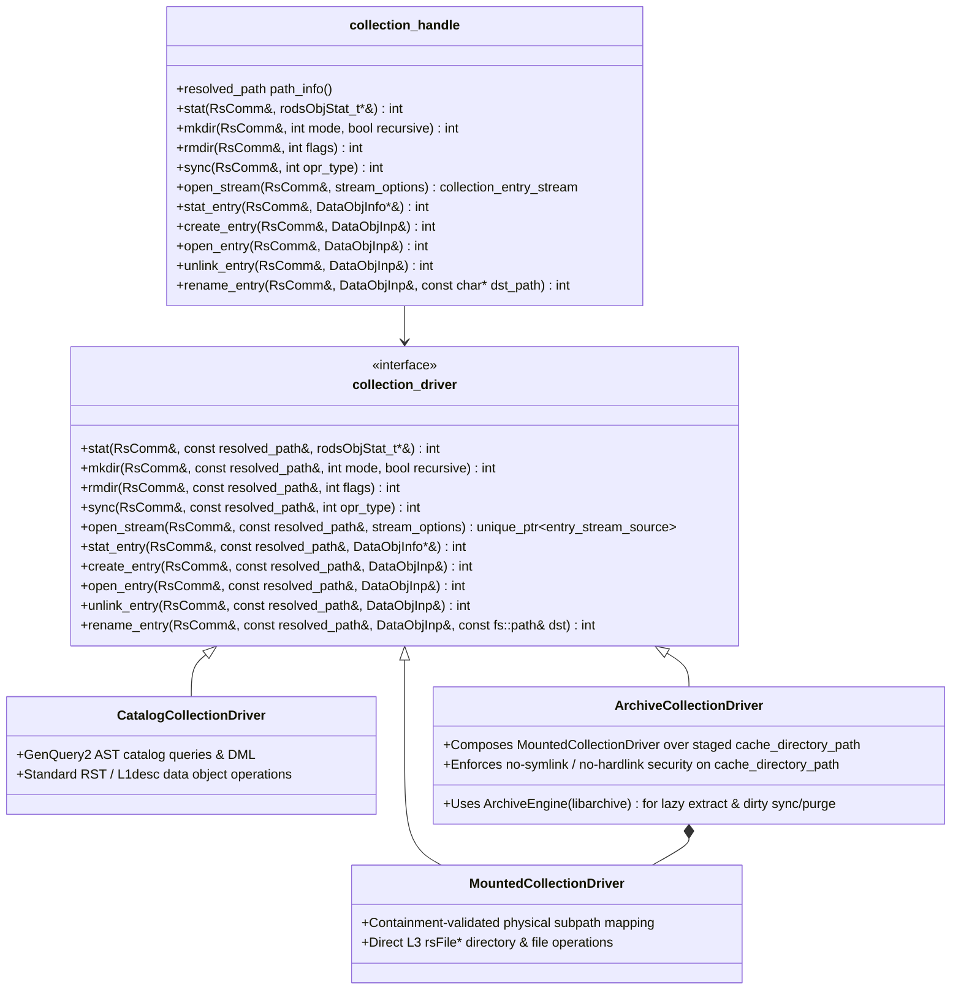

# Uniform Collection Architecture (`simply_collections`) — Design Specification

**Date:** 2026-10-20
**Branch:** `simply_collections`
**Scope:** Unify catalog collections (`NO_SPEC_COLL`), soft-linked collections (`LINKED_COLL`), mounted physical directory collections (`MOUNTED_COLL`), and mounted archive collections (`STRUCT_FILE_COLL` / `tar`) behind a strongly-typed, backwards-compatible C++17 collection architecture (`irods::experimental::collections`), while retiring dead structured-file types (`HAAW`, `MSSO`) and orphaned `iphybun` (`bundleResc`) staging remnants.

---

## 1. Problem Statement & Motivation

In iRODS today, collection semantics are fragmented across four collection flavors stored in `R_COLL_MAIN` by overloading three untyped string columns (`coll_type`, `coll_info1`, `coll_info2`):

1. **Ad-hoc String Encodings & Magic Values**:
   - `MOUNTED_COLL` (`coll_type = "mountPoint"`) stores the physical directory path in `coll_info1` and resource hierarchy in `coll_info2`.
   - `LINKED_COLL` (`coll_type = "linkPoint"`) stores the target logical path in `coll_info1`.
   - `STRUCT_FILE_COLL` (`coll_type = "tarStructFile"`) stores the backing archive logical path in `coll_info1` and `"<cacheDir>;;;<rescHier>;;;<cacheDirty>"` in `coll_info2`, parsed via raw pointer arithmetic in [`parseCachedStructFileStr`](file:///home/darkfell/dev/irods/lib/core/src/rcMisc.cpp#L3320-L3374).
   - Clearing columns in [`rsModColl`](file:///home/darkfell/dev/irods/server/api/src/rsModColl.cpp#L47-L61) relies on the magic sentinel string `"NULL_SPECIAL_VALUE"`.
2. **In-Place Path Mutation & Keyword Pollution**:
   - [`resolveLinkedPath`](file:///home/darkfell/dev/irods/server/core/src/specColl.cpp#L817-L905) mutates caller `objPath` buffers in-place and injects `TRANSLATED_PATH_KW` into `condInput` to prevent double-translation, requiring callers (`rsOpenCollection`, `rsReadCollection`, `readCollection`) to stash the original path in side-channel fields (`linkedObjPath`) and manually rewrite yielded paths.
3. **Broken Global Mutable Caches & Fixed Descriptor Tables**:
   - [`SpecCollCacheHead`](file:///home/darkfell/dev/irods/server/core/src/specColl.cpp#L252-L315) caches `specCollCache_t` entries per-agent without invalidation on `rsModColl` / unmount, alongside static `HaveFailedSpecCollPath` / `FailedSpecCollPath` globals.
   - Four separate fixed-size global descriptor tables exist for collection and archive operations: `CollHandle[NUM_COLL_HANDLE]`, `SpecCollDesc[NUM_SPEC_COLL_DESC]`, `PluginStructFileDesc[16]`, and `PluginTarSubFileDesc[20]`.
4. **Duplicated Iteration Pipelines & 3,010-Line `structfile.cpp` Duplication**:
   - Iterating a collection is split across [`collection_iterator.cpp`](file:///home/darkfell/dev/irods/lib/filesystem/src/collection_iterator.cpp), [`miscUtil.cpp`](file:///home/darkfell/dev/irods/lib/core/src/miscUtil.cpp) (`rclOpenCollection` / `readCollection`), and [`rsQuerySpecColl.cpp`](file:///home/darkfell/dev/irods/server/api/src/rsQuerySpecColl.cpp) (which packs physical directory entries into fake `genQueryOut_t` buffers and overloads `dataObjInp->openFlags` as a state-machine descriptor index).
   - Once a tar archive is extracted into its staging directory (`cacheDir`), every file/directory operation inside it is identical to `MOUNTED_COLL` (`rsFile*` on `<cacheDir>/<subPath>`), yet 16 `rsSubStructFile*` RPCs and [`plugins/resources/src/structfile.cpp`](file:///home/darkfell/dev/irods/plugins/resources/src/structfile.cpp) duplicate the entire POSIX L3 surface.
5. **Dead `HAAW`/`MSSO` Types & Orphaned `iphybun` (`bundleResc`) Code**:
   - `HAAW_STRUCT_FILE_T` and `MSSO_STRUCT_FILE_T` have no working implementation, and `iphybun` (`rsPhyBundleColl`) was removed in `#3603` (`f195d1858`), leaving orphaned `bundleResc` staging hooks in `rsDataObjOpen`, `rsDataObjRepl`, `rsDataObjUnlink`, `rsDataObjChksum`, `rsDataObjTruncate`, `physPath`, and `lsUtil`.

---

## 2. Architecture Overview

We introduce a unified **`irods::experimental::collections`** architecture using a **Hybrid Value Facade (`resolved_path` / `collection_handle`) backed by polymorphic collection drivers (`CatalogCollectionDriver`, `MountedCollectionDriver`, and `ArchiveCollectionDriver`)**:

---

## 3. Detailed Component Design

### 3.1 Value Types & `R_COLL_MAIN` Serialization (`collection_types.hpp` / `collection_types.cpp`)
Located in `lib/core/include/irods/collection_types.hpp` and `lib/core/src/collection_types.cpp` so both client (`lib/core`, `lib/filesystem`) and server (`server/core`, `server/api`) code share one authoritative representation:

- **`archive_format`**: `tar`, `gzip_tar`, `bzip2_tar`, `zip` (mapped cleanly to/from `TAR_DT_STR`, `GZIP_TAR_DT_STR`, `BZIP2_TAR_DT_STR`, `ZIP_DT_STR`, and CLI short flags `"t"`, `"g"`, `"b"`, `"z"`).
- **`catalog_collection_info`**: Normal ICAT collection (`coll_type == ""`).
- **`linked_collection_info`**: Soft-linked collection (`coll_type == "linkPoint"`, `target_collection_path` in `coll_info1`).
- **`mounted_collection_info`**: Mounted physical directory (`coll_type == "mountPoint"`, `physical_directory_path` in `coll_info1`, `resource_hierarchy` in `coll_info2`, `root_resource` extracted via `irods::hierarchy_parser`).
- **`archive_collection_info`**: Mounted structured archive collection (`coll_type == "tarStructFile"`, `archive_logical_path` in `coll_info1`, `cache_directory_path`, `resource_hierarchy`, and `cache_dirty` serialized/parsed from `coll_info2`).
- **Path Containment & Cache Security Helpers**:
  - `compose_contained_physical_path(const std::filesystem::path& root_dir, std::string_view logical_root, std::string_view target_logical_path)` normalizes the relative subpath and rejects any `..` traversal or prefix mismatch with `SYS_STRUCT_FILE_PATH_ERR`.
  - `validate_cache_path_no_links(const std::filesystem::path& cache_dir, const std::filesystem::path& relative_subpath)` verifies using `std::filesystem::symlink_status` and `std::filesystem::hard_link_count` that neither `cache_dir` nor any traversed component is a symlink or multi-linked file.
- **Wire Compatibility Converters**:
  - `parse_special_collection_info(std::string_view coll_path, std::string_view coll_type, std::string_view coll_info1, std::string_view coll_info2)` -> `std::expected` / status + `collection_info_variant`.
  - `format_cached_archive_info2(const archive_collection_info&)` -> `std::string` (`"<cacheDir>;;;<rescHier>;;;<cacheDirty>"`).
  - `populate_legacy_spec_coll(const fs::path& governing_coll, const collection_info_variant& info, specColl_t& out)` and `from_legacy_spec_coll(const specColl_t& in)` keep [`resolveSpecCollType`](file:///home/darkfell/dev/irods/lib/core/src/rcMisc.cpp#L3269-L3317), [`parseCachedStructFileStr`](file:///home/darkfell/dev/irods/lib/core/src/rcMisc.cpp#L3320-L3374), and [`makeCachedStructFileStr`](file:///home/darkfell/dev/irods/lib/core/src/rcMisc.cpp#L3377-L3393) as 5-line delegates.

### 3.2 Invalidatable Resolution Cache & Immutable Path/Link Resolver (`collection_resolver.hpp` / `.cpp`)
Located in `server/core/include/irods/collection_resolver.hpp` and `server/core/src/collection_resolver.cpp`:

- **`collection_resolution_cache`**:
  - Stores positive (`governing_coll` -> `collection_info_variant`) and negative (known non-special collection paths) entries in an in-memory map per agent.
  - Exposes `invalidate(std::string_view path)` (which invalidates `path` and any cached descendants) and `clear()`.
  - Called automatically whenever `rsModColl`, `rsCollCreate`, `rsRmColl`, `rsSyncMountedColl`, or `modCollInfo2` mutates `R_COLL_MAIN`.
  - Synchronization with legacy [`SpecCollCacheHead`](file:///home/darkfell/dev/irods/server/core/src/specColl.cpp#L252-L315) is maintained so any external plugin reading `SpecCollCacheHead` via `getSpecCollCache` sees consistent, up-to-date state.
- **`resolve_collection_path(RsComm& comm, std::string_view input_path, link_resolution_mode mode)`**:
  - Returns `resolved_path` containing `original_path`, `canonical_path`, `governing_coll`, `relative_subpath`, `was_link_translated`, and `collection_info_variant`.
  - Follows `LINKED_COLL` chains up to `MAX_LINK_CNT = 20` with cycle detection when `mode == link_resolution_mode::follow_links`, without mutating caller buffers unless called via the legacy compatibility shim `resolveLinkedPath`.

### 3.3 Stateless `archive_engine` (`archive_engine.hpp` / `.cpp`)
Located in `server/core/include/irods/archive_engine.hpp` and `server/core/src/archive_engine.cpp`:

- Encapsulates `libarchive` streaming over iRODS L3 `rsFileOpen` / `rsFileCreate` / `rsFileRead` / `rsFileWrite` / `rsFileClose` callbacks.
- Provides two clean operations:
  1. `extract_archive(RsComm& comm, const archive_descriptor& desc, const std::filesystem::path& target_cache_dir)`:
     - Streams archive entries from `desc.archive_physical_path` on `desc.resource_hierarchy`.
     - Rejects empty paths, absolute paths, `..` traversal, symlinks (`AE_IFLNK`), and hardlinks (`archive_entry_hardlink`) with `SYS_STRUCT_FILE_PATH_ERR`.
     - Extracts regular files and directories into `target_cache_dir`.
  2. `bundle_directory(RsComm& comm, const archive_descriptor& desc, const std::filesystem::path& source_cache_dir)`:
     - Recursively walks `source_cache_dir` using `std::filesystem::recursive_directory_iterator`, rejecting symlinks/hardlinks.
     - Writes pax tar (uncompressed, gzip, or bzip2) or zip archive to `desc.archive_physical_path` on `desc.resource_hierarchy`.
- Used by **both** `ArchiveCollectionDriver` (for `STRUCT_FILE_COLL` staging and sync) and `ibun` (`rsStructFileBundle` / `rsStructFileExtAndReg`).

### 3.4 Polymorphic Drivers (`collection_driver.hpp` / `.cpp`)
Located in `server/core/include/irods/collection_driver.hpp` and `server/core/src/collection_driver.cpp`:

1. **`CatalogCollectionDriver`**:
   - Handles normal cataloged collections using GenQuery2 ASTs and standard ICAT / RST / L1desc operations.
2. **`MountedCollectionDriver`**:
   - Maps `resolved_path::relative_subpath` onto `mounted_collection_info::physical_directory_path` via `compose_contained_physical_path`.
   - Executes `stat` (`l3Stat`), `mkdir` (`l3Mkdir`), `rmdir` (`l3Rmdir`), `open_stream` (`PhysicalDirStreamSource`), and child-entry operations (`stat_entry`, `create_entry`, `open_entry`, `unlink_entry`, `rename_entry`) on the mounted resource hierarchy.
3. **`ArchiveCollectionDriver` (Composes `MountedCollectionDriver` + `archive_engine`)**:
   - On any access, calls `ensure_staged(RsComm&, archive_collection_info&)`:
     - Resolves the backing archive replica physical path if not yet populated.
     - If `cache_directory_path` is empty, creates `<archivePhyPath>.cacheDirN` via `rsFileMkdir`, extracts the archive via `archive_engine::extract_archive`, and persists `cache_directory_path` in `R_COLL_MAIN.coll_info2`.
   - Validates `validate_cache_path_no_links(cache_directory_path, relative_subpath)`.
   - Delegates the operation to `MountedCollectionDriver` configured with `cache_directory_path` and `resource_hierarchy`!
   - On any mutating operation (`mkdir`, `rmdir`, `create_entry`, `open_entry` with write flags, `unlink_entry`, `rename_entry`, `truncate`), marks `cache_dirty = true` and persists `coll_info2` via `modCollInfo2`.
   - On `sync(RsComm&, opr_type)`:
     - If `cache_dirty`, calls `archive_engine::bundle_directory` and updates the archive replica's `data_size` in `R_DATA_MAIN` (`regNewObjSize`), then clears `cache_dirty`.
     - If `opr_type & PURGE_STRUCT_FILE_CACHE`, clears `coll_info2` in `R_COLL_MAIN` and recursively removes `cache_directory_path` via `rsFileRmdir`.

### 3.5 Unified Collection Entry Stream (`collection_entry_stream.hpp` / `.cpp`)
Located in `server/core/include/irods/collection_entry_stream.hpp` and `server/core/src/collection_entry_stream.cpp`:

- Yields strongly-typed `collection_entry` structs (`entry_type`, `coll_name`, `data_name`, `data_id`, `coll_id`, `data_size`, `replica_number`, `replica_status`, `modify_time`, `create_time`, `checksum`, `physical_path`, `resource_hierarchy`, `owner_name`, `owner_zone`, `data_mode`, `spec_coll_info`).
- Automatically rewrites `coll_name` prefix from `canonical_path` back to `original_path` when `resolved_path::was_link_translated` is true.
- Provides two stream sources:
  - `CatalogStreamSource`: Paged GenQuery2 AST queries for subcollections and data objects.
  - `PhysicalDirStreamSource`: RAII stack-based physical directory traversal (`l3Opendir` / `l3Readdir` / `l3Stat` / `l3Closedir`) shared by `MountedCollectionDriver` and `ArchiveCollectionDriver`.
- Provides adapters for `rsOpenCollection` / `rsReadCollection` / `rsCloseCollection` (`to_coll_ent`) and `rsQuerySpecColl` (`to_spec_coll_genquery_out`).

### 3.6 Legacy Cleanup (`HAAW` / `MSSO` and Orphaned `bundleResc`)
- Remove dead `HAAW_STRUCT_FILE_T` and `MSSO_STRUCT_FILE_T` branches from `mcollUtil.cpp`, `register_physical_path.cpp`, and `irods_structured_object.cpp`.
- Remove orphaned `iphybun` / `bundleResc` staging hooks from `rsDataObjOpen.cpp`, `rsDataObjRepl.cpp`, `rsDataObjUnlink.cpp`, `rsDataObjChksum.cpp`, `rsDataObjTruncate.cpp`, `physPath.cpp`, and `lsUtil.cpp`, and reduce `rsUnbunAndRegPhyBunfile` to a clean compatibility stub returning `SYS_NOT_SUPPORTED` while moving `unbunPhyBunFile` / `createPhyBundleDir` onto `archive_engine`.
