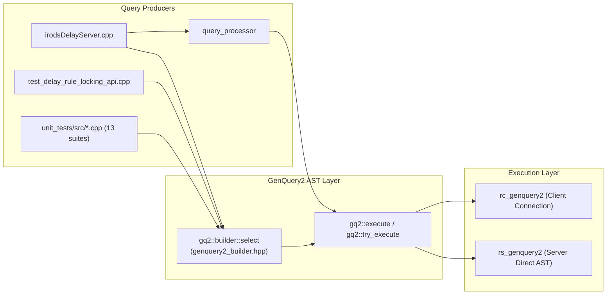

# GenQuery2 & `std::filesystem` Endgame — Design Specification

**Date**: 2026-10-21  
**Branch**: `simply_collections`  
**Status**: Draft for Review

---

## 1. Problem Statement & Motivation

Across Stages 1–8, iRODS 5.1's catalog query layer, administration libraries, server API handlers, rule engines, and collection drivers were migrated onto GenQuery2 ASTs ([`genquery2_builder.hpp`](file:///home/darkfell/dev/irods/lib/core/include/irods/genquery2_builder.hpp)) and C++17 `std::filesystem`. Two final pockets of legacy dependencies remain:

1. **Residual GenQuery1 C++ Wrappers (`irods::query`, `irods::experimental::query_builder`, `irods::query_processor`)**:
   - [`query_processor.hpp`](file:///home/darkfell/dev/irods/lib/core/include/irods/query_processor.hpp) and [`irodsDelayServer.cpp`](file:///home/darkfell/dev/irods/server/delay_server/src/irodsDelayServer.cpp) still construct GenQuery1 strings (`RULE_EXEC_*`) and execute them through `irods::query<rcComm_t>`.
   - [`plugins/microservices/src/test_delay_rule_locking_api.cpp`](file:///home/darkfell/dev/irods/plugins/microservices/src/test_delay_rule_locking_api.cpp) and 13 unit test files in `unit_tests/src/` still depend on `irods::query` or `irods::experimental::query_builder`. Two of those unit tests ([`test_rc_data_obj.cpp`](file:///home/darkfell/dev/irods/unit_tests/src/test_rc_data_obj.cpp) and [`test_replica_truncate.cpp`](file:///home/darkfell/dev/irods/unit_tests/src/test_replica_truncate.cpp)) fail to compile because `irods_query.hpp` is no longer transitively included by `replica.hpp`, blocking `make all` and the [`scripts/verify_refactoring.sh`](file:///home/darkfell/dev/irods/scripts/verify_refactoring.sh) pre-commit gate.

2. **Residual `boost::filesystem` Headers, Sources, & Link Dependencies**:
   - [`irods_default_paths.hpp.in`](file:///home/darkfell/dev/irods/lib/core/include/irods/irods_default_paths.hpp.in), [`irods_path_recursion.hpp`](file:///home/darkfell/dev/irods/lib/core/include/irods/irods_path_recursion.hpp), [`irods_load_plugin.hpp`](file:///home/darkfell/dev/irods/lib/core/include/irods/irods_load_plugin.hpp), and [`parallel_transfer_engine.hpp`](file:///home/darkfell/dev/irods/lib/core/include/irods/parallel_transfer_engine.hpp) still expose or use `boost::filesystem::path`.
   - 20 source/test files still include `<boost/filesystem.hpp>` or use `boost::filesystem`, and 51 CMake files still link `${IRODS_EXTERNALS_FULLPATH_BOOST}/lib/libboost_filesystem.so`.

---

## 2. Goals & Non-Goals

### Goals
1. **Zero `irods::query` / `query_builder` Usage**:
   - Modernize [`query_processor.hpp`](file:///home/darkfell/dev/irods/lib/core/include/irods/query_processor.hpp), [`irodsDelayServer.cpp`](file:///home/darkfell/dev/irods/server/delay_server/src/irodsDelayServer.cpp), [`plugins/microservices/src/test_delay_rule_locking_api.cpp`](file:///home/darkfell/dev/irods/plugins/microservices/src/test_delay_rule_locking_api.cpp), and all 13 unit test files onto `irods::experimental::genquery2::builder` (`gq2::builder`).
   - Remove `#include "irods/query_builder.hpp"` from [`experimental_plugin_framework.hpp`](file:///home/darkfell/dev/irods/lib/core/include/irods/experimental_plugin_framework.hpp).
2. **Zero `boost::filesystem` Usage & Link Dependencies**:
   - Migrate all remaining `boost::filesystem` headers and sources across `lib/core/`, `server/`, `plugins/`, and `unit_tests/` to C++17 `std::filesystem`.
   - Remove all `${IRODS_EXTERNALS_FULLPATH_BOOST}/lib/libboost_filesystem.so` link entries from `CMakeLists.txt` and `unit_tests/cmake/test_config/*.cmake`.
3. **100% Clean Full-Repository Build**:
   - Ensure `cmake --build build -j$(nproc)` (`make all`) and [`scripts/verify_refactoring.sh`](file:///home/darkfell/dev/irods/scripts/verify_refactoring.sh) compile every target in the repository with zero errors.

### Non-Goals
- Removing the underlying `rsGenQuery` (`GEN_QUERY_AN` = 702) C API endpoint used by legacy external C clients or the `irods_rule_language` (`GenQueryInp_MS_T`) microservice bindings.

---

## 3. Architecture & Component Design



### 3.1 `irods::query_processor` & `irodsDelayServer` Modernization

- **[`lib/core/include/irods/query_processor.hpp`](file:///home/darkfell/dev/irods/lib/core/include/irods/query_processor.hpp)**:
  - Replace `#include "irods/irods_query.hpp"` with `#include "irods/genquery2_builder.hpp"`.
  - Define `using result_row = std::vector<std::string>;` and `using job = std::function<void(const result_row&)>;`.
  - Provide constructors accepting either:
    1. `irods::experimental::genquery2::builder::select` AST + `job` + optional `zone_hint`, or
    2. `std::string` GenQuery2 query string + `job` + optional `limit` (`uint32_t`).
  - In `execute(thread_pool& _thread_pool, ConnectionType& _conn)`:
    - Execute the `gq2::builder::select` AST (or query string) via `gq2::execute(_conn, select_ast, zone_hint_)` (or `rc_genquery2` / `rs_genquery2` for raw strings) to obtain the JSON array of rows.
    - Convert each JSON row into `result_row` (`std::vector<std::string>`) and post to `_thread_pool` with a `std::promise<error>`, preserving the exact `future` / `errors` interface.

- **[`server/delay_server/src/irodsDelayServer.cpp`](file:///home/darkfell/dev/irods/server/delay_server/src/irodsDelayServer.cpp)**:
  - Remove `#include "irods/irods_query.hpp"` and `#include <boost/filesystem.hpp>`.
  - Update [`make_delay_queue_query_processor`](file:///home/darkfell/dev/irods/server/delay_server/src/irodsDelayServer.cpp#L682-L744) to construct a `gq2::builder::select` AST:
    ```cpp
    namespace gq2 = irods::experimental::genquery2;
    using gq2::builder::col;
    using gq2::builder::order_desc;

    auto q = gq2::builder::select({"DELAY_RULE_ID", order_desc("DELAY_RULE_PRIORITY")})
                 .where(col("DELAY_RULE_TIME") <= std::to_string(std::time(nullptr)) &&
                        col("DELAY_RULE_LOCK_HOST") == "" &&
                        col("DELAY_RULE_LOCK_HOST_PID") == "" &&
                        col("DELAY_RULE_LOCK_TIME") == "")
                 .build();

    return {std::move(q), job};
    ```

### 3.2 Microservice & Unit Test Migration to `gq2::builder`

Each remaining consumer of `irods::query` or `irods::experimental::query_builder` is migrated to `gq2::builder::select` and `gq2::execute`:

| File | Current Usage | GenQuery2 AST Replacement |
| :--- | :--- | :--- |
| [`plugins/microservices/src/test_delay_rule_locking_api.cpp`](file:///home/darkfell/dev/irods/plugins/microservices/src/test_delay_rule_locking_api.cpp) | `irods::query` on `RULE_EXEC_*` + raw `rs_genquery2` | `gq2::builder::select` on `DELAY_RULE_*` (`DELAY_RULE_ID`, `DELAY_RULE_LOCK_HOST`, `DELAY_RULE_LOCK_HOST_PID`, `DELAY_RULE_LOCK_TIME`) |
| [`unit_tests/src/test_delay_rule_locking_api.cpp`](file:///home/darkfell/dev/irods/unit_tests/src/test_delay_rule_locking_api.cpp) | `irods::query` on `RULE_EXEC_*` | `gq2::builder::select` on `DELAY_RULE_*` via `gq2::execute` |
| [`unit_tests/src/test_get_delay_rule_info.cpp`](file:///home/darkfell/dev/irods/unit_tests/src/test_get_delay_rule_info.cpp) | `irods::query{conn_ptr, "select RULE_EXEC_ID"}` | `gq2::builder::select({"DELAY_RULE_ID"}).build()` |
| [`unit_tests/src/test_rc_data_obj.cpp`](file:///home/darkfell/dev/irods/unit_tests/src/test_rc_data_obj.cpp) | `irods::query` on `TICKET_WRITE_FILE_COUNT, TICKET_WRITE_BYTE_COUNT` | `gq2::builder::select({"TICKET_WRITE_FILE_COUNT", "TICKET_WRITE_BYTE_COUNT"}).where(col("TICKET_STRING") == ticket_string)` |
| [`unit_tests/src/test_replica_truncate.cpp`](file:///home/darkfell/dev/irods/unit_tests/src/test_replica_truncate.cpp) | `irods::query` on `DATA_CHECKSUM` | Helper `has_checksum(comm, target_object)` using `gq2::builder::select({"DATA_CHECKSUM"}).where(col("COLL_NAME") == ... && col("DATA_NAME") == ...)` |
| [`unit_tests/src/test_replica_open_and_close.cpp`](file:///home/darkfell/dev/irods/unit_tests/src/test_replica_open_and_close.cpp) | `irods::query` on `DATA_SIZE`, `DATA_REPL_STATUS`, `DATA_CHECKSUM` | `gq2::builder::select` + `gq2::execute` |
| [`unit_tests/src/test_dstream.cpp`](file:///home/darkfell/dev/irods/unit_tests/src/test_dstream.cpp) | `irods::query` on `DATA_REPL_STATUS` | `gq2::builder::select({"DATA_REPL_STATUS"}).where(...)` |
| [`unit_tests/src/filesystem/test_filesystem.cpp`](file:///home/darkfell/dev/irods/unit_tests/src/filesystem/test_filesystem.cpp) | `irods::query` on `DATA_MODIFY_TIME` | `gq2::builder::select({"DATA_MODIFY_TIME"}).where(...)` |
| [`unit_tests/src/test_authenticate_client.cpp`](file:///home/darkfell/dev/irods/unit_tests/src/test_authenticate_client.cpp) | `irods::query` on `COLL_ID` before/after auth | `gq2::builder::select({"COLL_ID"}).where(col("COLL_NAME") == ...)` via `gq2::execute` |
| [`unit_tests/src/test_get_resource_info_for_operation.cpp`](file:///home/darkfell/dev/irods/unit_tests/src/test_get_resource_info_for_operation.cpp) | Unused `#include "irods/irods_query.hpp"` | Remove unused include |
| [`unit_tests/src/test_json_apis_from_client.cpp`](file:///home/darkfell/dev/irods/unit_tests/src/test_json_apis_from_client.cpp) | `irods::query` on `DATA_REPL_NUM, DATA_REPL_STATUS` | `gq2::builder::select({"DATA_REPL_NUM", "DATA_REPL_STATUS"}).where(...)` |
| [`unit_tests/src/test_rc_mod_data_obj_meta.cpp`](file:///home/darkfell/dev/irods/unit_tests/src/test_rc_mod_data_obj_meta.cpp) | `irods::query` on `DATA_SIZE, DATA_REPL_STATUS, DATA_MODIFY_TIME, DATA_COMMENTS, DATA_EXPIRY` | `gq2::builder::select({...}).where(...)` |
| [`unit_tests/src/test_rc_update_replica_access_time.cpp`](file:///home/darkfell/dev/irods/unit_tests/src/test_rc_update_replica_access_time.cpp) | `irods::query` on `DATA_ID`, `DATA_CREATE_TIME, DATA_MODIFY_TIME, DATA_ACCESS_TIME` | `gq2::builder::select({...}).where(...)` |
| [`unit_tests/src/test_ticket_administration.cpp`](file:///home/darkfell/dev/irods/unit_tests/src/test_ticket_administration.cpp) | `query_builder` on `TICKET_*` | `gq2::builder::select` on `TICKET_*` via `gq2::execute` |
| [`unit_tests/src/test_query_builder.cpp`](file:///home/darkfell/dev/irods/unit_tests/src/test_query_builder.cpp) | Tests `ix::query_builder` | Migrate to test `gq2::builder::select` (general query, case-insensitive/options, zone_hint, and empty-select validation) |

### 3.3 Complete `std::filesystem` Migration

1. **Core Headers & Implementations**:
   - [`lib/core/include/irods/irods_default_paths.hpp.in`](file:///home/darkfell/dev/irods/lib/core/include/irods/irods_default_paths.hpp.in) & [`lib/core/src/irods_default_paths.cpp`](file:///home/darkfell/dev/irods/lib/core/src/irods_default_paths.cpp): Change all `get_irods_*_directory()` return types from `boost::filesystem::path` to `std::filesystem::path`.
   - [`lib/core/include/irods/irods_path_recursion.hpp`](file:///home/darkfell/dev/irods/lib/core/include/irods/irods_path_recursion.hpp) & [`lib/core/src/irods_path_recursion.cpp`](file:///home/darkfell/dev/irods/lib/core/src/irods_path_recursion.cpp): Change `is_path_valid_for_recursion`, `check_for_filesystem_loop`, and `check_directories_for_loops` signatures and internals from `boost::filesystem::path` to `std::filesystem::path`.
   - [`lib/core/include/irods/irods_load_plugin.hpp`](file:///home/darkfell/dev/irods/lib/core/include/irods/irods_load_plugin.hpp) & [`lib/core/include/irods/parallel_transfer_engine.hpp`](file:///home/darkfell/dev/irods/lib/core/include/irods/parallel_transfer_engine.hpp): Replace `boost::filesystem` with `std::filesystem`.
   - Remaining `lib/core/src/` files: [`apiHandler.cpp`](file:///home/darkfell/dev/irods/lib/core/src/apiHandler.cpp), [`irods_configuration_parser.cpp`](file:///home/darkfell/dev/irods/lib/core/src/irods_configuration_parser.cpp), [`irods_environment_properties.cpp`](file:///home/darkfell/dev/irods/lib/core/src/irods_environment_properties.cpp), [`irods_get_full_path_for_config_file.cpp`](file:///home/darkfell/dev/irods/lib/core/src/irods_get_full_path_for_config_file.cpp), [`irods_parse_command_line_options.cpp`](file:///home/darkfell/dev/irods/lib/core/src/irods_parse_command_line_options.cpp), [`irods_plugin_name_generator.cpp`](file:///home/darkfell/dev/irods/lib/core/src/irods_plugin_name_generator.cpp), [`irods_socket_information.cpp`](file:///home/darkfell/dev/irods/lib/core/src/irods_socket_information.cpp), [`rcMisc.cpp`](file:///home/darkfell/dev/irods/lib/core/src/rcMisc.cpp), [`rmdirUtil.cpp`](file:///home/darkfell/dev/irods/lib/core/src/rmdirUtil.cpp).

2. **Server & Plugins**:
   - [`server/core/src/fileOpr.cpp`](file:///home/darkfell/dev/irods/server/core/src/fileOpr.cpp), [`server/core/src/initServer.cpp`](file:///home/darkfell/dev/irods/server/core/src/initServer.cpp), [`server/core/src/miscServerFunct.cpp`](file:///home/darkfell/dev/irods/server/core/src/miscServerFunct.cpp), [`server/api/src/rsClientHints.cpp`](file:///home/darkfell/dev/irods/server/api/src/rsClientHints.cpp), [`server/api/src/rsDataObjUnlink.cpp`](file:///home/darkfell/dev/irods/server/api/src/rsDataObjUnlink.cpp), [`server/api/src/rsServerReport.cpp`](file:///home/darkfell/dev/irods/server/api/src/rsServerReport.cpp).
   - [`plugins/resources/unixfilesystem/src/unixfilesystem.cpp`](file:///home/darkfell/dev/irods/plugins/resources/unixfilesystem/src/unixfilesystem.cpp) & [`plugins/microservices/src/update_unixfilesystem_resource_free_space.cpp`](file:///home/darkfell/dev/irods/plugins/microservices/src/update_unixfilesystem_resource_free_space.cpp):
     - Replace `boost::filesystem` with `std::filesystem`.
     - Guard ancestor walk loops (`while (!fs::exists(p))`) with `const auto parent = p.parent_path(); if (parent == p) { break; } p = parent;` because `std::filesystem::path("/").parent_path()` returns `"/"` instead of `""`.
   - [`plugins/resources/src/mockarchive.cpp`](file:///home/darkfell/dev/irods/plugins/resources/src/mockarchive.cpp), [`plugins/rule_engines/irods_rule_language/include/irods/private/re/datetime.hpp`](file:///home/darkfell/dev/irods/plugins/rule_engines/irods_rule_language/include/irods/private/re/datetime.hpp), [`plugins/rule_engines/irods_rule_language/src/configuration.cpp`](file:///home/darkfell/dev/irods/plugins/rule_engines/irods_rule_language/src/configuration.cpp), and [`plugins/rule_engines/irods_rule_language/src/filesystem.cpp`](file:///home/darkfell/dev/irods/plugins/rule_engines/irods_rule_language/src/filesystem.cpp) (using `stat(fn, &st)` for POSIX `time_t` `st_mtime` in `getModifiedTime`).

3. **Unit Tests & CMake Link Cleanup**:
   - Migrate [`unit_tests/src/unit_test_utils.hpp`](file:///home/darkfell/dev/irods/unit_tests/src/unit_test_utils.hpp), [`unit_tests/src/test_dstream.cpp`](file:///home/darkfell/dev/irods/unit_tests/src/test_dstream.cpp), [`unit_tests/src/test_get_resource_info_for_operation.cpp`](file:///home/darkfell/dev/irods/unit_tests/src/test_get_resource_info_for_operation.cpp), [`unit_tests/src/test_parallel_transfer_engine.cpp`](file:///home/darkfell/dev/irods/unit_tests/src/test_parallel_transfer_engine.cpp), [`unit_tests/src/test_rc_data_obj.cpp`](file:///home/darkfell/dev/irods/unit_tests/src/test_rc_data_obj.cpp), [`unit_tests/src/filesystem/test_filesystem.cpp`](file:///home/darkfell/dev/irods/unit_tests/src/filesystem/test_filesystem.cpp), and [`unit_tests/src/test_json_apis_from_client.cpp`](file:///home/darkfell/dev/irods/unit_tests/src/test_json_apis_from_client.cpp) to `std::filesystem`.
   - Remove all `${IRODS_EXTERNALS_FULLPATH_BOOST}/lib/libboost_filesystem.so` link entries from `lib/`, `server/`, `plugins/`, and `unit_tests/cmake/test_config/*.cmake`.

---

## 4. Verification & Testing Strategy

1. **Zero-Occurrence Audit**:
   - `git grep "boost::filesystem"` and `git grep "boost/filesystem"` across `lib/`, `server/`, `plugins/`, and `unit_tests/` must return 0 matches.
   - `git grep "libboost_filesystem"` across the repository must return 0 matches.
   - `git grep "irods::query"` and `git grep "query_builder"` outside `irods_query.hpp` / `query_builder.hpp` must return 0 matches.
2. **Full Repository Build & Unit Tests**:
   - Run `cmake --build /home/darkfell/dev/irods/build -j$(nproc)` across all targets (libraries, server, delay server, plugins, icommands, and all unit tests).
   - Run standalone unit tests (`irods_collection_types`, `irods_nanodbc_executor`, `irods_genquery2_ast_builder`, etc.) and [`scripts/verify_refactoring.sh`](file:///home/darkfell/dev/irods/scripts/verify_refactoring.sh).
