# Plugin & First-Class Object Framework C++17 Modernization — Design Specification

**Date**: 2026-10-22  
**Branch**: `simply_collections`  
**Status**: Ready for Review

---

## 1. Problem Statement & Motivation

iRODS's Plugin and First-Class Object (FCO) architecture — originally designed in the pre-C++11 era and partially updated during iRODS 4.x — still relies on pre-standard Boost vocabulary types across its core headers and plugin boundaries:

1. **`boost::shared_ptr` and `boost::dynamic_pointer_cast`**:
   - Core pointer aliases ([`plugin_ptr`](file:///home/darkfell/dev/irods/lib/core/include/irods/irods_first_class_object.hpp#L19), [`first_class_object_ptr`](file:///home/darkfell/dev/irods/lib/core/include/irods/irods_first_class_object.hpp#L47), [`api_entry_ptr`](file:///home/darkfell/dev/irods/lib/core/include/irods/apiHandler.hpp#L400), and 20 derived FCO/plugin pointer typedefs across auth, network, resource, and database subsystems) use `boost::shared_ptr<T>`.
   - [`plugin_context::valid<OBJ_TYPE>()`](file:///home/darkfell/dev/irods/lib/core/include/irods/irods_plugin_context.hpp#L85-L91) includes `<boost/pointer_cast.hpp>` and invokes `boost::dynamic_pointer_cast<OBJ_TYPE>(fco_.get()) == NULL`.
   - [`icatHighLevelRoutines.cpp`](file:///home/darkfell/dev/irods/server/icat/src/icatHighLevelRoutines.cpp) (99 functions), [`sockComm.cpp`](file:///home/darkfell/dev/irods/lib/core/src/sockComm.cpp), and [`irods_resource_redirect.cpp`](file:///home/darkfell/dev/irods/server/core/src/irods_resource_redirect.cpp) perform redundant `boost::dynamic_pointer_cast<irods::first_class_object>` upcasts on derived `shared_ptr` instances (`database_object_ptr`, `network_object_ptr`, `file_object_ptr`), incurring unnecessary dynamic RTTI checks and atomic reference-count operations where implicit derived-to-base conversion suffices.
2. **`boost::any` and `boost::function`**:
   - [`irods::lookup_table<boost::any>`](file:///home/darkfell/dev/irods/lib/core/include/irods/irods_lookup_table.hpp#L158) (`plugin_property_map`), [`plugin_base::operations_`](file:///home/darkfell/dev/irods/lib/core/include/irods/irods_plugin_base.hpp#L365), [`apidef_t::svrHandler`](file:///home/darkfell/dev/irods/lib/core/include/irods/apiHandler.hpp#L51) (and all 136 entries in [`apiTable.hpp`](file:///home/darkfell/dev/irods/lib/api/include/irods/apiTable.hpp)), [`configuration_parser`](file:///home/darkfell/dev/irods/lib/core/include/irods/irods_configuration_parser.hpp#L23), [`process_stash`](file:///home/darkfell/dev/irods/lib/core/include/irods/process_stash.hpp#L21), [`HashStrategy`](file:///home/darkfell/dev/irods/lib/hasher/include/irods/HashStrategy.hpp#L17), and the Rule Engine Plugin Framework ([`irods_re_plugin.hpp`](file:///home/darkfell/dev/irods/server/re/include/irods/irods_re_plugin.hpp), [`irods_re_serialization.hpp`](file:///home/darkfell/dev/irods/server/re/include/irods/irods_re_serialization.hpp), [`irods_ms_plugin.hpp`](file:///home/darkfell/dev/irods/server/re/include/irods/irods_ms_plugin.hpp)) all use `boost::any`.
   - Unlike `boost::any`, which heap-allocates (`new holder<T>`) on every construction, C++17 `std::any` in `libstdc++` provides Small Buffer Optimization (SBO), storing pointers (`rsComm_t*`, `dataObjInp_t*`, `std::string*`, `EVP_MD_CTX*`), integers (`int`, `rodsLong_t`, `uint32_t`), and small structs inline with **zero heap allocation**.
   - On iRODS 5.1's `libstdc++` 13 toolchain (`__GXX_MERGED_TYPEINFO_NAMES == 0`), `std::type_info::operator==` compares mangled type names by string when typeinfo pointers differ, making `std::any_cast` completely safe across `dlopen(..., RTLD_LOCAL)` shared library boundaries.
   - 11 headers and plugins still include `<boost/function.hpp>` even though their function objects already use `std::function`.
3. **`boost::lexical_cast` and `boost::hash`**:
   - [`irods_lexical_cast.hpp`](file:///home/darkfell/dev/irods/lib/core/include/irods/irods_lexical_cast.hpp) wraps `boost::lexical_cast` (which constructs a `std::stringstream` with locale overhead on every call), and [`irods_re_serialization.cpp`](file:///home/darkfell/dev/irods/server/re/src/irods_re_serialization.cpp) plus 25 other files call `boost::lexical_cast` directly for numeric/string conversions.
   - [`apiHandler.hpp`](file:///home/darkfell/dev/irods/lib/core/include/irods/apiHandler.hpp#L405) and [`irods_hasher_factory.cpp`](file:///home/darkfell/dev/irods/lib/hasher/src/irods_hasher_factory.cpp#L27) use `boost::hash` for `size_t` and `std::string` where `std::hash` is a direct standard replacement.

---

## 2. Architecture & Modernization Design

```mermaid
flowchart TD
    subgraph Core["lib/core & lib/api"]
        FCO["irods::first_class_object<br/>std::shared_ptr&lt;first_class_object&gt;"]
        PB["irods::plugin_base<br/>std::shared_ptr&lt;plugin_base&gt;<br/>lookup_table&lt;std::any&gt;"]
        PC["irods::plugin_context<br/>dynamic_cast&lt;OBJ_TYPE*&gt;(fco_.get())"]
        API["irods::api_entry / apidef_t<br/>std::shared_ptr&lt;api_entry&gt;<br/>std::any svrHandler"]
        CFG["irods::configuration_parser &amp; process_stash<br/>std::unordered_map&lt;std::string, std::any&gt;"]
        LEX["irods::lexical_cast<br/>std::from_chars / fmt::to_string"]
    end

    subgraph Subsystems["Server & Plugins"]
        RESC["Resource Plugins &amp; fileDriver<br/>std::dynamic_pointer_cast&lt;resource&gt;"]
        ICAT["ICAT &amp; Database Plugins<br/>implicit FCO upcast + std::dynamic_pointer_cast&lt;database&gt;"]
        AUTH_NET["Auth &amp; Network Plugins<br/>std::shared_ptr + std::dynamic_pointer_cast"]
        RE["Rule Engine &amp; Serialization<br/>std::list&lt;std::any&gt; (SBO) + std::to_string"]
        HASH["lib/hasher Strategies<br/>std::any context (SBO)"]
    end

    FCO --> RESC
    FCO --> ICAT
    FCO --> AUTH_NET
    PB --> RESC
    PB --> ICAT
    PB --> AUTH_NET
    PB --> API
    PC --> RESC
    PC --> AUTH_NET
    CFG --> RE
    LEX --> Subsystems
```



### 2.1 Smart Pointers & Polymorphic Casts (`std::shared_ptr` / `std::dynamic_pointer_cast`)

1. **Core & Subsystem Pointer Aliases**:
   Replace `<boost/shared_ptr.hpp>` with `<memory>` and `boost::shared_ptr` with `std::shared_ptr` in:
   - [`irods_first_class_object.hpp`](file:///home/darkfell/dev/irods/lib/core/include/irods/irods_first_class_object.hpp): `plugin_ptr`, `first_class_object_ptr`
   - [`irods_plugin_base.hpp`](file:///home/darkfell/dev/irods/lib/core/include/irods/irods_plugin_base.hpp): `plugin_ptr`
   - [`apiHandler.hpp`](file:///home/darkfell/dev/irods/lib/core/include/irods/apiHandler.hpp): `api_entry_ptr`
   - Auth headers: [`irods_auth_factory.hpp`](file:///home/darkfell/dev/irods/lib/core/include/irods/irods_auth_factory.hpp), [`irods_auth_object.hpp`](file:///home/darkfell/dev/irods/lib/core/include/irods/irods_auth_object.hpp), [`irods_auth_types.hpp`](file:///home/darkfell/dev/irods/lib/core/include/irods/irods_auth_types.hpp), [`irods_generic_auth_object.hpp`](file:///home/darkfell/dev/irods/lib/core/include/irods/irods_generic_auth_object.hpp), [`irods_native_auth_object.hpp`](file:///home/darkfell/dev/irods/lib/core/include/irods/irods_native_auth_object.hpp), [`irods_pam_auth_object.hpp`](file:///home/darkfell/dev/irods/lib/core/include/irods/irods_pam_auth_object.hpp)
   - Network & Negotiation headers/sources: [`irods_network_factory.hpp`](file:///home/darkfell/dev/irods/lib/core/include/irods/irods_network_factory.hpp), [`irods_network_object.hpp`](file:///home/darkfell/dev/irods/lib/core/include/irods/irods_network_object.hpp), [`irods_network_types.hpp`](file:///home/darkfell/dev/irods/lib/core/include/irods/irods_network_types.hpp), [`irods_ssl_object.hpp`](file:///home/darkfell/dev/irods/lib/core/include/irods/irods_ssl_object.hpp), [`irods_tcp_object.hpp`](file:///home/darkfell/dev/irods/lib/core/include/irods/irods_tcp_object.hpp), [`irods_client_server_negotiation.hpp`](file:///home/darkfell/dev/irods/lib/core/include/irods/irods_client_server_negotiation.hpp), [`irods_client_negotiation.cpp`](file:///home/darkfell/dev/irods/lib/core/src/irods_client_negotiation.cpp), [`irods_server_negotiation.cpp`](file:///home/darkfell/dev/irods/server/core/src/irods_server_negotiation.cpp)
   - Resource & Data/Collection Object headers: [`irods_resource_types.hpp`](file:///home/darkfell/dev/irods/server/core/include/irods/irods_resource_types.hpp), [`irods_collection_object.hpp`](file:///home/darkfell/dev/irods/server/core/include/irods/irods_collection_object.hpp), [`irods_data_object.hpp`](file:///home/darkfell/dev/irods/server/core/include/irods/irods_data_object.hpp), [`irods_file_object.hpp`](file:///home/darkfell/dev/irods/server/core/include/irods/irods_file_object.hpp), [`irods_structured_object.hpp`](file:///home/darkfell/dev/irods/server/core/include/irods/irods_structured_object.hpp)
   - Database Object headers: [`irods_database_factory.hpp`](file:///home/darkfell/dev/irods/server/core/include/irods/irods_database_factory.hpp), [`irods_database_object.hpp`](file:///home/darkfell/dev/irods/server/core/include/irods/irods_database_object.hpp), [`irods_database_types.hpp`](file:///home/darkfell/dev/irods/server/core/include/irods/irods_database_types.hpp), [`irods_generic_database_object.hpp`](file:///home/darkfell/dev/irods/server/core/include/irods/irods_generic_database_object.hpp), [`irods_postgres_object.hpp`](file:///home/darkfell/dev/irods/server/core/include/irods/irods_postgres_object.hpp), [`irods_mysql_object.hpp`](file:///home/darkfell/dev/irods/server/core/include/irods/irods_mysql_object.hpp), [`irods_oracle_object.hpp`](file:///home/darkfell/dev/irods/server/core/include/irods/irods_oracle_object.hpp)

2. **Zero-Overhead `plugin_context::valid<OBJ_TYPE>()`**:
   In [`irods_plugin_context.hpp`](file:///home/darkfell/dev/irods/lib/core/include/irods/irods_plugin_context.hpp#L85-L91), replace `<boost/pointer_cast.hpp>` and `boost::dynamic_pointer_cast<OBJ_TYPE>(fco_.get()) == NULL` with:
   ```cpp
   template <typename OBJ_TYPE>
   error valid()
   {
       return dynamic_cast<OBJ_TYPE*>(fco_.get()) == nullptr
                  ? ERROR(INVALID_DYNAMIC_CAST, "invalid type for fco cast")
                  : valid();
   }
   ```

3. **Downcasts & Derived-to-Base Upcasts**:
   - Replace `boost::dynamic_pointer_cast` with `std::dynamic_pointer_cast` across `lib/core`, `server/`, and `plugins/`.
   - Where a derived `std::shared_ptr<Derived>` (`database_object_ptr`, `network_object_ptr`, `file_object_ptr`, `auth_ptr`, `resource_ptr`, `database_ptr`) is converted to a base `std::shared_ptr<Base>` (`first_class_object_ptr` or `plugin_ptr`), use implicit `std::shared_ptr` derived-to-base conversion (or `std::static_pointer_cast` where explicit) instead of `dynamic_pointer_cast`.
   - In [`svrPortalPutGet`](file:///home/darkfell/dev/irods/server/core/src/miscServerFunct.cpp#L384) (`server/core/src/miscServerFunct.cpp`), replace `boost::shared_ptr<boost::thread>` with `std::unique_ptr<boost::thread>` (or `std::shared_ptr<boost::thread>`).

### 2.2 Type-Erased Containers & Callables (`std::any` / `std::function`)

1. **`irods::lookup_table<std::any>` (`plugin_property_map`) & `irods::plugin_base`**:
   - In [`irods_lookup_table.hpp`](file:///home/darkfell/dev/irods/lib/core/include/irods/irods_lookup_table.hpp), replace `<boost/any.hpp>` with `<any>`, specialize `lookup_table<std::any, KeyType, HashType>`, and catch `const std::bad_any_cast&`.
   - In [`irods_plugin_base.hpp`](file:///home/darkfell/dev/irods/lib/core/include/irods/irods_plugin_base.hpp), remove `<boost/function.hpp>`, store `lookup_table<std::any> operations_`, and use `std::any_cast<fcn_t&>` / `catch (const std::bad_any_cast&)`.

2. **API Table & Handlers ([`apiHandler.hpp`](file:///home/darkfell/dev/irods/lib/core/include/irods/apiHandler.hpp) & [`apiTable.hpp`](file:///home/darkfell/dev/irods/lib/api/include/irods/apiTable.hpp))**:
   - Change `apidef_t::svrHandler` to `std::any`, `api_entry::call_handler` / `call_handler_without_policy` to `std::any_cast`, and `api_entry_table` base class hash to `std::hash<size_t>`.
   - Update all 136 `boost::any(std::function<...>(...))` entries in [`apiTable.hpp`](file:///home/darkfell/dev/irods/lib/api/include/irods/apiTable.hpp) and [`helloworld.cpp`](file:///home/darkfell/dev/irods/plugins/api/src/helloworld.cpp) to `std::any(std::function<...>(...))`.

3. **Configuration Parser, Environment/Catalog Properties, & Process Stash**:
   - [`irods_configuration_parser.hpp`](file:///home/darkfell/dev/irods/lib/core/include/irods/irods_configuration_parser.hpp) & [`irods_configuration_parser.cpp`](file:///home/darkfell/dev/irods/lib/core/src/irods_configuration_parser.cpp): Replace `boost::any` with `std::any`, `cur_val->empty()` with `!cur_val->has_value()`, `boost::optional<boost::any&>` traversal with a raw pointer `std::any* cur_val = nullptr`, and `boost::format` with `fmt::format`.
   - [`irods_environment_properties.hpp`](file:///home/darkfell/dev/irods/lib/core/include/irods/irods_environment_properties.hpp), [`getRodsEnv.cpp`](file:///home/darkfell/dev/irods/lib/core/src/getRodsEnv.cpp), [`irods_server_properties.cpp`](file:///home/darkfell/dev/irods/lib/core/src/irods_server_properties.cpp), [`irods_catalog_properties.hpp`](file:///home/darkfell/dev/irods/plugins/database/include/irods/private/irods_catalog_properties.hpp), [`irods_catalog_properties.cpp`](file:///home/darkfell/dev/irods/plugins/database/src/irods_catalog_properties.cpp): Migrate `boost::any` / `boost::any_cast` / `boost::bad_any_cast` to `std::any` / `std::any_cast` / `std::bad_any_cast`.
   - [`process_stash.hpp`](file:///home/darkfell/dev/irods/lib/core/include/irods/process_stash.hpp), [`process_stash.cpp`](file:///home/darkfell/dev/irods/lib/core/src/process_stash.cpp), [`json_common.hpp`](file:///home/darkfell/dev/irods/plugins/microservices/src/json_common.hpp) (and `json_*.cpp` microservices), and [`test_process_stash.cpp`](file:///home/darkfell/dev/irods/unit_tests/src/test_process_stash.cpp): Migrate `boost::any` to `std::any`.

4. **`lib/hasher` Checksum Strategies**:
   - [`HashStrategy.hpp`](file:///home/darkfell/dev/irods/lib/hasher/include/irods/HashStrategy.hpp), [`Hasher.hpp`](file:///home/darkfell/dev/irods/lib/hasher/include/irods/Hasher.hpp), and all 6 strategy headers/implementations (`ADLER32Strategy`, `CRC64NVMEStrategy`, `MD5Strategy`, `SHA1Strategy`, `SHA256Strategy`, `SHA512Strategy`): Replace `boost::any` with `std::any` and `context.empty()` with `!context.has_value()`.

5. **Rule Engine Plugin Framework & Plugins**:
   - [`irods_re_plugin.hpp`](file:///home/darkfell/dev/irods/server/re/include/irods/irods_re_plugin.hpp), [`irods_re_plugin.cpp`](file:///home/darkfell/dev/irods/server/re/src/irods_re_plugin.cpp), [`irods_re_serialization.hpp`](file:///home/darkfell/dev/irods/server/re/include/irods/irods_re_serialization.hpp), [`irods_re_serialization.cpp`](file:///home/darkfell/dev/irods/server/re/src/irods_re_serialization.cpp), [`irods_ms_plugin.hpp`](file:///home/darkfell/dev/irods/server/re/include/irods/irods_ms_plugin.hpp), [`irods_ms_plugin.cpp`](file:///home/darkfell/dev/irods/server/re/src/irods_ms_plugin.cpp), [`irods_re_structs.hpp`](file:///home/darkfell/dev/irods/server/re/include/irods/irods_re_structs.hpp), [`irods_re_structs.cpp`](file:///home/darkfell/dev/irods/server/re/src/irods_re_structs.cpp), [`msi_genquery2.cpp`](file:///home/darkfell/dev/irods/server/re/src/msi_genquery2.cpp), [`cpp_default_policy.cpp`](file:///home/darkfell/dev/irods/plugins/rule_engines/src/cpp_default_policy.cpp), [`passthrough.cpp`](file:///home/darkfell/dev/irods/plugins/rule_engines/src/passthrough.cpp), [`irods_rule_language.cpp`](file:///home/darkfell/dev/irods/plugins/rule_engines/irods_rule_language/src/irods_rule_language.cpp), [`arithmetics.cpp`](file:///home/darkfell/dev/irods/plugins/rule_engines/irods_rule_language/src/arithmetics.cpp): Replace `boost::any` with `std::any`, `boost::any_cast` with `std::any_cast`, and `boost::bad_any_cast` with `std::bad_any_cast`.
   - Remove all remaining `<boost/function.hpp>` includes across `plugins/resources/` and `plugins/rule_engines/`.

### 2.3 `boost::lexical_cast` & `boost::hash` Elimination

1. **Modernize [`irods_lexical_cast.hpp`](file:///home/darkfell/dev/irods/lib/core/include/irods/irods_lexical_cast.hpp)**:
   - Replace `<boost/lexical_cast.hpp>` with C++17 `std::from_chars` (for integral types), `std::stod` / `std::stof` / `std::stold` (for floating-point types), and `fmt::to_string` / `std::to_string` (when target `T` is `std::string`), returning `ERROR(INVALID_LEXICAL_CAST, ...)` on failure or trailing unparsed characters.
2. **Replace Direct `boost::lexical_cast` Usages**:
   - In [`irods_re_serialization.cpp`](file:///home/darkfell/dev/irods/server/re/src/irods_re_serialization.cpp) (~90 occurrences) and [`helloworld.cpp`](file:///home/darkfell/dev/irods/plugins/api/src/helloworld.cpp): Replace `boost::lexical_cast<std::string>(...)` with `std::to_string(...)` or `fmt::to_string(...)`.
   - Across `clients/icommands/`, `lib/core/`, `plugins/`, and `server/`: Replace `boost::lexical_cast<std::string>(x)` with `std::to_string(x)`, and `boost::lexical_cast<IntType>(str)` with `std::from_chars` / `irods::lexical_cast` (preserving error handling semantics).
3. **Replace `boost::hash`**:
   - Replace `boost::hash<size_t>` in [`apiHandler.hpp`](file:///home/darkfell/dev/irods/lib/core/include/irods/apiHandler.hpp#L405) and `boost::hash<const std::string>` in [`irods_hasher_factory.cpp`](file:///home/darkfell/dev/irods/lib/hasher/src/irods_hasher_factory.cpp#L27) with `std::hash<size_t>` and `std::hash<std::string>`.

---

## 3. Verification Criteria

1. Zero occurrences of `boost::shared_ptr`, `boost::dynamic_pointer_cast`, `boost::pointer_cast`, `boost::any`, `boost::any_cast`, `boost::bad_any_cast`, `boost::function`, and `boost::lexical_cast` across `lib/`, `server/`, `plugins/`, `clients/`, and `unit_tests/`.
2. 100% clean compilation across all targets in `cmake --build /home/darkfell/dev/irods/build -j$(nproc)`.
3. 100% pass rate on all standalone Catch2 unit test binaries (`irods_process_stash`, `irods_genquery2_builder`, `irods_collection_types`, `irods_genquery2_dml_ast`, `irods_genquery2_sql_dml`, `irods_nanodbc_executor`, `irods_system_error`, `irods_parallel_transfer_engine` `[offline]`).
