# Stage 12: C++17/20 Standard Library Modernization & Legacy Boost Elimination — Design Specification

## 1. Executive Summary & Goals

In Stages 1–11, we eliminated `boost::filesystem`, `boost::any`, and `boost::lexical_cast` across the iRODS server, plugins, and FCO framework, and migrated legacy GenQuery1 calls to GenQuery2 and `irods::filesystem`.

**Stage 12** targets the remaining pre-C++17/20 Boost utilities across `lib/`, `server/`, `plugins/`, `clients/`, and `unit_tests/` that now have direct C++17/20 standard library or `fmt` replacements, removing unnecessary compiled Boost shared library dependencies (`libboost_thread.so`, `libboost_regex.so`, `libboost_random.so`, `libboost_chrono.so`, `libboost_container.so`) and header bloat (`<boost/format.hpp>`, `<boost/optional.hpp>`, `<boost/date_time/...>`).

---

## 2. Scope & Architecture by Subsystem

```mermaid
flowchart TD
    subgraph S12["Stage 12: Legacy Boost Elimination & C++17/20 Modernization"]
        A["1. Dead Boost Headers & Macros\n(variant, assert, static_assert, chrono, tuple, range)"]
        B["2. boost::optional -> std::optional\n(irods_error, sockComm, initServer, imeta)"]
        C["3. boost::format -> fmt::format / fmt::printf\n(irods_error, irods_exception, server, plugins, icommands)"]
        D["4. boost::container::pmr -> std::pmr\n(fixed_buffer_resource, capped_memory_resource, irods_delay_queue)"]
        E["5. boost::random -> <random>\n(irods_random.cpp, rcMisc.cpp)"]
        F["6. boost::thread / mutex / cond -> <thread> / <mutex> / <condition_variable>\n(irods_threads, rcConnect, rcPortalOpr, initServer, miscServerFunct, rsApiHandler, rsExecCmd)"]
        G["7. boost::regex / tokenizer / date_time / archive\n(<regex>, string_view, <chrono>/<iomanip>, irods::base64_encode)"]
        H["8. CMake Build Targets\nDrop libboost_{thread,regex,random,chrono,container}.so"]
    end
    A --> B --> C --> D --> E --> F --> G --> H
```

### 2.1 Dead Boost Includes & Trivial Macros
- **[`lib/core/include/irods/genquery2_ast_types.hpp`](file:///home/darkfell/dev/irods/lib/core/include/irods/genquery2_ast_types.hpp)**: Remove unused `#include <boost/variant.hpp>` (AST types already use `std::variant`).
- **[`lib/core/include/irods/irods_load_plugin.hpp`](file:///home/darkfell/dev/irods/lib/core/include/irods/irods_load_plugin.hpp)**: Replace `#include <boost/static_assert.hpp>` and `BOOST_STATIC_ASSERT(...)` with C++ `static_assert(...)`.
- **[`lib/core/include/irods/irods_error.hpp`](file:///home/darkfell/dev/irods/lib/core/include/irods/irods_error.hpp), [`lib/core/src/irods_plugin_name_generator.cpp`](file:///home/darkfell/dev/irods/lib/core/src/irods_plugin_name_generator.cpp), [`lib/core/src/rcMisc.cpp`](file:///home/darkfell/dev/irods/lib/core/src/rcMisc.cpp)**: Remove `#include <boost/assert.hpp>`, replace `BOOST_ASSERT` with `assert` (`<cassert>`), and remove the dead `boost::assertion_failed` definition in `rcMisc.cpp`.
- **[`lib/core/include/irods/chrono.hpp`](file:///home/darkfell/dev/irods/lib/core/include/irods/chrono.hpp), [`lib/core/src/rcConnect.cpp`](file:///home/darkfell/dev/irods/lib/core/src/rcConnect.cpp), [`server/main_server/src/agent_main.cpp`](file:///home/darkfell/dev/irods/server/main_server/src/agent_main.cpp)**: Remove `#include <boost/chrono.hpp>` in favor of `<chrono>`.
- **[`server/core/src/initServer.cpp`](file:///home/darkfell/dev/irods/server/core/src/initServer.cpp), [`server/re/src/reIn2p3SysRule.cpp`](file:///home/darkfell/dev/irods/server/re/src/reIn2p3SysRule.cpp), [`server/icat/include/irods/icatHighLevelRoutines.hpp`](file:///home/darkfell/dev/irods/server/icat/include/irods/icatHighLevelRoutines.hpp), [`lib/core/include/irods/irods_logger.hpp`](file:///home/darkfell/dev/irods/lib/core/include/irods/irods_logger.hpp)**: Remove unused `<boost/system/error_code.hpp>`, `<boost/tuple/tuple.hpp>`, and `<boost/range/iterator_range_core.hpp>`.
- **[`server/re/src/irods_re_serialization.cpp`](file:///home/darkfell/dev/irods/server/re/src/irods_re_serialization.cpp)**: Replace `boost::adaptors::map_keys` (`<boost/range/adaptors.hpp>`) with structured bindings `for (const auto& [k, _] : ...)`.
- **[`clients/icommands/src/irule.cpp`](file:///home/darkfell/dev/irods/clients/icommands/src/irule.cpp)**: Replace remaining `catch (boost::bad_any_cast&)` with `catch (const std::bad_any_cast&)` (`irods::any` is already `std::any`).

### 2.2 `boost::optional` $\rightarrow$ `std::optional`
- **[`lib/core/include/irods/irods_error.hpp`](file:///home/darkfell/dev/irods/lib/core/include/irods/irods_error.hpp) & [`lib/core/src/irods_error.cpp`](file:///home/darkfell/dev/irods/lib/core/src/irods_error.cpp)**: Replace `boost::optional<exception> exception_` with `std::optional<exception> exception_`.
- **[`lib/core/src/sockComm.cpp`](file:///home/darkfell/dev/irods/lib/core/src/sockComm.cpp)**: Replace `boost::optional<int> svr_port_range_start_wrapper` (`.reset(...)` $\rightarrow$ `= ...`) with `std::optional<int>`.
- **[`server/core/src/initServer.cpp`](file:///home/darkfell/dev/irods/server/core/src/initServer.cpp)**: Replace `boost::optional<std::string> zone_name` with `std::optional<std::string>`.
- **[`clients/icommands/src/imeta.cpp`](file:///home/darkfell/dev/irods/clients/icommands/src/imeta.cpp)**: Replace `boost::optional<std::tuple<po::parsed_options, po::variables_map>>` with `std::optional<...>`.

### 2.3 `boost::format` $\rightarrow$ `fmt::format` & `fmt::printf`
- **Core Error & Exception Classes**:
  - Remove `#include <boost/format.hpp>` and the `boost::format` constructor overloads from [`irods::error`](file:///home/darkfell/dev/irods/lib/core/include/irods/irods_error.hpp#L35-L41) ([`irods_error.cpp`](file:///home/darkfell/dev/irods/lib/core/src/irods_error.cpp#L90-L102)) and [`irods::exception`](file:///home/darkfell/dev/irods/lib/core/include/irods/irods_exception.hpp#L23-L29) ([`irods_exception.cpp`](file:///home/darkfell/dev/irods/lib/core/src/irods_exception.cpp#L23-L30)).
- **Compile-Time Format Strings ($\rightarrow$ `fmt::format`)**:
  - [`lib/core/include/irods/experimental_plugin_framework.hpp`](file:///home/darkfell/dev/irods/lib/core/include/irods/experimental_plugin_framework.hpp)
  - [`lib/core/src/irods_hierarchy_parser.cpp`](file:///home/darkfell/dev/irods/lib/core/src/irods_hierarchy_parser.cpp)
  - [`lib/core/src/irods_socket_information.cpp`](file:///home/darkfell/dev/irods/lib/core/src/irods_socket_information.cpp)
  - [`server/core/src/physPath.cpp`](file:///home/darkfell/dev/irods/server/core/src/physPath.cpp)
  - [`server/re/src/irods_re_structs.cpp`](file:///home/darkfell/dev/irods/server/re/src/irods_re_structs.cpp)
  - [`server/api/src/rsServerReport.cpp`](file:///home/darkfell/dev/irods/server/api/src/rsServerReport.cpp), [`server/api/src/rsModDataObjMeta.cpp`](file:///home/darkfell/dev/irods/server/api/src/rsModDataObjMeta.cpp), [`server/api/src/rsGenQuery.cpp`](file:///home/darkfell/dev/irods/server/api/src/rsGenQuery.cpp), [`server/api/src/rsZoneReport.cpp`](file:///home/darkfell/dev/irods/server/api/src/rsZoneReport.cpp), [`server/api/src/rsDataObjCopy.cpp`](file:///home/darkfell/dev/irods/server/api/src/rsDataObjCopy.cpp)
  - [`plugins/network/src/tcp.cpp`](file:///home/darkfell/dev/irods/plugins/network/src/tcp.cpp), [`plugins/database/src/db_plugin.cpp`](file:///home/darkfell/dev/irods/plugins/database/src/db_plugin.cpp), [`plugins/resources/src/compound.cpp`](file:///home/darkfell/dev/irods/plugins/resources/src/compound.cpp), [`plugins/resources/unixfilesystem/src/unixfilesystem.cpp`](file:///home/darkfell/dev/irods/plugins/resources/unixfilesystem/src/unixfilesystem.cpp), [`plugins/resources/replication/src/irods_repl_rebalance.cpp`](file:///home/darkfell/dev/irods/plugins/resources/replication/src/irods_repl_rebalance.cpp), [`plugins/resources/replication/src/librepl.cpp`](file:///home/darkfell/dev/irods/plugins/resources/replication/src/librepl.cpp)
  - [`clients/icommands/src/iqstat.cpp`](file:///home/darkfell/dev/irods/clients/icommands/src/iqstat.cpp), [`clients/icommands/src/iuserinfo.cpp`](file:///home/darkfell/dev/irods/clients/icommands/src/iuserinfo.cpp)
  - [`unit_tests/src/irods_error_enum_matcher.hpp`](file:///home/darkfell/dev/irods/unit_tests/src/irods_error_enum_matcher.hpp)
- **Runtime User-Supplied `printf` Format Strings in `iquest` & `rcMisc`**:
  - In [`clients/icommands/src/iquest.cpp`](file:///home/darkfell/dev/irods/clients/icommands/src/iquest.cpp#L98-L109) (`printFormatted`) and [`lib/core/src/rcMisc.cpp`](file:///home/darkfell/dev/irods/lib/core/src/rcMisc.cpp#L3163-L3175) (`printGenQueryOut`), replace `boost::format` with `fmt::dynamic_format_arg_store<fmt::printf_context>` + `fmt::vsprintf(format, store)` (`<fmt/printf.h>`, `<fmt/args.h>`), preserving C `printf`-style format specifiers (`%s`, `%-12.12s`, etc.) for dynamic argument counts.

### 2.4 `boost::container::pmr` $\rightarrow$ `std::pmr` (`<memory_resource>`)
- **[`lib/core/include/irods/fixed_buffer_resource.hpp`](file:///home/darkfell/dev/irods/lib/core/include/irods/fixed_buffer_resource.hpp)**: Inherit from `std::pmr::memory_resource` (`<memory_resource>`) instead of `boost::container::pmr::memory_resource`.
- **[`lib/core/include/irods/capped_memory_resource.hpp`](file:///home/darkfell/dev/irods/lib/core/include/irods/capped_memory_resource.hpp)**: Inherit from `std::pmr::memory_resource` (`<memory_resource>`).
- **[`server/core/include/irods/irods_delay_queue.hpp`](file:///home/darkfell/dev/irods/server/core/include/irods/irods_delay_queue.hpp)**: Replace `boost::container::pmr::{memory_resource, vector, string, new_delete_resource}` with `std::pmr::{memory_resource, vector, string, new_delete_resource}` (`<memory_resource>`, `<vector>`, `<string>`).
- **[`unit_tests/src/test_fixed_buffer_resource.cpp`](file:///home/darkfell/dev/irods/unit_tests/src/test_fixed_buffer_resource.cpp) & [`unit_tests/src/test_capped_memory_resource.cpp`](file:///home/darkfell/dev/irods/unit_tests/src/test_capped_memory_resource.cpp)**: Replace `boost::container::pmr::vector<int>` with `std::pmr::vector<int>`.

### 2.5 `boost::random` $\rightarrow$ `<random>`
- **[`lib/core/src/irods_random.cpp`](file:///home/darkfell/dev/irods/lib/core/src/irods_random.cpp)**: Replace `boost::mt19937`, `boost::uniform_int<unsigned char>`, and `boost::variate_generator` with `std::mt19937` and `std::uniform_int_distribution<unsigned int>(0, 0xff)` from `<random>`.
- **[`lib/core/src/rcMisc.cpp`](file:///home/darkfell/dev/irods/lib/core/src/rcMisc.cpp)**: Remove unused `#include <boost/generator_iterator.hpp>`.

### 2.6 `boost::thread`, `boost::mutex`, `boost::condition_variable`, `boost::scoped_thread` $\rightarrow$ `<thread>`, `<mutex>`, `<condition_variable>`
- **[`lib/core/include/irods/irods_threads.hpp`](file:///home/darkfell/dev/irods/lib/core/include/irods/irods_threads.hpp)**:
  - Replace `boost::thread*`, `boost::mutex*`, `boost::condition_variable*` in `struct thread_context` with `std::thread*`, `std::mutex*`, `std::condition_variable*`.
  - Remove the uncompiled, broken [`lib/core/src/irods_threads.cpp`](file:///home/darkfell/dev/irods/lib/core/src/irods_threads.cpp) file from the repository.
- **[`lib/core/src/rcConnect.cpp`](file:///home/darkfell/dev/irods/lib/core/src/rcConnect.cpp)**:
  - Migrate `conn->thread_ctx` allocation and synchronization to `std::mutex`, `std::condition_variable`, `std::unique_lock<std::mutex>`, and `std::thread`.
  - Fix the reconnect thread lifecycle in `cliReconnManager` and `rcDisconnect`:
    - Instead of sleeping uninterruptibly for 600s in `rodsSleep` and timing out after 2s in `rcDisconnect`, wait on `conn->thread_ctx->cond->wait_for(lock, ..., [conn] { return conn->exit_flg != 0; })`.
    - In `rcDisconnect`, set `_conn->exit_flg = true` under the lock, call `_conn->thread_ctx->cond->notify_all()`, and `join()` `_conn->thread_ctx->reconnThr` if `joinable()`.
    - In `cleanRcComm` and error cleanup paths, ensure `reconnThr->joinable()` is checked and joined/detached before `delete conn->thread_ctx->reconnThr`.
- **[`lib/core/src/rcPortalOpr.cpp`](file:///home/darkfell/dev/irods/lib/core/src/rcPortalOpr.cpp) & [`server/core/src/miscServerFunct.cpp`](file:///home/darkfell/dev/irods/server/core/src/miscServerFunct.cpp)**:
  - Replace `std::unique_ptr<boost::scoped_thread<>>` and `std::shared_ptr<boost::thread>` arrays with `std::vector<std::thread>` (or `std::array<std::thread, MAX_NUM_CONFIG_TRAN_THR>`), joining joinable threads in a scope guard or explicit loop and catching `const std::system_error&` instead of `boost::thread_resource_error`.
  - Replace `boost::unique_lock<boost::mutex>` with `std::unique_lock<std::mutex>`.
- **[`server/core/src/initServer.cpp`](file:///home/darkfell/dev/irods/server/core/src/initServer.cpp) & [`server/core/src/rsApiHandler.cpp`](file:///home/darkfell/dev/irods/server/core/src/rsApiHandler.cpp)**:
  - Replace `boost::mutex`, `boost::condition_variable`, `boost::thread`, and `boost::unique_lock<boost::mutex>` with `std::mutex`, `std::condition_variable`, `std::thread`, and `std::unique_lock<std::mutex>`. Detach `reconnThr` or clean up safely in `agent_main.cpp`.
- **[`server/api/src/rsExecCmd.cpp`](file:///home/darkfell/dev/irods/server/api/src/rsExecCmd.cpp)**:
  - Replace `boost::mutex ExecCmdMutex` with `std::mutex ExecCmdMutex`.

### 2.7 `boost::regex`, `boost::tokenizer`, `boost::posix_time`, and `boost::archive`
- **`boost::regex` $\rightarrow$ `std::regex` (`<regex>`)**:
  - [`server/re/include/irods/irods_re_ruleexistshelper.hpp`](file:///home/darkfell/dev/irods/server/re/include/irods/irods_re_ruleexistshelper.hpp) & [`server/re/src/irods_re_ruleexistshelper.cpp`](file:///home/darkfell/dev/irods/server/re/src/irods_re_ruleexistshelper.cpp): `std::vector<std::regex>`, `std::regex_match`.
  - [`lib/core/src/stringOpr.cpp`](file:///home/darkfell/dev/irods/lib/core/src/stringOpr.cpp): `std::regex`, `std::regex_match`.
  - [`lib/core/src/irods_serialization.cpp`](file:///home/darkfell/dev/irods/lib/core/src/irods_serialization.cpp): `std::regex`, `std::regex_match`, `std::regex_replace`.
  - [`plugins/database/src/db_plugin.cpp`](file:///home/darkfell/dev/irods/plugins/database/src/db_plugin.cpp): `std::regex`, `std::regex_match`, `std::regex_replace`.
- **`boost::tokenizer` $\rightarrow$ `std::string_view`**:
  - [`server/api/src/rsGenQuery.cpp`](file:///home/darkfell/dev/irods/server/api/src/rsGenQuery.cpp): Extract the firstnon-empty `/`ited component of `_zone_hint` using `std::string_view` (`find_first_not_of('/')` / `find('/')`) instead of `boost::tokenizer<boost::char_separator<char>>`.
- **`boost::posix_time` $\rightarrow$ `<chrono>` / `<ctime>` / `<iomanip>` (`std::get_time`, `std::put_time`, `gmtime_r`, `timegm`)**:
  - [`server/api/src/rsGeneralAdmin.cpp`](file:///home/darkfell/dev/irods/server/api/src/rsGeneralAdmin.cpp): Format current UTC time (`"%Y%m%dT%H%M%SZ"`) using `std::time` + `gmtime_r` + `std::strftime` / `std::put_time`.
  - [`plugins/database/src/db_plugin.cpp`](file:///home/darkfell/dev/irods/plugins/database/src/db_plugin.cpp): Parse `"%Y-%m-%d.%H:%M:%S"` UTC timestamp using `std::get_time(&tm, "%Y-%m-%d.%H:%M:%S")` + `timegm(&tm)`.
  - [`clients/icommands/src/iticket.cpp`](file:///home/darkfell/dev/irods/clients/icommands/src/iticket.cpp) & [`clients/icommands/src/iadmin.cpp`](file:///home/darkfell/dev/irods/clients/icommands/src/iadmin.cpp): Format `std::time_t` as UTC `"%Y-%m-%d.%H:%M:%S"` using `gmtime_r` + `std::put_time`.
- **`boost::archive::iterators::base64_from_binary` $\rightarrow$ `irods::base64_encode`**:
  - [`server/api/src/rsClientHints.cpp`](file:///home/darkfell/dev/irods/server/api/src/rsClientHints.cpp): Remove unused `<boost/archive/iterators/...>` headers.
  - [`server/api/src/rsServerReport.cpp`](file:///home/darkfell/dev/irods/server/api/src/rsServerReport.cpp): Replace `boost::archive::iterators::base64_from_binary` stream pipeline in `get_file_contents` with `irods::base64_encode` from [`lib/core/include/irods/base64.hpp`](file:///home/darkfell/dev/irods/lib/core/include/irods/base64.hpp).

### 2.8 CMake Build Cleanup
- Remove `libboost_random.so`, `libboost_regex.so`, `libboost_chrono.so`, `libboost_thread.so`, and `libboost_container.so` link entries from:
  - [`lib/CMakeLists.txt`](file:///home/darkfell/dev/irods/lib/CMakeLists.txt) and [`lib/core/CMakeLists.txt`](file:///home/darkfell/dev/irods/lib/core/CMakeLists.txt)
  - [`server/CMakeLists.txt`](file:///home/darkfell/dev/irods/server/CMakeLists.txt), [`server/core/CMakeLists.txt`](file:///home/darkfell/dev/irods/server/core/CMakeLists.txt), [`server/api/CMakeLists.txt`](file:///home/darkfell/dev/irods/server/api/CMakeLists.txt), [`server/re/CMakeLists.txt`](file:///home/darkfell/dev/irods/server/re/CMakeLists.txt), [`server/icat/CMakeLists.txt`](file:///home/darkfell/dev/irods/server/icat/CMakeLists.txt), [`server/drivers/CMakeLists.txt`](file:///home/darkfell/dev/irods/server/drivers/CMakeLists.txt), [`server/main_server/CMakeLists.txt`](file:///home/darkfell/dev/irods/server/main_server/CMakeLists.txt), [`server/delay_server/CMakeLists.txt`](file:///home/darkfell/dev/irods/server/delay_server/CMakeLists.txt), [`server/harness/CMakeLists.txt`](file:///home/darkfell/dev/irods/server/harness/CMakeLists.txt), [`server/hostname_resolves_to_local_address/CMakeLists.txt`](file:///home/darkfell/dev/irods/server/hostname_resolves_to_local_address/CMakeLists.txt)
  - [`plugins/database/CMakeLists.txt`](file:///home/darkfell/dev/irods/plugins/database/CMakeLists.txt)
  - [`unit_tests/cmake/test_config/irods_fixed_buffer_resource.cmake`](file:///home/darkfell/dev/irods/unit_tests/cmake/test_config/irods_fixed_buffer_resource.cmake) and [`unit_tests/cmake/test_config/irods_capped_memory_resource.cmake`](file:///home/darkfell/dev/irods/unit_tests/cmake/test_config/irods_capped_memory_resource.cmake)
  - [`test/c_api_test/CMakeLists.txt`](file:///home/darkfell/dev/irods/test/c_api_test/CMakeLists.txt)

---

## 3. Verification Plan
1. Compile 100% of targets in `/home/darkfell/dev/irods/build` (`cmake --build /home/darkfell/dev/irods/build -j$(nproc)`).
2. Run all standalone Catch2 unit test binaries (`irods_fixed_buffer_resource`, `irods_capped_memory_resource`, `irods_rc_connect`, `irods_error`, `irods_hierarchy_parser`, `irods_kvp_string_parser`, `irods_lexical_cast`, etc.).
3. Verify via `grep` that zero occurrences of `boost::optional`, `boost::format`, `boost::container::pmr`, `boost::thread`, `boost::mutex`, `boost::condition_variable`, `boost::scoped_thread`, `boost::regex`, `boost::posix_time`, `boost::tokenizer`, `boost::random`, or `boost::archive` remain in `lib/`, `server/`, `plugins/`, `clients/`, or `unit_tests/`.
4. Run [`scripts/verify_refactoring.sh`](file:///home/darkfell/dev/irods/scripts/verify_refactoring.sh) (CPG synchronization and dialectic verification gate) and commit.
