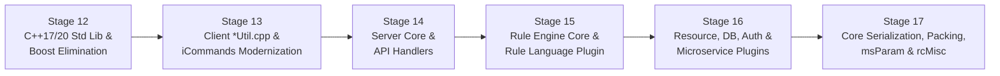

# iRODS Codebase Modernization Deep-Dive & Master Roadmap

## 1. Codebase-Wide Quantitative Audit

A full static scan across `lib/`, `server/`, `plugins/`, `clients/`, `unit_tests/`, and `test/` (excluding third-party externals) reveals the exact remaining footprint of legacy C idioms and pre-C++17/20 constructs:

| Category | Occurrences | Files Affected | Target Modern Replacement |
| :--- | ---: | ---: | :--- |
| **`NULL` macro** | 4,449 | 429 | `nullptr` |
| **C string functions (`snprintf`, `sprintf`, `strncpy`, `strcpy`, `strcat`, `strdup`, `rstrcpy`)** | 2,414 | 308 | `std::string`, `std::string_view`, `fmt::format`, `fmt::format_to_n` |
| **Legacy logging (`rodsLog`, `rodsLogError`)** | 2,015 | 270 | `irods::experimental::log` (`log_server`, `log_api`, `log_agent`, `log_client`) |
| **Raw C heap (`malloc`, `calloc`, `realloc`, `free`)** | 1,408 | 254 | `std::unique_ptr`, `std::vector`, `std::string`, `irods::at_scope_exit` |
| **Raw memory ops (`memset`, `memcpy`, `memmove`, `bzero`)** | 941 | 244 | Value initialization `Struct{}`, `std::copy`, `std::span` |
| **Raw `new` / `delete`** | 885 | 301 | `std::make_unique`, `std::make_shared`, value semantics |
| **`typedef struct` C headers** | 227 | 109 | Modern C++ structs with default member initializers (`= {}`) |
| **Legacy C number/token parsing (`strtok`, `strtol`, `atoi`, `atof`)** | 180 | 44 | `std::from_chars` (`<charconv>`), `std::string_view` |
| **GenQuery1 (`genQueryInp_t`, `rcGenQuery`, `rsGenQuery`)** | 150 | 28 | `irods::experimental::genquery2::builder` + `rc_genquery2` / `irods::filesystem` |
| **Non-local jumps & C signals (`setjmp`, `longjmp`, `signal`)** | 76 | 55 | Socket timeouts (`SO_RCVTIMEO`), structured error returns, `sigaction` |
| **POSIX directory/stat (`opendir`, `readdir`, `closedir`, `stat`, `lstat`)** | 38 | 13 | `std::filesystem` |
| **Raw process spawning (`fork`, `vfork`, `exec*`, `popen`, `pipe`)** | 35 | 10 | `boost::process` / RAII pipe & process wrappers |
| **Legacy Boost (`variant`, `optional`, `format`, `pmr`, `random`, `thread`, `regex`, `tokenizer`, `date_time`, `archive`, `safe_numerics`, `numeric_cast`, `function_input_iterator`, `preprocessor`, `algorithm/string`)** | ~280 | 68 | `<variant>`, `<optional>`, `fmt::format`, `<memory_resource>`, `<random>`, `<thread>`, `<mutex>`, `<regex>`, `<string_view>`, `<chrono>`, `<utility>` (`std::in_range`) |

---

## 2. Top Modernization Hotspots by File

| File | Lines | `malloc`/`free` | C-Strings | `rodsLog` | GQ1 | `boost::` |
| :--- | ---: | ---: | ---: | ---: | ---: | ---: |
| [`lib/core/src/rcMisc.cpp`](file:///home/darkfell/dev/irods/lib/core/src/rcMisc.cpp) | 4,910 | 119 | 107 | 55 | 3 | 2 |
| [`lib/core/src/miscUtil.cpp`](file:///home/darkfell/dev/irods/lib/core/src/miscUtil.cpp) | 2,780 | 63 | 32 | 63 | 12 | 0 |
| [`lib/core/src/packStruct.cpp`](file:///home/darkfell/dev/irods/lib/core/src/packStruct.cpp) | 3,489 | 83 | 22 | 53 | 0 | 0 |
| [`server/core/src/miscServerFunct.cpp`](file:///home/darkfell/dev/irods/server/core/src/miscServerFunct.cpp) | 2,844 | 30 | 17 | 84 | 0 | 31 |
| [`lib/core/src/msParam.cpp`](file:///home/darkfell/dev/irods/lib/core/src/msParam.cpp) | 1,884 | 74 | 24 | 36 | 0 | 0 |
| [`server/re/src/genQueryMS.cpp`](file:///home/darkfell/dev/irods/server/re/src/genQueryMS.cpp) | 987 | 19 | 7 | 32 | 34 | 0 |
| [`plugins/rule_engines/irods_rule_language/src/functions.cpp`](file:///home/darkfell/dev/irods/plugins/rule_engines/irods_rule_language/src/functions.cpp) | 2,772 | 53 | 46 | 3 | 5 | 0 |
| [`plugins/database/src/db_plugin.cpp`](file:///home/darkfell/dev/irods/plugins/database/src/db_plugin.cpp) | 14,545 | 5 | 109 | 0 | 3 | 11 |
| [`lib/core/src/rcPortalOpr.cpp`](file:///home/darkfell/dev/irods/lib/core/src/rcPortalOpr.cpp) | 1,695 | 22 | 4 | 69 | 0 | 10 |
| [`plugins/rule_engines/irods_rule_language/src/nre.reLib1.cpp`](file:///home/darkfell/dev/irods/plugins/rule_engines/irods_rule_language/src/nre.reLib1.cpp) | 1,150 | 53 | 32 | 9 | 0 | 0 |
| [`server/core/src/physPath.cpp`](file:///home/darkfell/dev/irods/server/core/src/physPath.cpp) | 1,442 | 16 | 61 | 31 | 0 | 1 |
| [`server/re/src/reDataObjOpr.cpp`](file:///home/darkfell/dev/irods/server/re/src/reDataObjOpr.cpp) | 3,379 | 41 | 13 | 35 | 0 | 0 |
| [`lib/core/src/rcConnect.cpp`](file:///home/darkfell/dev/irods/lib/core/src/rcConnect.cpp) | 615 | 12 | 13 | 24 | 0 | 35 |
| [`plugins/rule_engines/irods_rule_language/src/conversion.cpp`](file:///home/darkfell/dev/irods/plugins/rule_engines/irods_rule_language/src/conversion.cpp) | 781 | 49 | 28 | 0 | 0 | 0 |
| [`lib/core/src/sockComm.cpp`](file:///home/darkfell/dev/irods/lib/core/src/sockComm.cpp) | 1,623 | 16 | 13 | 51 | 0 | 1 |
| [`plugins/api/src/register_physical_path.cpp`](file:///home/darkfell/dev/irods/plugins/api/src/register_physical_path.cpp) | 1,440 | 18 | 57 | 1 | 0 | 0 |
| [`server/api/src/rsGenQuery.cpp`](file:///home/darkfell/dev/irods/server/api/src/rsGenQuery.cpp) | 941 | 7 | 1 | 6 | 19 | 12 |
| [`server/core/src/specColl.cpp`](file:///home/darkfell/dev/irods/server/core/src/specColl.cpp) | 896 | 9 | 46 | 23 | 0 | 0 |
| [`plugins/database/src/general_query.cpp`](file:///home/darkfell/dev/irods/plugins/database/src/general_query.cpp) | 2,651 | 3 | 47 | 0 | 6 | 6 |
| [`lib/core/src/rsyncUtil.cpp`](file:///home/darkfell/dev/irods/lib/core/src/rsyncUtil.cpp) | 1,279 | 1 | 25 | 41 | 0 | 0 |

---

## 3. Master Multi-Stage Modernization Roadmap (Stages 12–17)

### Stage 12: C++17/20 Standard Library Modernization & Legacy Boost Elimination (Next Up)
1. **GenQuery2 AST `boost::variant` $\rightarrow$ `std::variant` (`TODO(#7679)`)**:
   - Migrate `projection`, `condition_expression`, and `condition_wrapper` in [`lib/core/include/irods/genquery2_ast_types.hpp`](file:///home/darkfell/dev/irods/lib/core/include/irods/genquery2_ast_types.hpp) from `boost::variant` / `boost::recursive_wrapper` to `std::variant`.
   - Migrate [`lib/core/include/irods/genquery2_builder.hpp`](file:///home/darkfell/dev/irods/lib/core/include/irods/genquery2_builder.hpp), [`server/genquery2/src/genquery2_sql.cpp`](file:///home/darkfell/dev/irods/server/genquery2/src/genquery2_sql.cpp), and [`server/genquery2/dsl/parser.y`](file:///home/darkfell/dev/irods/server/genquery2/dsl/parser.y) from `boost::static_visitor` / `boost::apply_visitor` / `boost::get` to `std::visit` / `std::get_if` and simplify the `sort_expression` and `group_expression` grammar rules in `parser.y`.
2. **Dead Boost Headers, Macros & Unused Files**:
   - Remove dead [`lib/core/include/irods/microservice.hpp`](file:///home/darkfell/dev/irods/lib/core/include/irods/microservice.hpp) (27 `boost/preprocessor` headers) and uncompiled [`lib/core/src/irods_threads.cpp`](file:///home/darkfell/dev/irods/lib/core/src/irods_threads.cpp).
   - Remove `<boost/static_assert.hpp>`, `<boost/assert.hpp>`, `<boost/chrono.hpp>`, `<boost/numeric/ublas/storage.hpp>`, `<boost/tuple/tuple.hpp>`, `<boost/range/...>`, `<boost/regex.h>`, and `<boost/iterator/function_input_iterator.hpp>`.
   - Replace `boost::safe_numerics::safe<To>{_value}` in [`plugins/microservices/src/json_common.hpp`](file:///home/darkfell/dev/irods/plugins/microservices/src/json_common.hpp) and `boost::numeric_cast` in [`plugins/resources/replication/src/irods_repl_retry.cpp`](file:///home/darkfell/dev/irods/plugins/resources/replication/src/irods_repl_retry.cpp) with C++20 `std::in_range` (`<utility>`).
3. **`boost::optional` $\rightarrow$ `std::optional`**:
   - [`irods_error.hpp`](file:///home/darkfell/dev/irods/lib/core/include/irods/irods_error.hpp), [`irods_error.cpp`](file:///home/darkfell/dev/irods/lib/core/src/irods_error.cpp), [`sockComm.cpp`](file:///home/darkfell/dev/irods/lib/core/src/sockComm.cpp), [`initServer.cpp`](file:///home/darkfell/dev/irods/server/core/src/initServer.cpp), [`imeta.cpp`](file:///home/darkfell/dev/irods/clients/icommands/src/imeta.cpp).
4. **`boost::format` $\rightarrow$ `fmt::format` / `fmt::vsprintf`**:
   - Remove `boost::format` constructor overloads from [`irods::error`](file:///home/darkfell/dev/irods/lib/core/include/irods/irods_error.hpp) and [`irods::exception`](file:///home/darkfell/dev/irods/lib/core/include/irods/irods_exception.hpp), and migrate all 18 caller files across `lib/`, `server/`, `plugins/`, `clients/`, and `unit_tests/`.
5. **`boost::container::pmr` $\rightarrow$ `std::pmr` (`<memory_resource>`)**:
   - [`fixed_buffer_resource.hpp`](file:///home/darkfell/dev/irods/lib/core/include/irods/fixed_buffer_resource.hpp), [`capped_memory_resource.hpp`](file:///home/darkfell/dev/irods/lib/core/include/irods/capped_memory_resource.hpp), [`irods_delay_queue.hpp`](file:///home/darkfell/dev/irods/server/core/include/irods/irods_delay_queue.hpp), and unit tests.
6. **`boost::random` $\rightarrow$ `<random>`**:
   - [`irods_random.cpp`](file:///home/darkfell/dev/irods/lib/core/src/irods_random.cpp) and [`rcMisc.cpp`](file:///home/darkfell/dev/irods/lib/core/src/rcMisc.cpp).
7. **`boost::thread` / `mutex` / `condition_variable` / `scoped_thread` $\rightarrow$ `<thread>`, `<mutex>`, `<condition_variable>`**:
   - [`irods_threads.hpp`](file:///home/darkfell/dev/irods/lib/core/include/irods/irods_threads.hpp), [`rcConnect.cpp`](file:///home/darkfell/dev/irods/lib/core/src/rcConnect.cpp) (fixing the reconnect thread wake-up/join lifecycle), [`rcPortalOpr.cpp`](file:///home/darkfell/dev/irods/lib/core/src/rcPortalOpr.cpp), [`initServer.cpp`](file:///home/darkfell/dev/irods/server/core/src/initServer.cpp), [`miscServerFunct.cpp`](file:///home/darkfell/dev/irods/server/core/src/miscServerFunct.cpp), [`rsApiHandler.cpp`](file:///home/darkfell/dev/irods/server/core/src/rsApiHandler.cpp), [`rsExecCmd.cpp`](file:///home/darkfell/dev/irods/server/api/src/rsExecCmd.cpp).
8. **`boost::regex`, `boost::tokenizer`, `boost::posix_time`, `boost::archive`, & `boost/algorithm/string`**:
   - Migrate `boost::regex` to `std::regex` (`<regex>`), `boost::tokenizer` to `std::string_view`, `boost::posix_time` to `gmtime_r`/`timegm`/`std::get_time`/`std::put_time`, `boost::archive::iterators::base64_from_binary` to `irods::base64_encode`, and `boost/algorithm/string` across all 18 files to C++20 `std::string_view` (`starts_with`, `ends_with`), `<algorithm>`, and string utilities.
9. **CMake Link Cleanup**:
   - Remove `libboost_thread.so`, `libboost_regex.so`, `libboost_random.so`, `libboost_chrono.so`, and `libboost_container.so` across all `CMakeLists.txt` and test configs.

---

### Stage 13: Client Utilities (`lib/core/src/*Util.cpp`) & iCommands (`clients/icommands/`) Modernization
- **Scope**: 20 `*Util.cpp` files in `lib/core/src/` (`miscUtil.cpp`, `putUtil.cpp`, `getUtil.cpp`, `rsyncUtil.cpp`, `lsUtil.cpp`, `cpUtil.cpp`, `replUtil.cpp`, `chksumUtil.cpp`, `trimUtil.cpp`, `scanUtil.cpp`, `phymvUtil.cpp`, `rmtrashUtil.cpp`, `fsckUtil.cpp`, `rmUtil.cpp`, `bunUtil.cpp`, `regUtil.cpp`, `mcollUtil.cpp`, `rmdirUtil.cpp`, `mvUtil.cpp`, `mkdirUtil.cpp`) and 42 iCommand tools in `clients/icommands/src/`.
- **Key Transformations**:
  1. **Filesystem & Collection Iteration**: Replace remaining `rclOpenCollection` / `rclReadCollection` / `queryCollInColl` / `queryDataObjInColl` / `getRodsObjType` loops and local POSIX `opendir`/`readdir`/`stat` calls with `irods::filesystem::client::(recursive_)collection_iterator`, `irods::filesystem::client::status`, and `std::filesystem`.
  2. **Timing & Formatting**: Replace `struct timeval` / `gettimeofday` with `std::chrono::steady_clock`, `printf`/`fprintf`/`snprintf` with `fmt::print`/`fmt::format`, and `atoi`/`strtoll` with `std::from_chars`.
  3. **Memory & Buffer Safety**: Replace `malloc`/`free`/`strdup` and fixed `MAX_NAME_LEN` `rstrcpy` chains with `std::string`, `std::vector`, and `irods::at_scope_exit`.

---

### Stage 14: Server Core & Server API Handlers (`server/core/`, `server/api/`, `plugins/api/`) Modernization
- **Scope**:
  - `server/core/src/`: [`miscServerFunct.cpp`](file:///home/darkfell/dev/irods/server/core/src/miscServerFunct.cpp), [`physPath.cpp`](file:///home/darkfell/dev/irods/server/core/src/physPath.cpp), [`dataObjOpr.cpp`](file:///home/darkfell/dev/irods/server/core/src/dataObjOpr.cpp), [`specColl.cpp`](file:///home/darkfell/dev/irods/server/core/src/specColl.cpp), [`objDesc.cpp`](file:///home/darkfell/dev/irods/server/core/src/objDesc.cpp), [`fileOpr.cpp`](file:///home/darkfell/dev/irods/server/core/src/fileOpr.cpp), [`initServer.cpp`](file:///home/darkfell/dev/irods/server/core/src/initServer.cpp), [`rsApiHandler.cpp`](file:///home/darkfell/dev/irods/server/core/src/rsApiHandler.cpp), [`json_deserialization.cpp`](file:///home/darkfell/dev/irods/server/core/src/json_deserialization.cpp).
  - `server/api/src/` & `plugins/api/src/`: [`rsRmColl.cpp`](file:///home/darkfell/dev/irods/server/api/src/rsRmColl.cpp), [`rsBulkDataObjPut.cpp`](file:///home/darkfell/dev/irods/server/api/src/rsBulkDataObjPut.cpp), [`rsBulkDataObjReg.cpp`](file:///home/darkfell/dev/irods/server/api/src/rsBulkDataObjReg.cpp), [`rsProcStat.cpp`](file:///home/darkfell/dev/irods/server/api/src/rsProcStat.cpp), [`rsStructFileBundle.cpp`](file:///home/darkfell/dev/irods/server/api/src/rsStructFileBundle.cpp), [`rsUnbunAndRegPhyBunfile.cpp`](file:///home/darkfell/dev/irods/server/api/src/rsUnbunAndRegPhyBunfile.cpp), [`rsExecCmd.cpp`](file:///home/darkfell/dev/irods/server/api/src/rsExecCmd.cpp), [`rsPamAuthRequest.cpp`](file:///home/darkfell/dev/irods/server/api/src/rsPamAuthRequest.cpp), [`register_physical_path.cpp`](file:///home/darkfell/dev/irods/plugins/api/src/register_physical_path.cpp).
- **Key Transformations**:
  1. **Structured Logging**: Migrate `rodsLog` / `rodsLogError` calls to `irods::experimental::log::server`, `log::api`, and `log::agent`.
  2. **Eliminate `setjmp` / `longjmp` + `alarm()`**: In [`rsApiHandler.cpp`](file:///home/darkfell/dev/irods/server/core/src/rsApiHandler.cpp), replace `setjmp(Jenv)` / `longjmp(Jenv, ...)` + `alarm()` in `readAndProcClientMsg` with socket receive timeouts (`SO_RCVTIMEO`) and structured error handling.
  3. **RAII & Modern String/Number Handling**: Replace manual `malloc`/`free`/`rstrcpy`/`snprintf`/`atoi`/`strtol` with `std::string`, `std::vector`, `fmt::format`, and `std::from_chars`.

---

### Stage 15: Rule Engine Core (`server/re/`) & Rule Language Plugin (`plugins/rule_engines/irods_rule_language/`) Modernization
- **Scope**:
  - `server/re/src/`: [`reDataObjOpr.cpp`](file:///home/darkfell/dev/irods/server/re/src/reDataObjOpr.cpp), [`genQueryMS.cpp`](file:///home/darkfell/dev/irods/server/re/src/genQueryMS.cpp), [`extractAvuMS.cpp`](file:///home/darkfell/dev/irods/server/re/src/extractAvuMS.cpp), [`nre.systemMS.cpp`](file:///home/darkfell/dev/irods/server/re/src/nre.systemMS.cpp), [`keyValPairMS.cpp`](file:///home/darkfell/dev/irods/server/re/src/keyValPairMS.cpp), [`irods_re_structs.cpp`](file:///home/darkfell/dev/irods/server/re/src/irods_re_structs.cpp), [`reSysDataObjOpr.cpp`](file:///home/darkfell/dev/irods/server/re/src/reSysDataObjOpr.cpp), [`reNaraMetaData.cpp`](file:///home/darkfell/dev/irods/server/re/src/reNaraMetaData.cpp).
  - `plugins/rule_engines/irods_rule_language/src/`: [`functions.cpp`](file:///home/darkfell/dev/irods/plugins/rule_engines/irods_rule_language/src/functions.cpp), [`nre.reLib1.cpp`](file:///home/darkfell/dev/irods/plugins/rule_engines/irods_rule_language/src/nre.reLib1.cpp), [`conversion.cpp`](file:///home/darkfell/dev/irods/plugins/rule_engines/irods_rule_language/src/conversion.cpp), [`arithmetics.cpp`](file:///home/darkfell/dev/irods/plugins/rule_engines/irods_rule_language/src/arithmetics.cpp), [`msiHelper.cpp`](file:///home/darkfell/dev/irods/plugins/rule_engines/irods_rule_language/src/msiHelper.cpp), [`nre.reHelpers1.cpp`](file:///home/darkfell/dev/irods/plugins/rule_engines/irods_rule_language/src/nre.reHelpers1.cpp), [`parser.cpp`](file:///home/darkfell/dev/irods/plugins/rule_engines/irods_rule_language/src/parser.cpp).
- **Key Transformations**:
  1. Replace C string manipulation (`snprintf`, `strncpy`, `strcpy`, `strcat`, `strdup`), `atoi`/`atof`/`strtol`, and `rodsLog` with `fmt::format`, `std::from_chars`, and `irods::experimental::log::rule_engine`.
  2. Replace raw `malloc`/`free` intermediate buffers with `std::vector` / `std::string` / `std::unique_ptr` while preserving `msParam_t` ABI ownership boundaries.

---

### Stage 16: Resource, Database, & Authentication Plugins (`plugins/`) C-to-C++ Modernization
- **Scope**:
  - `plugins/resources/`: [`structfile.cpp`](file:///home/darkfell/dev/irods/plugins/resources/src/structfile.cpp), [`univmss.cpp`](file:///home/darkfell/dev/irods/plugins/resources/src/univmss.cpp), [`nonblocking.cpp`](file:///home/darkfell/dev/irods/plugins/resources/src/nonblocking.cpp), [`mockarchive.cpp`](file:///home/darkfell/dev/irods/plugins/resources/src/mockarchive.cpp), [`unixfilesystem.cpp`](file:///home/darkfell/dev/irods/plugins/resources/unixfilesystem/src/unixfilesystem.cpp), [`compound.cpp`](file:///home/darkfell/dev/irods/plugins/resources/src/compound.cpp).
  - `plugins/database/`: [`db_plugin.cpp`](file:///home/darkfell/dev/irods/plugins/database/src/db_plugin.cpp), [`general_query.cpp`](file:///home/darkfell/dev/irods/plugins/database/src/general_query.cpp), [`catalog_access_control.cpp`](file:///home/darkfell/dev/irods/plugins/database/src/catalog_access_control.cpp).
  - `plugins/authentication/` & `plugins/auth_legacy/`: [`pam_password.cpp`](file:///home/darkfell/dev/irods/plugins/authentication/src/pam_password.cpp), [`pam.cpp`](file:///home/darkfell/dev/irods/plugins/auth_legacy/src/pam.cpp).
- **Key Transformations**:
  1. Replace POSIX `stat`/`opendir`/`readdir` in resource plugins with `std::filesystem` where applicable.
  2. Replace `rstrcpy`/`snprintf`/`strncpy` and `strtol`/`atoi` in `structfile.cpp`, `univmss.cpp`, `db_plugin.cpp`, `general_query.cpp`, and `catalog_access_control.cpp` with `fmt::format_to_n`, `std::string`, and `std::from_chars`.

---

### Stage 17: Core Networking, Packing, `msParam`, & `rcMisc` (`lib/core/src/`) Endgame Refactoring
- **Scope**: [`rcMisc.cpp`](file:///home/darkfell/dev/irods/lib/core/src/rcMisc.cpp), [`packStruct.cpp`](file:///home/darkfell/dev/irods/lib/core/src/packStruct.cpp), [`msParam.cpp`](file:///home/darkfell/dev/irods/lib/core/src/msParam.cpp), [`sockComm.cpp`](file:///home/darkfell/dev/irods/lib/core/src/sockComm.cpp), [`sslSockComm.cpp`](file:///home/darkfell/dev/irods/lib/core/src/sslSockComm.cpp), [`procApiRequest.cpp`](file:///home/darkfell/dev/irods/lib/core/src/procApiRequest.cpp), [`rcPortalOpr.cpp`](file:///home/darkfell/dev/irods/lib/core/src/rcPortalOpr.cpp), [`rodsPath.cpp`](file:///home/darkfell/dev/irods/lib/core/src/rodsPath.cpp), [`parseCommandLine.cpp`](file:///home/darkfell/dev/irods/lib/core/src/parseCommandLine.cpp), [`getRodsEnv.cpp`](file:///home/darkfell/dev/irods/lib/core/src/getRodsEnv.cpp).
- **Key Transformations**:
  1. Modernize internal implementations of `rcMisc.cpp`, `packStruct.cpp`, `msParam.cpp`, `sockComm.cpp`, and `rcPortalOpr.cpp` to use C++17/20 `std::string_view`, `std::from_chars`, `std::filesystem`, `fmt::format_to_n`, and RAII buffers while maintaining C ABI compatibility for external callers.
  2. Replace `NULL` with `nullptr` and `typedef struct` patterns with modern C++ struct definitions across `lib/core/include/irods/` and `lib/api/include/irods/`.
