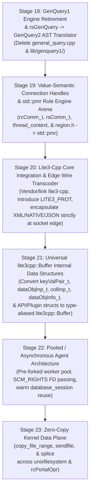

# iRODS Next-Generation Architecture Roadmap (Stages 18–23)

**Date**: 2026-10-25  
**Status**: Approved Architecture Specification  
**Target Branch**: `irods6`  
**Prerequisite Baseline**: Stages 0–17 Completed (`01f8bffcc`)

---

## 1. Executive Summary

Having completed Stages 0–17 of the [iRODS Master Modernization Roadmap](2026-10-23-irods-master-modernization-roadmap.md)—unifying catalog access on `nanodbc_executor`, promoting GenQuery2 ASTs everywhere, introducing `simply_collections` polymorphic drivers, migrating to C++17/20 standard facilities (`std::filesystem`, `std::variant`, `std::optional`, `std::any`, `std::pmr`, `std::thread`, `std::from_chars`, `fmt::format`), removing `setjmp`/`longjmp`, and fixing all CPG-detected resource and concurrency defects—iRODS is ready for **Phase III: Next-Generation Architecture (iRODS 6.0, Stages 18–23)**.

A centerpiece of Phase III is the **Lite3-Core / Edge-Transcoder Architecture**:
1. **Strict Wire Boundary Encapsulation (Stage 20)**: Legacy `XML_PROT`, `NATIVE_PROT`, and human-readable `JSON_PROT` (`lite3_json`) are encapsulated strictly inside an isolated **Edge Wire Transcoder** at the socket boundary (`sockComm.cpp`, `procApiRequest.cpp`, `rsApiHandler.cpp`), while 6.0-to-6.0 connections negotiate **`LITE3_PROT`** for zero-parse, zero-copy `lite3cpp::Buffer` wire streaming. Mixed-version 4.x/5.x grids, rolling upgrades, cross-zone federation, and Python/Go/Java clients work seamlessly via version-aware edge transcoding.
2. **Universal `lite3cpp::Buffer` Internal Data Structures with Type Aliasing (Stage 21)**: Every internal passed data structure (`dataObjInp_t`, `collInp_t`, `dataObjInfo_t`, `keyValPair_t`, `modAVUMetadataInp_t`, `rodsObjStat_t`, etc.) is converted under the hood into a strongly-typed `lite3cpp::Buffer` / `lite3cpp::Object` facade with domain type aliases (`using dataObjInp_t = irods::protocol::DataObjInp;`), eliminating `clearKeyVal`, `freeAllDataObjInfo`, `rstrcpy` fixed-buffer truncation, and `irods_re_serialization.cpp` across the entire codebase.

---

## 2. Stage Overview & Dependency Sequence

| Stage | Spec Document | Core Objective | Key Deletions / Replacements |
| :--- | :--- | :--- | :--- |
| **Stage 18** | [`2026-10-24-stage18-genquery1-retirement-design.md`](2026-10-24-stage18-genquery1-retirement-design.md) | Route `rsGenQuery` RPCs through a `genQueryInp_t` $\rightarrow$ `genquery2::select` AST translator and retire the legacy GenQuery1 SQL generator and parser. | Delete `plugins/database/src/general_query.cpp` (2,651 lines), `general_query_setup.hpp`, `low_level_odbc.cpp` legacy statement table, and `lib/genquery1/`. |
| **Stage 19** | [`2026-10-24-stage19-raii-connection-handles-design.md`](2026-10-24-stage19-raii-connection-handles-design.md) | Transform `thread_context`, `rcComm_t`, and `rsComm_t` into RAII-managed types with value-semantic sub-objects, and migrate `Region` (`region.h`/`.cpp`) to `std::pmr::monotonic_buffer_resource`. | Replace raw `std::thread*`/`std::mutex*`/`std::condition_variable*` in `thread_context`, manual `freeRcComm` teardown, and `<setjmp.h>`/custom linked lists in `region.cpp`. |
| **Stage 20** | [`2026-10-24-stage20-lite3-edge-wire-transcoder-design.md`](2026-10-24-stage20-lite3-edge-wire-transcoder-design.md) | Integrate `lite3-cpp`, add `LITE3_PROT` & `JSON_PROT` to `irodsProt_t` with automatic version-aware negotiation, and encapsulate `XML_PROT`/`NATIVE_PROT`/`JSON_PROT` strictly inside the Edge Wire Transcoder. | Isolate `packStruct.cpp` behind `lib/core/src/wire_transcoder.cpp` at the socket boundary; 6.0-to-6.0 peers stream raw `lite3cpp::Buffer`s with zero parsing/transcoding. |
| **Stage 21** | [`2026-10-24-stage21-lite3-internal-data-structures-design.md`](2026-10-24-stage21-lite3-internal-data-structures-design.md) | Convert all internal passed data structures (`keyValPair_t`, `dataObjInp_t`, `collInp_t`, `dataObjInfo_t`, `modAVUMetadataInp_t`, `rodsObjStat_t`, etc.) to type-aliased `lite3cpp::Buffer` / `lite3cpp::Object` facades. | Eliminate `clearKeyVal`, `freeAllDataObjInfo`, `replDataObjInfo` pointer-walking, `char[MAX_NAME_LEN]` stack bloat, and `irods_re_serialization.cpp`. |
| **Stage 22** | [`2026-10-24-stage22-pooled-async-agent-design.md`](2026-10-24-stage22-pooled-async-agent-design.md) | Replace `fork()`-per-connection in `rodsServer` with a persistent pre-forked/reusable agent worker pool using `SCM_RIGHTS` FD passing and per-request context reset. | Eliminate cold `fork` + `dlopen` + ODBC connection setup overhead on every client session; reuse warm `database_session` and statement caches. |
| **Stage 23** | [`2026-10-24-stage23-zero-copy-data-plane-design.md`](2026-10-24-stage23-zero-copy-data-plane-design.md) | Add kernel zero-copy I/O (`copy_file_range`, `sendfile`, `splice`) to `unixfilesystem`, `basic_transport`, and portal transfers. | Bypass user-space buffer copies during unencrypted and kTLS-offloaded replica streaming and vault-to-vault copies. |

---

## 3. Why This Ordering?

1. **Stage 18 first** removes the single largest remaining block of legacy stateful C code in the catalog provider (`general_query.cpp` + `low_level_odbc.cpp` statement arrays + `lib/genquery1/`), making the database plugin 100% stateless outside of `database_session` and `nanodbc_executor`.
2. **Stage 19 next** eliminates manual heap lifetimes in `rcComm_t`/`rsComm_t`/`thread_context` and upgrades `region.cpp` to `std::pmr::monotonic_buffer_resource`, ensuring connection handles and rule engine arenas are RAII-safe.
3. **Stage 20** integrates `lite3-cpp` and pushes `XML_PROT`, `NATIVE_PROT`, and `JSON_PROT` out to the **Edge Wire Transcoder**, establishing `lite3cpp::Buffer` (`LITE3_PROT`) as the canonical payload representation across the socket boundary while preserving 100% mixed-grid, rolling-upgrade, federation, and 4.x/5.x client compatibility.
4. **Stage 21** converts all internal passed data structures (`dataObjInp_t`, `collInp_t`, `dataObjInfo_t`, `keyValPair_t`, etc.) into type-aliased `lite3cpp::Buffer` facades (`irods::protocol::message_buffer<Tag>`), eliminating C struct unpacking, `clearKeyVal`, `freeAllDataObjInfo`, and `irods_re_serialization` across `lib/core`, `server/`, and `plugins/`.
5. **Stage 22** leverages the stateless catalog (Stage 18), RAII `rsComm_t` lifecycle (Stage 19), and RAII `lite3cpp::Buffer` messages (Stages 20–21) to safely reuse persistent agent workers across multiple client sessions without cross-session state leakage.
6. **Stage 23** optimizes the kernel data path once the control, serialization, and connection planes are modernized.

---

## 4. Verification Mandate

Every stage in Phase III (Stages 18–23) must pass the 4-Phase Dialectic CPG Verification Gate ([`scripts/verify_refactoring.sh`](../../../scripts/verify_refactoring.sh)):
1. **100% CMake/Ninja target compilation** with zero errors.
2. **100% Catch2 unit test suite pass rate** (including new unit tests dedicated to each stage).
3. **Incremental Project Insight CPG synchronization** (`insight ingest`).
4. **Zero concurrency violations and zero typestate violations** (`insight check --concurrency` and `insight check --typestate`).
