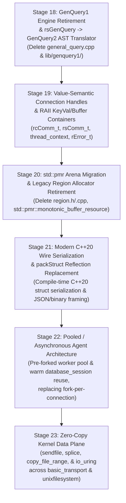

# iRODS Next-Generation Architecture Roadmap (Stages 18–23)

**Date**: 2026-10-24  
**Status**: Approved Architecture Specification  
**Prerequisite Baseline**: Stages 0–17 Completed (`01f8bffcc`)

---

## 1. Executive Summary

Having completed Stages 0–17 of the [iRODS Master Modernization Roadmap](file:///home/darkfell/dev/irods/docs/superpowers/specs/2026-10-23-irods-master-modernization-roadmap.md)—unifying catalog access on `nanodbc_executor`, promoting GenQuery2 ASTs everywhere, introducing `simply_collections` polymorphic drivers, migrating to C++17/20 standard facilities (`std::filesystem`, `std::variant`, `std::optional`, `std::any`, `std::pmr`, `std::thread`, `std::from_chars`, `fmt::format`), removing `setjmp`/`longjmp`, and fixing all CPG-detected resource and concurrency defects—iRODS is ready for **Phase III: Next-Generation Architecture (iRODS 6.0, Stages 18–23)**.

This roadmap defines six sequential architectural stages that eliminate the remaining legacy C infrastructure and unlock modern performance, memory safety, and horizontal scalability:

---

## 2. Stage Overview & Dependency Sequence

| Stage | Spec Document | Core Objective | Key Deletions / Replacements |
| :--- | :--- | :--- | :--- |
| **Stage 18** | [`2026-10-24-stage18-genquery1-retirement-design.md`](file:///home/darkfell/dev/irods/docs/superpowers/specs/2026-10-24-stage18-genquery1-retirement-design.md) | Route `rsGenQuery` RPCs through a `genQueryInp_t` $\rightarrow$ `genquery2::select` AST translator and retire the legacy GenQuery1 SQL generator and parser. | Delete `plugins/database/src/general_query.cpp` (2,651 lines), `general_query_setup.hpp`, `low_level_odbc.cpp` legacy statement table, and `lib/genquery1/`. |
| **Stage 19** | [`2026-10-24-stage19-raii-connection-handles-design.md`](file:///home/darkfell/dev/irods/docs/superpowers/specs/2026-10-24-stage19-raii-connection-handles-design.md) | Transform `thread_context`, `rcComm_t`, and `rsComm_t` into RAII-managed types with value-semantic sub-objects. | Replace raw `std::thread*`/`std::mutex*`/`std::condition_variable*` in `thread_context`, raw `rError_t*`, and manual `freeRcComm`/`cleanupAndExit` teardown chains. |
| **Stage 20** | [`2026-10-24-stage20-pmr-region-allocator-design.md`](file:///home/darkfell/dev/irods/docs/superpowers/specs/2026-10-24-stage20-pmr-region-allocator-design.md) | Replace the custom C `Region` allocator (`region.h`/`region.cpp`) used by the Native Rule Engine with `std::pmr::monotonic_buffer_resource`. | Delete `lib/core/include/irods/region.h` and `lib/core/src/region.cpp`; remove `<setjmp.h>` from rule engine memory management. |
| **Stage 21** | [`2026-10-24-stage21-cpp20-wire-serialization-design.md`](file:///home/darkfell/dev/irods/docs/superpowers/specs/2026-10-24-stage21-cpp20-wire-serialization-design.md) | Introduce compile-time C++20 struct reflection and direct JSON/MessagePack framing to replace runtime string-parsed `packStruct` instructions. | Replace `*_PI` runtime string parsing for modern API structs with compile-time `irods::serialization::traits<T>` and zero-copy buffer framing. |
| **Stage 22** | [`2026-10-24-stage22-pooled-async-agent-design.md`](file:///home/darkfell/dev/irods/docs/superpowers/specs/2026-10-24-stage22-pooled-async-agent-design.md) | Replace `fork()`-per-connection in `rodsServer` with a persistent pre-forked/reusable agent worker pool using `SCM_RIGHTS` FD passing and per-request context reset. | Eliminate cold `fork` + `dlopen` + ODBC connection setup overhead on every client session; reuse warm `database_session` and statement caches. |
| **Stage 23** | [`2026-10-24-stage23-zero-copy-data-plane-design.md`](file:///home/darkfell/dev/irods/docs/superpowers/specs/2026-10-24-stage23-zero-copy-data-plane-design.md) | Add kernel zero-copy I/O (`copy_file_range`, `sendfile`, `splice`) to `unixfilesystem`, `basic_transport`, and portal transfers. | Bypass user-space buffer copies during unencrypted and kTLS-offloaded replica streaming and vault-to-vault copies. |

---

## 3. Why This Ordering?

1. **Stage 18 first** removes the single largest remaining block of legacy stateful C code in the catalog provider (`general_query.cpp` + `low_level_odbc.cpp` statement arrays + `lib/genquery1/`), making the database plugin 100% stateless outside of `database_session` and `nanodbc_executor`.
2. **Stages 19 & 20 next** eliminate manual heap lifetimes in `rcComm_t`/`rsComm_t`/`thread_context` and the custom `Region` allocator (`region.cpp`), ensuring that connection handles and rule engine arenas can be cleanly constructed, reset, and destroyed without leaks.
3. **Stage 21** decouples API payload serialization from raw C pointer graphs (`packStruct`).
4. **Stage 22** leverages the stateless catalog (Stage 18), RAII `rsComm_t` lifecycle (Stage 19), and `std::pmr` per-request arenas (Stage 20) to safely reuse persistent agent workers across multiple client sessions without cross-session state leakage.
5. **Stage 23** optimizes the data path once the control and connection planes are modernized.

---

## 4. Verification Mandate

Every stage in Phase III (Stages 18–23) must pass the 4-Phase Dialectic CPG Verification Gate ([`scripts/verify_refactoring.sh`](file:///home/darkfell/dev/irods/scripts/verify_refactoring.sh)):
1. **100% CMake/Ninja target compilation** with zero errors.
2. **100% Catch2 unit test suite pass rate** (including new unit tests dedicated to each stage).
3. **Incremental Project Insight CPG synchronization** (`insight ingest`).
4. **Zero concurrency violations and zero typestate violations** (`insight check --concurrency` and `insight check --typestate`).
