# Stage 18 Design Specification: Legacy GenQuery1 Engine Retirement & `rsGenQuery` $\rightarrow$ GenQuery2 AST Translator

**Date**: 2026-10-24  
**Stage**: 18 of 23  
**Parent Roadmap**: [`2026-10-24-irods-nextgen-architecture-roadmap.md`](2026-10-24-irods-nextgen-architecture-roadmap.md)

---

## 1. Problem Statement & Motivation

In Stages 3–5 and 8–9, all internal iRODS server core routines, API handlers, plugins, client utilities, and iCommands were migrated from GenQuery1 (`rcGenQuery` / `rsGenQuery`) to strongly-typed **GenQuery2 ASTs** ([`genquery2_ast_types.hpp`](../../../lib/core/include/irods/genquery2_ast_types.hpp) and [`genquery2_builder.hpp`](../../../lib/core/include/irods/genquery2_builder.hpp)).

However, external clients and legacy rules that still invoke the `rsGenQuery` RPC (`GEN_QUERY_AN = 702`) or `fillGenQueryInpFromStrCond` trigger two large legacy subsystems:
1. **`plugins/database/src/general_query.cpp` (2,651 lines)** and **`general_query_setup.hpp`**: A stateful, C-era spanning-tree SQL generator that relies on global mutable arrays (`Tables`, `Columns`, `Fklink`, `sFklink`) and raw ODBC statement slots (`MAX_NUM_OF_CONCURRENT_STMTS = 50` in [`low_level_odbc.cpp`](../../../plugins/database/src/low_level_odbc.cpp)).
2. **`lib/genquery1/`**: A legacy Flex/Bison parser (`genquery1_scanner.ll`, `genquery1_parser.yy`, `genquery1_driver.cpp`) that parses `iquest`-style strings into `genQueryInp_t`.

By introducing a **direct `genQueryInp_t` $\rightarrow$ `irods::experimental::genquery2::select` AST translator** inside [`rsGenQuery.cpp`](../../../server/api/src/rsGenQuery.cpp), `rsGenQuery` can execute through the modern GenQuery2 SQL engine ([`genquery2_sql.cpp`](../../../server/genquery2/src/genquery2_sql.cpp)) and `nanodbc_executor`, allowing us to **completely delete `general_query.cpp`, `general_query_setup.hpp`, and `lib/genquery1/`**.

---

## 2. Architecture & Data Flow

```mermaid
flowchart LR
    Client["External Client / Legacy Rule\n(genQueryInp_t)"] --> RS["rsGenQuery.cpp\n(_rsGenQuery)"]
    RS --> PreHook["acPreProcForGenQuery\n(Policy Hook)"]
    PreHook --> Translator["genquery1_to_genquery2_ast(genQueryInp_t)\n(lib/core/src/genquery1_ast_adapter.cpp)"]
    Translator --> AST["irods::experimental::genquery2::select\n(Strongly-Typed AST)"]
    AST --> GQ2["rs_genquery2 / genquery2::to_sql\n(Parameterized SQL + Bind Vars)"]
    GQ2 --> Nano["nanodbc_executor\n(Statement Cache)"]
    Nano --> OutAdapter["rows_to_genquery_out\n(genQueryOut_t)"]
    OutAdapter --> PostHook["acPostProcForGenQuery\n(Policy Hook)"]
    PostHook --> Client
```

---

## 3. Component Design

### 3.1 `genQueryInp_t` $\rightarrow$ `genquery2::select` AST Adapter
- **Header**: `lib/core/include/irods/genquery1_ast_adapter.hpp`
- **Implementation**: `lib/core/src/genquery1_ast_adapter.cpp`
- **Responsibilities**:
  1. **Column ID Mapping (`selectInp.inx` & `selectInp.value`)**:
     - Map every legacy `COL_*` integer constant from [`rodsGenQueryNames.h`](../../../lib/core/include/irods/rodsGenQueryNames.h) (`columnNames` table) to its corresponding GenQuery2 column name (e.g., `COL_COLL_NAME` $\rightarrow$ `"COLL_NAME"`, `COL_D_DATA_ID` $\rightarrow$ `"DATA_ID"`).
     - Map aggregate bitflags (`SELECT_MIN`, `SELECT_MAX`, `SELECT_SUM`, `SELECT_AVG`, `SELECT_COUNT`) to `genquery2::function{"min"|"max"|"sum"|"avg"|"count", ...}`.
     - Map ordering bitflags (`ORDER_BY`, `ORDER_BY_DESC`) to `genquery2::order_by_Field{column, sort_order::ascending | descending}`.
  2. **Condition Parsing (`sqlCondInp.inx` & `sqlCondInp.value`)**:
     - Parse legacy condition strings (`"= 'foo'"`, `"like 'bar%'"`, `"in ('a', 'b')"`, `"between '1' '10'"`, `"> '100' && < '200'"`, `"|| = 'baz'"`) into GenQuery2 AST condition nodes (`condition_equal`, `condition_like`, `condition_in`, `condition_between`, `logical_and`, `logical_or`).
     - Support `UPPER_CASE_WHERE` option by wrapping string comparisons appropriately or delegating to case-insensitive operators where configured.
  3. **Pagination & Query Options (`maxRows`, `rowOffset`, `continueInx`, `options`)**:
     - Map `maxRows` and `rowOffset` directly to `select.range` (`limit` and `offset`).
     - Map `NO_DISTINCT` (`options & NO_DISTINCT`) to `select.distinct = false`.
     - Handle `continueInx > 0`: since GenQuery2 uses stateless `OFFSET` / `LIMIT` pagination (or cursor caching), maintain a lightweight per-agent continuation offset map (`std::unordered_map<int, int> continuation_offsets`) in `rsGenQuery.cpp` so callers passing `continueInx` with `maxRows > 0` automatically advance their offset, and `maxRows == 0` closes/erases the `continueInx` entry (`AUTO_CLOSE`).
  4. **Output Conversion (`rows_to_genquery_out`)**:
     - Reuse and extend [`rows_to_genquery_out`](../../../lib/core/include/irods/genquery2_ast_types.hpp) so that the JSON rows returned by GenQuery2 are packed into `genQueryOut_t` with the exact `attriInx` (`COL_*`) integer IDs expected by legacy callers.

### 3.2 Retirement of `general_query.cpp`, `chlGenQuery`, & `lib/genquery1/`
1. **`server/api/src/rsGenQuery.cpp`**:
   - Replace `status = chlGenQuery(*genQueryInp, *genQueryOut);` with the new AST adapter + GenQuery2 execution pipeline while preserving `acPreProcForGenQuery` and `acPostProcForGenQuery` policy hooks and `add_resc_hier_name_to_query_out` post-processing.
2. **Database Plugin Cleanup (`plugins/database/`)**:
   - Remove `plugins/database/src/general_query.cpp` and `plugins/database/include/irods/private/general_query_setup.hpp` from `plugins/database/CMakeLists.txt` and delete both files.
   - Remove `db_general_query_op` and `db_gen_query_access_control_setup_op` from [`db_plugin.cpp`](../../../plugins/database/src/db_plugin.cpp) and [`icatHighLevelRoutines.cpp`](../../../server/core/src/icatHighLevelRoutines.cpp).
3. **`lib/genquery1/` Retirement**:
   - Replace `fillGenQueryInpFromStrCond` in `lib/core/src/miscUtil.cpp` with a lightweight C++20 `std::string_view` parser (handling `SELECT ... WHERE ...`) or route it directly to the GenQuery2 parser, and delete `lib/genquery1/` (removing the Flex/Bison build dependency for GenQuery1).

---

## 4. Error Handling & Backward Compatibility

- **Empty Result Sets**: When GenQuery2 returns 0 rows, `_rsGenQuery` returns `CAT_NO_ROWS_FOUND` (`-808000`) and populates an empty `genQueryOut_t` (`rowCnt = 0`), matching legacy `chlGenQuery` behavior.
- **Invalid Column IDs**: Unknown `COL_*` constants return `CAT_INVALID_ARGUMENT`.
- **`RETURN_TOTAL_ROW_COUNT`**: When `genQueryInp->options & RETURN_TOTAL_ROW_COUNT` is set, execute a companion `COUNT(*)` GenQuery2 AST with the same `WHERE` clause and populate `(*genQueryOut)->totalRowCount`.

---

## 5. Verification & Testing Plan

1. **Unit Tests (`unit_tests/src/test_genquery1_ast_adapter.cpp`)**:
   - Verify 100% of `COL_*` mappings in `columnNames`.
   - Verify compound condition parsing (`=`, `!=`, `<`, `<=`, `>`, `>=`, `like`, `not like`, `in`, `between`, `is null`, `is not null`, `&&`, `||`).
   - Verify aggregates (`SELECT_COUNT`, `SELECT_SUM`, `SELECT_MIN`, `SELECT_MAX`, `SELECT_AVG`), `ORDER_BY` / `ORDER_BY_DESC`, `NO_DISTINCT`, and `continueInx` pagination.
2. **Dialectic CPG Gate**:
   - Pass [`scripts/verify_refactoring.sh`](../../../scripts/verify_refactoring.sh) with 0 build errors, 100% unit tests passing, 0 concurrency violations, and 0 typestate violations.
