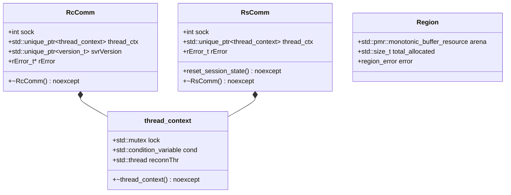

# Stage 19 Design Specification: Value-Semantic Connection Handles (`rcComm_t` / `rsComm_t`) & `std::pmr` Rule Engine Arena

**Date**: 2026-10-25  
**Stage**: 19 of 23  
**Parent Roadmap**: [`2026-10-24-irods-nextgen-architecture-roadmap.md`](2026-10-24-irods-nextgen-architecture-roadmap.md)

---

## 1. Problem Statement & Motivation

Two foundational lifetime mechanisms in `lib/core` and `server/core` still rely on legacy C manual pointer management:

1. **Connection Handles (`thread_context`, `rcComm_t`, `rsComm_t`)**:
   - In Stage 12, [`thread_context`](../../../lib/core/include/irods/irods_threads.hpp) was migrated to `<thread>`, `<mutex>`, and `<condition_variable>`, but it still holds three raw heap pointers (`std::thread* reconnThr`, `std::mutex* lock`, `std::condition_variable* cond`).
   - [`rcComm_t`](../../../lib/core/include/irods/rcConnect.h#L82-L126) and [`rsComm_t`](../../../lib/core/include/irods/rcConnect.h#L134-L185) are initialized with `malloc` + `memset` in [`_rcConnect`](../../../lib/core/src/rcConnect.cpp) and [`initRsComm`](../../../server/core/src/initServer.cpp), preventing C++ constructors and destructors from running automatically and requiring fragile teardown chains in `freeRcComm`, `cleanRcComm`, and `cleanupAndExit`.
2. **Rule Engine `Region` Allocator (`region.h` / `region.cpp`)**:
   - [`lib/core/include/irods/region.h`](../../../lib/core/include/irods/region.h) and [`lib/core/src/region.cpp`](../../../lib/core/src/region.cpp) implement a custom C arena allocator that embeds `<setjmp.h>` (`jmp_buf* label`—the last remaining `<setjmp.h>` include in `lib/core/include/`) and uses 8-byte alignment (`REGION_ALIGNMENT = 8`), violating `alignof(std::max_align_t)` (`16` on x86_64).

In Stage 19, we upgrade `thread_context`, `rcComm_t`, and `rsComm_t` to value-semantic / RAII C++20 types and replace the internal implementation of `Region` with `std::pmr::monotonic_buffer_resource`.

---

## 2. Architecture & Component Design



### 2.1 Value-Semantic `thread_context` (`lib/core/include/irods/irods_threads.hpp`)
- Replace raw pointers inside [`thread_context`](../../../lib/core/include/irods/irods_threads.hpp) with direct value members:
  ```cpp
  struct thread_context {
      std::mutex              lock{};
      std::condition_variable cond{};
      std::thread             reconnThr{};

      ~thread_context() noexcept {
          if (reconnThr.joinable()) {
              reconnThr.join();
          }
      }
  };
  ```
- Destroying `thread_context` automatically joins `reconnThr` (if joinable) and destroys `cond` and `lock` in reverse declaration order.

### 2.2 RAII `RcComm` (`rcComm_t`) & Reusable `RsComm` (`rsComm_t`)
- Allocate `rcComm_t` via `new rcComm_t{}` instead of `malloc` + `memset`, and provide `~RcComm() noexcept` so `freeRcComm(rcComm_t* conn)` is a thin wrapper around `cleanRcComm(conn); delete conn;`.
- Value-initialize `rsComm_t` (`rsComm_t rsComm{}`) without overwriting C++ members via `memset`, and provide `reset_rs_comm_session(rsComm_t& comm) noexcept` to cleanly scrub per-session fields (`clientUser`, `proxyUser`, `rError`, `portalOpr`, `reconnAddr`, `auth_scheme`, `apiInx`, `status`) so Stage 22's pooled agent workers can reuse `rsComm_t` across consecutive client connections.

### 2.3 `std::pmr::monotonic_buffer_resource` Region Allocator (`region.h` / `region.cpp`)
- Replace the linked list of `struct region_node` and `#include <setjmp.h>` in [`region.h`](../../../lib/core/include/irods/region.h) and [`region.cpp`](../../../lib/core/src/region.cpp) with `std::pmr::monotonic_buffer_resource`:
  ```cpp
  struct region {
      std::pmr::monotonic_buffer_resource arena;
      std::size_t total_allocated{0};
      struct region_error error{};

      explicit region(std::size_t initial_size)
          : arena(initial_size > 0 ? initial_size : DEFAULT_BLOCK_SIZE,
                  std::pmr::new_delete_resource())
      {}
  };
  ```
- Upgrade `REGION_ALIGNMENT` from `8` to `alignof(std::max_align_t)` (`16` on x86_64) while preserving the `RegionDesc` prefix (`IN_REGION`, `SIZE`, `SET_DELETE`, `DELETED`) expected by `irods_rule_language`.

---

## 3. Verification & Testing Plan

1. **Unit Tests (`unit_tests/src/test_raii_comm_and_pmr_region.cpp`)**:
   - Verify construction, cleanup, and destruction of `thread_context`, `rcComm_t`, and `rsComm_t` (`reset_rs_comm_session`).
   - Verify `make_region`, `region_alloc`, `region_size`, `IN_REGION`, `SIZE`, 16-byte alignment (`alignof(std::max_align_t)`), and `region_free`.
2. **Dialectic CPG Gate**:
   - Pass [`scripts/verify_refactoring.sh`](../../../scripts/verify_refactoring.sh) with 0 concurrency violations and 0 typestate violations.
