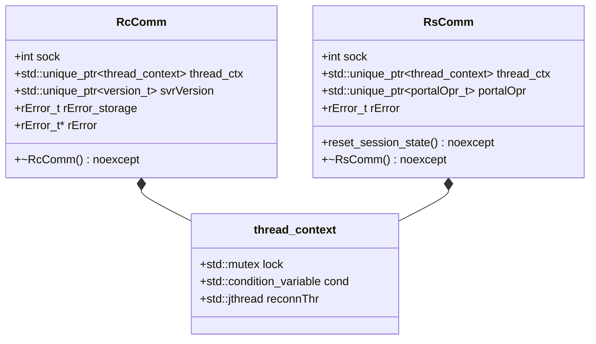

# Stage 19 Design Specification: Value-Semantic Connection Handles (`rcComm_t` / `rsComm_t`) & RAII Containers

**Date**: 2026-10-24  
**Stage**: 19 of 23  
**Parent Roadmap**: [`2026-10-24-irods-nextgen-architecture-roadmap.md`](2026-10-24-irods-nextgen-architecture-roadmap.md)

---

## 1. Problem Statement & Motivation

In Stage 12, [`thread_context`](../../../lib/core/include/irods/irods_threads.hpp) was migrated from `boost::thread` / `boost::mutex` / `boost::condition_variable` to `<thread>`, `<mutex>`, and `<condition_variable>`. However, `thread_context` itself still holds three raw heap pointers (`std::thread* reconnThr`, `std::mutex* lock`, `std::condition_variable* cond`), and [`rcComm_t`](../../../lib/core/include/irods/rcConnect.h#L82-L126) and [`rsComm_t`](../../../lib/core/include/irods/rcConnect.h#L134-L185) are still C-style structs allocated with `malloc` + `memset` and holding raw owning pointers:
- `struct thread_context* thread_ctx`
- `version_t* svrVersion`
- `rError_t* rError`
- `portalOpr_t* portalOpr`
- `char* reconnAddr` and `char* auth_scheme`
- `SSL_CTX* ssl_ctx` and `SSL* ssl`

Because `rcComm_t` and `rsComm_t` are initialized via `malloc` + `memset` in [`_rcConnect`](../../../lib/core/src/rcConnect.cpp) and [`initRsComm`](../../../server/core/src/initServer.cpp), C++ constructors and destructors never run automatically, requiring error-prone manual cleanup in `freeRcComm`, `cleanRcComm`, and `cleanupAndExit`.

Under our iRODS 6.0 ABI freedom posture, we can convert `thread_context`, `rcComm_t`, and `rsComm_t` into proper C++20 value-initialized structs with RAII members (`std::unique_ptr`, `std::optional`, `std::string`) while keeping C-compatible helper functions (`freeRcComm`, `rcDisconnect`) as thin wrappers around `delete`.

---

## 2. Architecture & Component Design



### 2.1 Value-Semantic `thread_context` (`lib/core/include/irods/irods_threads.hpp`)
- Replace raw pointers inside [`thread_context`](../../../lib/core/include/irods/irods_threads.hpp) with direct value members:
  ```cpp
  struct thread_context {
      std::mutex              lock{};
      std::condition_variable cond{};
      std::thread             reconnThr{};

      ~thread_context() noexcept {
          if (reconnThr.joinable()) {
              reconnThr.join();
          }
      }
  };
  ```
- Every site that previously allocated `conn->thread_ctx->lock = new std::mutex()` and `conn->thread_ctx->cond = new std::condition_variable()` is simplified to `conn->thread_ctx = std::make_unique<thread_context>();`.
- Destroying `thread_context` automatically joins `reconnThr` (if still joinable) and destroys `cond` and `lock` in reverse declaration order—eliminating all leak and destruction-order hazards in [`rcConnect.cpp`](../../../lib/core/src/rcConnect.cpp) and [`miscServerFunct.cpp`](../../../server/core/src/miscServerFunct.cpp).

### 2.2 RAII `RcComm` (`rcComm_t`) Lifecycle (`lib/core/include/irods/rcConnect.h` & `lib/core/src/rcConnect.cpp`)
- Allocate `rcComm_t` via `new rcComm_t{}` instead of `malloc(sizeof(rcComm_t))` + `memset`.
- Provide a destructor `~RcComm() noexcept` that automatically calls `freeRError(rError)`, frees `svrVersion`, and destroys `thread_ctx`.
- `freeRcComm(rcComm_t* conn)` becomes:
  ```cpp
  int freeRcComm(rcComm_t* conn) {
      if (!conn) {
          return 0;
      }
      cleanRcComm(conn);
      delete conn;
      return 0;
  }
  ```

### 2.3 Reusable & RAII `RsComm` (`rsComm_t`) Lifecycle (`server/core/src/initServer.cpp`)
- Ensure `rsComm_t` is value-initialized (`rsComm_t rsComm{}`) without `memset(&rsComm, 0, sizeof(rsComm_t))` overwriting C++ members.
- Add a `reset_rs_comm_session(rsComm_t& comm) noexcept` method that cleanly resets per-session fields (`clientUser`, `proxyUser`, `rError`, `portalOpr`, `reconnAddr`, `auth_scheme`, `apiInx`, `status`) so that Stage 22's pooled agent workers can reuse an `rsComm_t` instance across consecutive client sessions without leaking memory or credentials.

---

## 3. Verification & Testing Plan

1. **Unit Tests (`unit_tests/src/test_raii_comm_lifecycle.cpp`)**:
   - Verify construction, move/cleanup, and destruction of `thread_context`, `rcComm_t`, and `rsComm_t`.
   - Verify `reset_rs_comm_session` clears error stacks, portal operations, and user credentials with zero leaks.
2. **Dialectic CPG Gate**:
   - Pass [`scripts/verify_refactoring.sh`](../../../scripts/verify_refactoring.sh) with 0 concurrency violations and 0 typestate violations.
