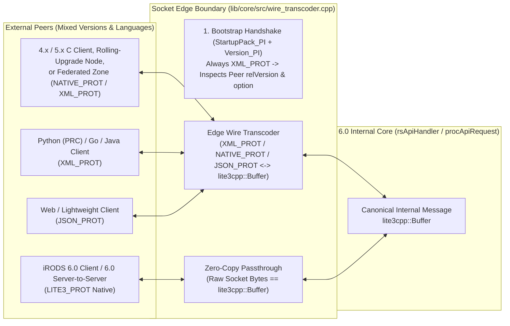

# Stage 20 Design Specification: `lite3-cpp` Core Integration & Edge Wire Transcoder (`LITE3_PROT` + Polyglot Boundary)

**Date**: 2026-10-25  
**Stage**: 20 of 23  
**Parent Roadmap**: [`2026-10-24-irods-nextgen-architecture-roadmap.md`](2026-10-24-irods-nextgen-architecture-roadmap.md)

---

## 1. Problem Statement & Motivation

In iRODS today, wire protocol concerns (`XML_PROT` and `NATIVE_PROT`) and runtime string-parsed packing instructions (`#define DataObjInp_PI "str objPath[MAX_NAME_LEN]; ..."`) in [`packStruct.cpp`](../../../lib/core/src/packStruct.cpp) leak across the entire architecture. At the same time, real-world iRODS deployments operate across **four distinct communication topologies**:
1. **Mixed Client Ecosystems**: Python (`python-irodsclient`), Java (`jargon`), and Go (`go-irodsclient`) clients speak `XML_PROT` directly on the socket, while 4.x/5.x C/C++ clients speak `NATIVE_PROT` or `XML_PROT`.
2. **Rolling Upgrades Within a Zone**: During a rolling upgrade from iRODS 5.x to 6.0, a 6.0 Catalog Service Provider communicates with 5.x Storage Resource Servers (or vice versa) via `svrToSvrConnect`.
3. **Cross-Zone Federation**: Independent organizations federate 6.0 zones with 4.3 or 5.x remote zones.
4. **Native 6.0-to-6.0 High-Speed Communication**: 6.0 clients, 6.0 server-to-server redirects, erasure coding plugins, Project Nucleus, and L3KV nodes communicating with 6.0 servers.

In Stage 20, we integrate **`lite3-cpp`** (`lite3cpp::Buffer` / `lite3cpp::Document`) into `lib/core` and introduce a **Hexagonal Edge Wire Transcoder** at the socket boundary (`sockComm.cpp`, `procApiRequest.cpp`, `rsApiHandler.cpp`):
- **`XML_PROT`, `NATIVE_PROT`, and `JSON_PROT` (`lite3_json`) are encapsulated 100% at the socket edge.**
- **Internally, every message crossing the socket boundary is delivered as a canonical `lite3cpp::Buffer`.**
- **When two 6.0 peers connect, they automatically negotiate `LITE3_PROT`**, streaming raw `lite3cpp::Buffer` bytes directly across the socket with **zero parsing, zero transcoding, and zero heap node allocations**.

---

## 2. Architecture & Data Flow



---

## 3. Component Design

### 3.1 Protocol Enumeration & Version-Aware Handshake Negotiation (`rodsDef.h` & `sockComm.cpp`)
Extend [`irodsProt_t`](../../../lib/core/include/irods/rodsDef.h#L130-L133) with `JSON_PROT` and `LITE3_PROT`:
```cpp
typedef enum iRODSProtocol {
    NATIVE_PROT = 0, // Legacy binary struct packing (4.x / 5.x compatibility)
    XML_PROT    = 1, // Legacy XML packing (PRC, Jargon, Go, & handshake bootstrap)
    JSON_PROT   = 2, // UTF-8 JSON framing via lite3cpp::lite3_json
    LITE3_PROT  = 3  // iRODS 6.0 Zero-Copy / Zero-Parse lite3cpp::Buffer B-Tree wire format
} irodsProt_t;
```
- **Universal Bootstrap**:
  - `StartupPack_PI` (`RODS_CONNECT_T`), `CS_NEG`, and `Version_PI` (`RODS_VERSION_T`) remain framed in `XML_PROT` so any 4.x, 5.x, or 6.0 peer can always complete the initial connection handshake and exchange `version_t` (`relVersion`, `apiVersion`).
- **Automatic Protocol Upgrade (`connectToRhost` & `initRsCommWithStartupPack`)**:
  - After the handshake completes, if both `cliVersion.relVersion` and `svrVersion->relVersion` are `>= 6.0` (e.g. `"rods6."`), the session automatically upgrades `irodsProt` to **`LITE3_PROT`** (unless explicitly pinned to `JSON_PROT` or `XML_PROT` via environment configuration).
  - If the peer is `rods4.*` or `rods5.*` (a federated 4.3/5.x zone, a 5.x server during a rolling upgrade, or a Python/Go/Java client), the session remains on the peer's `XML_PROT` or `NATIVE_PROT`, activating the Edge Wire Transcoder on that socket.

### 3.2 The Edge Wire Transcoder (`lib/core/include/irods/wire_transcoder.hpp` & `lib/core/src/wire_transcoder.cpp`)
Provide a single boundary layer invoked by `readMsgBody` / `sendRodsMsg`:
```cpp
namespace irods::wire {

// Ingress: Convert wire bytes from any protocol into a canonical lite3cpp::Buffer
auto decode_to_lite3(std::span<const std::byte> wire_bytes,
                     std::string_view pack_instruct_name,
                     irodsProt_t wire_prot,
                     std::string_view peer_version) -> irods::expected<lite3cpp::Buffer, int>;

// Egress: Convert a canonical lite3cpp::Buffer into wire bytes for the peer's protocol
auto encode_from_lite3(const lite3cpp::Buffer& msg_buf,
                       std::string_view pack_instruct_name,
                       irodsProt_t wire_prot,
                       std::string_view peer_version) -> irods::expected<bytesBuf_t*, int>;

} // namespace irods::wire
```
1. **`wire_prot == LITE3_PROT` (Zero-Copy / Zero-Parse Fast Path)**:
   - `decode_to_lite3`: Wraps `wire_bytes` directly into `lite3cpp::Buffer(reinterpret_cast<const uint8_t*>(wire_bytes.data()), wire_bytes.size())` in $O(1)$ time with zero parsing!
   - `encode_from_lite3`: Copies/views `msg_buf.data()` and `msg_buf.size()` directly into the outbound network buffer.
2. **`wire_prot == JSON_PROT`**:
   - Uses `lite3cpp::lite3_json::from_json_string` on ingress and `lite3cpp::lite3_json::to_json_string` on egress.
3. **`wire_prot == XML_PROT` or `NATIVE_PROT` (4.x / 5.x Compatibility Adapter)**:
   - Uses the schema-driven `RodsPackTable` walker inside `wire_transcoder.cpp` to translate `XML_PROT` tags or `NATIVE_PROT` binary fields directly into `lite3cpp::Buffer` B-Tree keys (`set_str`, `set_i64`, `set_f64`, `set_bytes`, `set_obj`, `set_arr`) on ingress, and emits `XML_PROT` or `NATIVE_PROT` from the `lite3cpp::Buffer` keys on egress.

---

## 4. Verification & Testing Plan

1. **Unit & Cross-Protocol Round-Trip Tests (`unit_tests/src/test_lite3_wire_transcoder.cpp`)**:
   - Verify lossless round-trip transcoding (`XML_PROT` $\leftrightarrow$ `lite3cpp::Buffer`, `NATIVE_PROT` $\leftrightarrow$ `lite3cpp::Buffer`, `JSON_PROT` $\leftrightarrow$ `lite3cpp::Buffer`, and zero-parse `LITE3_PROT` passthrough) across all core iRODS packing instructions (`DataObjInp_PI`, `OpenedDataObjInp_PI`, `CollInp_PI`, `KeyValPair_PI`, `GenQueryInp_PI`, `GenQueryOut_PI`, `Genquery2Input_PI`, `ModAVUMetadataInp_PI`, `RodsObjStat_PI`).
   - Verify version-aware protocol negotiation for simulated `rods4.3.2`, `rods5.0.0`, and `rods6.0.0` peers.
2. **Dialectic CPG Gate**:
   - Pass [`scripts/verify_refactoring.sh`](../../../scripts/verify_refactoring.sh) with 0 concurrency violations and 0 typestate violations.
