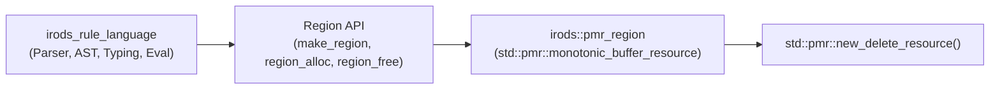

# Stage 20 Design Specification: `std::pmr` Arena Migration & Legacy `Region` Allocator Retirement

**Date**: 2026-10-24  
**Stage**: 20 of 23  
**Parent Roadmap**: [`2026-10-24-irods-nextgen-architecture-roadmap.md`](file:///home/darkfell/dev/irods/docs/superpowers/specs/2026-10-24-irods-nextgen-architecture-roadmap.md)

---

## 1. Problem Statement & Motivation

In Stage 12, we migrated `fixed_buffer_resource.hpp`, `capped_memory_resource.hpp`, and `irods_delay_queue.hpp` from `boost::container::pmr` to C++17 `<memory_resource>` (`std::pmr`).

However, the Native Rule Engine (`plugins/rule_engines/irods_rule_language/`) and `lib/core` still rely on a legacy custom C arena allocator defined in [`lib/core/include/irods/region.h`](file:///home/darkfell/dev/irods/lib/core/include/irods/region.h) and [`lib/core/src/region.cpp`](file:///home/darkfell/dev/irods/lib/core/src/region.cpp):
- `Region` embeds a `<setjmp.h>` `jmp_buf* label` (the last remaining `<setjmp.h>` include in `lib/core/include/`).
- Every allocation prepends a 24-byte `RegionDesc` header (`CACHE_SIZE(RegionDesc, 1)`) using manual 8-byte alignment macros (`roundToAlignment`), violating `alignof(std::max_align_t)` (16 bytes on x86_64) and causing unaligned access UB for 16-byte aligned types.
- `region_node` chains manual `malloc` blocks and zeroes them on allocation and free.

Replacing `Region` with a C++17 `std::pmr::monotonic_buffer_resource`-backed implementation eliminates custom allocator bugs, restores proper `alignof(std::max_align_t)` alignment, removes `<setjmp.h>` from `region.h`, and enables zero-overhead arena resets in pooled agent workers.

---

## 2. Architecture & Component Design



### 2.1 `Region` Backed by `std::pmr::monotonic_buffer_resource`
- Replace the internal linked list of `struct region_node` and `<setjmp.h>` in [`region.h`](file:///home/darkfell/dev/irods/lib/core/include/irods/region.h) and [`region.cpp`](file:///home/darkfell/dev/irods/lib/core/src/region.cpp) with a C++17 `std::pmr::monotonic_buffer_resource`:
  ```cpp
  struct region {
      std::pmr::monotonic_buffer_resource arena;
      std::size_t total_allocated{0};
      struct region_error error{};

      explicit region(std::size_t initial_size)
          : arena(initial_size > 0 ? initial_size : DEFAULT_BLOCK_SIZE,
                  std::pmr::new_delete_resource())
      {}
  };
  using Region = struct region;
  ```
- **Removing `<setjmp.h>`**:
  - Change `Region* make_region(size_t is, jmp_buf* label)` to `Region* make_region(size_t is = 0, void* unused_label = nullptr)` (all callers in `irods_rule_language` already pass `nullptr` for `label`!).
  - Remove `#include <setjmp.h>` from [`region.h`](file:///home/darkfell/dev/irods/lib/core/include/irods/region.h).
- **16-Byte Safe Alignment (`REGION_ALIGNMENT`)**:
  - Update `REGION_ALIGNMENT` from `8` to `alignof(std::max_align_t)` (`16` on x86_64) and allocate from `r->arena.allocate(alloc_size, alignof(std::max_align_t))`.
  - Maintain the lightweight `RegionDesc` prefix (`IN_REGION(x, r)` and `SIZE(x)`) used by the rule engine garbage collector/copying collector (`cp.cpp`) while delegating all block management and O(1) bulk deallocation (`r->arena.release()`) to `std::pmr::monotonic_buffer_resource`.

---

## 3. Error Handling & Memory Safety

- `make_region` catches `std::bad_alloc` and returns `nullptr` so C callers checking `if (!r)` behave identically.
- `region_alloc` catches `std::bad_alloc` and returns `nullptr` while zero-initializing the returned memory block (`std::memset(mem, 0, alloc_size)`) to preserve existing zero-fill semantics expected by the rule engine AST constructors.
- `region_free(Region* r)` simply executes `delete r;` (which invokes `monotonic_buffer_resource::~monotonic_buffer_resource()`, releasing all arena chunks in O(chunks) time).

---

## 4. Verification & Testing Plan

1. **Unit Tests (`unit_tests/src/test_pmr_region.cpp`)**:
   - Verify `make_region`, `region_alloc`, `region_size`, `IN_REGION`, `SIZE`, and `region_free` across small, medium, and large (>64 KB) allocations.
   - Verify 16-byte pointer alignment (`reinterpret_cast<std::uintptr_t>(ptr) % alignof(std::max_align_t) == 0`) for all returned pointers.
2. **Dialectic CPG Gate**:
   - Pass [`scripts/verify_refactoring.sh`](file:///home/darkfell/dev/irods/scripts/verify_refactoring.sh) with 0 concurrency violations and 0 typestate violations.
