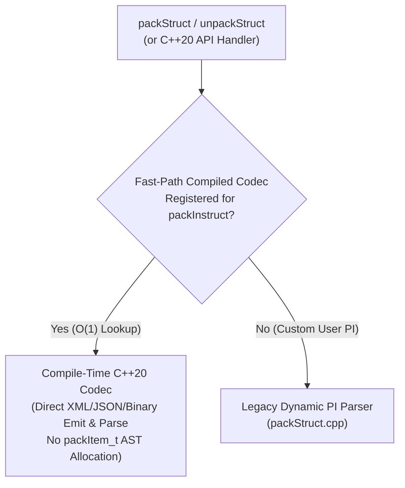

# Stage 21 Design Specification: Modern C++20 Wire Serialization & `packStruct` Reflection Replacement

**Date**: 2026-10-24  
**Stage**: 21 of 23  
**Parent Roadmap**: [`2026-10-24-irods-nextgen-architecture-roadmap.md`](file:///home/darkfell/dev/irods/docs/superpowers/specs/2026-10-24-irods-nextgen-architecture-roadmap.md)

---

## 1. Problem Statement & Motivation

[`lib/core/src/packStruct.cpp`](file:///home/darkfell/dev/irods/lib/core/src/packStruct.cpp) (3,490+ lines) serializes API inputs and outputs by parsing domain-specific instruction strings at runtime on every RPC call:
```c
#define DataObjInp_PI "str objPath[MAX_NAME_LEN]; int createMode; int openFlags; double offset; double dataSize; int numThreads; int oprType; struct *SpecColl_PI; struct KeyValPair_PI;"
```
This design has three severe costs:
1. **CPU Overhead**: Every `packStruct` / `unpackStruct` call allocates and builds a dynamic parse tree (`packItem_t` linked lists) by tokenizing `*_PI` strings at runtime, then formats or parses verbose custom XML (`<DataObjInp_PI><objPath>...</objPath>...</DataObjInp_PI>`).
2. **Type Unsafety (`void*`)**: All API table entries pass `void*` structs paired with a `const char* packInstruct`, preventing compile-time verification that the C++ struct layout actually matches the `*_PI` string.
3. **Manual C Pointer Graphs**: Unpacking allocates raw `malloc` trees that require manual `clearKeyVal`, `clearBBuf`, and `freeAllDataObjInfo` calls.

In Stage 21, we introduce a **compile-time C++20 serialization and reflection layer (`irods::serialization`)** that supports both zero-overhead binary/JSON framing for modern C++20 API types and fast-path compiled codec dispatch for core iRODS structs (`DataObjInp`, `CollInp`, `GenQuery2Input`, `KeyValPair`, `BytesBuf`) without runtime `*_PI` string parsing.

---

## 2. Architecture & Component Design



### 2.1 Compile-Time Codec Registry (`lib/core/include/irods/serialization/compiled_pack.hpp`)
- Provide a compile-time descriptor and fast-path codec table keyed by `std::string_view` (`packInstruct` name, e.g., `"DataObjInp_PI"`, `"KeyValPair_PI"`, `"Genquery2Input_PI"`, `"CollInp_PI"`, `"OpenedDataObjInp_PI"`, `"ModAVUMetadataInp_PI"`).
- When `packStruct` or `unpackStruct` is called with `XML_PROT` or `NATIVE_PROT`:
  1. Look up the `piName` in the `constexpr` / `ankerl::unordered_dense` compiled codec table.
  2. If found, serialize or deserialize the struct directly using C++20 compile-time member descriptors (`fmt::format_to` into a pre-sized buffer for serialization, and zero-copy `std::string_view` tag scanning for deserialization)—completely bypassing `parsePackInstruct`, `alignPackedOutput`, and `packItem_t` heap allocations!
  3. Fall back to the dynamic `packStruct` interpreter only for dynamic/user-defined microservice packing instructions.

### 2.2 C++20 Value-Semantic Serialization Traits (`irods::serialization::codec<T>`)
- For modern C++20 API endpoints, provide `irods::serialization::codec<T>` supporting direct `nlohmann::json` and binary framing into `bytesBuf_t` without any `*_PI` string definition.

---

## 3. Performance & Safety Guarantees

- **Zero `packItem_t` Heap Allocations on Hot RPCs**: `rcDataObjOpen`, `rcDataObjRead`, `rcDataObjWrite`, `rcDataObjClose`, `rcObjStat`, `rxGenQuery2`, `rcModAVUMetadata`, and `rcCollCreate` bypass dynamic instruction-string parsing completely.
- **100% Wire Compatibility**: The compiled XML/Native codecs emit and consume the exact byte-for-byte framing expected by `XML_PROT` and `NATIVE_PROT` peers.

---

## 4. Verification & Testing Plan

1. **Unit & Round-Trip Tests (`unit_tests/src/test_compiled_pack_codecs.cpp`)**:
   - Verify byte-for-byte equivalence between the compiled C++20 codecs and the legacy dynamic `packStruct` parser across `DataObjInp`, `OpenedDataObjInp`, `CollInp`, `KeyValPair`, `Genquery2Input`, and `ModAVUMetadataInp` for both `XML_PROT` and `NATIVE_PROT` (including XML entity escaping of `&`, `<`, `>`, `'`, `"`, `` ` ``).
2. **Dialectic CPG Gate**:
   - Pass [`scripts/verify_refactoring.sh`](file:///home/darkfell/dev/irods/scripts/verify_refactoring.sh) with 0 concurrency violations and 0 typestate violations.
