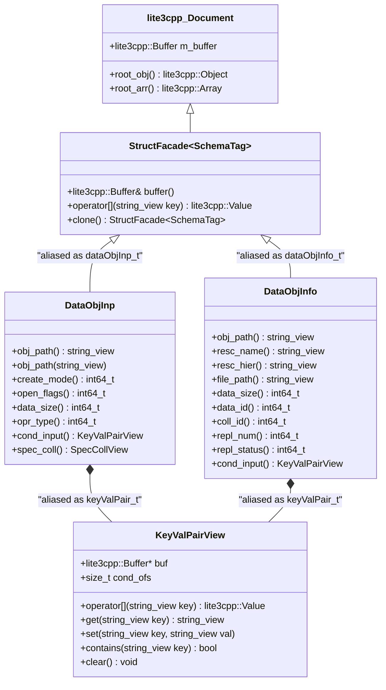

# Stage 21 Design Specification: Universal `lite3cpp::Buffer` Internal Data Structures with Type Aliasing

**Date**: 2026-10-25  
**Stage**: 21 of 23  
**Parent Roadmap**: [`2026-10-24-irods-nextgen-architecture-roadmap.md`](2026-10-24-irods-nextgen-architecture-roadmap.md)

---

## 1. Problem Statement & Motivation

Once Stage 20 encapsulates `XML_PROT`, `NATIVE_PROT`, and `JSON_PROT` inside the Edge Wire Transcoder and delivers every network message as a `lite3cpp::Buffer`, the remaining bottleneck inside `lib/core`, `server/`, `clients/`, and `plugins/` is the legacy C struct layer itself:
- **`dataObjInp_t`, `collInp_t`, `dataObjInfo_t`, `rodsObjStat_t`, `modAVUMetadataInp_t`, etc.** are C structs with fixed-size `char[MAX_NAME_LEN]` arrays (wasting kilobytes of stack/heap space and risking silent `rstrcpy` truncation) and raw owning pointers (`keyValPair_t condInput`, `specColl_t* specColl`, `dataObjInfo_t* next`).
- **`keyValPair_t`** is a C struct of two `malloc`'d `char**` arrays (`keyWord` and `value`) requiring linear $O(K)$ `strcmp` scans (`getValByKey`), `strdup` allocations (`addKeyVal`), and manual `clearKeyVal` scope guards in hundreds of functions.
- **`dataObjInfo_t*`** is a singly-linked list of heap-allocated 3 KB structs requiring manual `freeAllDataObjInfo` cleanup and expensive pointer-graph cloning (`replDataObjInfo`).
- **`irods_re_serialization.cpp`** must convert all of these C structs and pointers into `std::map<std::string, std::string>` on every dynamic PEP rule engine invocation.

In Stage 21, we convert **all internal passed data structures** into **`lite3cpp::Buffer` / `lite3cpp::Object`-backed C++20 facades**, preserving code readability and compile-time type safety via **domain type aliases** (`using dataObjInp_t = irods::protocol::DataObjInp;`, `using keyValPair_t = irods::protocol::KeyValPair;`, `using dataObjInfo_t = irods::protocol::DataObjInfo;`).

---

## 2. Architecture & Type-Aliased `lite3cpp::Buffer` Design



---

## 3. Component Design

### 3.1 Core Template Facade & Type Aliases (`lib/core/include/irods/protocol/lite3_structs.hpp`)
Every iRODS domain structure is a strongly-typed facade over a `lite3cpp::Buffer` (either owning its own `lite3cpp::Buffer` when constructed on the stack, or referencing a sub-object offset `size_t ofs` inside a parent `lite3cpp::Buffer`):

```cpp
namespace irods::protocol {

template <typename Tag>
class struct_buffer {
public:
    struct_buffer() {
        buf_.init_object();
    }
    explicit struct_buffer(lite3cpp::Buffer buf, std::size_t root_ofs = 0) noexcept
        : buf_(std::move(buf)), ofs_(root_ofs) {}

    // Zero-cost deep copy (single contiguous vector copy, no pointer chasing!)
    struct_buffer(const struct_buffer&) = default;
    struct_buffer(struct_buffer&&) noexcept = default;
    struct_buffer& operator=(const struct_buffer&) = default;
    struct_buffer& operator=(struct_buffer&&) noexcept = default;
    ~struct_buffer() = default;

    auto buffer() noexcept -> lite3cpp::Buffer& { return buf_; }
    auto buffer() const noexcept -> const lite3cpp::Buffer& { return buf_; }
    auto offset() const noexcept -> std::size_t { return ofs_; }

    auto operator[](std::string_view key) -> lite3cpp::Value {
        return lite3cpp::Value(&buf_, ofs_)[key];
    }

protected:
    lite3cpp::Buffer buf_;
    std::size_t ofs_{0};
};

} // namespace irods::protocol

// Domain Type Aliases (preserving 100% readability across server, client, and plugins):
using keyValPair_t        = irods::protocol::KeyValPair;
using dataObjInp_t        = irods::protocol::DataObjInp;
using openedDataObjInp_t  = irods::protocol::OpenedDataObjInp;
using dataObjCopyInp_t    = irods::protocol::DataObjCopyInp;
using collInp_t           = irods::protocol::CollInp;
using dataObjInfo_t       = irods::protocol::DataObjInfo;
using rodsObjStat_t       = irods::protocol::RodsObjStat;
using modAVUMetadataInp_t = irods::protocol::ModAVUMetadataInp;
using authPlugReqInp_t    = irods::protocol::AuthPlugReqInp;
using execCmd_t           = irods::protocol::ExecCmdInp;
using execCmdOut_t        = irods::protocol::ExecCmdOut;
```

### 3.2 `keyValPair_t` as a Zero-Copy `lite3cpp::Buffer` B-Tree Sub-Object
- Instead of `char** keyWord` and `char** value`, `keyValPair_t` (`irods::protocol::KeyValPair`) is a `lite3cpp::Object` B-Tree node inside the buffer:
  - **Lookup (`getValByKey` / `condInput[KW]`)**: Uses `lite3cpp::Buffer::get_str(cond_ofs, kw)`, performing an $O(\log K)$ hash-indexed B-Tree lookup and returning a zero-copy `std::string_view` (`const char*` null-terminated in the buffer).
  - **Insertion/Mutation (`addKeyVal` / `condInput[KW] = val`)**: Mutates the B-Tree in-place via `lite3cpp::Buffer::set_str(cond_ofs, kw, val)` with zero `strdup` allocations.
  - **Teardown (`clearKeyVal`)**: Becomes a no-op (or `buf.clear()` for standalone maps), eliminating every `clearKeyVal` scope guard in the repository!

### 3.3 Replacing `dataObjInfo_t*` Linked Lists with Contiguous `lite3cpp::Array`
- Replace `dataObjInfo_t* next` linked lists with `irods::protocol::DataObjInfoList` (backed by a single contiguous `lite3cpp::Buffer` array or `std::vector<dataObjInfo_t>`).
- `freeAllDataObjInfo` is completely retired; replica lists are RAII value objects that free their single contiguous buffer automatically when they leave scope.
- `replDataObjInfo` / `replDataObjInp` / `replKeyVal` become simple `std::memcpy` buffer copies (`dst = src;`).

### 3.4 Direct `lite3cpp::Buffer` Dispatch in `rsApiHandler`, `procApiRequest`, & Dynamic PEP Hooks
1. **Zero-Unpack API Dispatch**:
   - In `rsApiHandler` (`server/core/src/rsApiHandler.cpp`), the `lite3cpp::Buffer` produced by the Stage 20 Edge Wire Transcoder is wrapped directly in the target `irods::protocol::struct_buffer<Tag>` and passed to the API handler—**zero `unpack_struct` and zero `pack_struct` calls inside `rsApiHandler` or `procApiRequest`!**
2. **Server-to-Server Redirect (`svrToSvrConnect`)**:
   - When a Catalog Provider resolves `RESC_HIER_STR_KW` and redirects to a Storage Consumer, it sets `dataObjInp.cond_input()[RESC_HIER_STR_KW] = resc_hier;` **in-place** in the `lite3cpp::Buffer` and sends the buffer straight across the socket.
3. **Retirement of `irods_re_serialization.cpp`**:
   - Dynamic PEP rule engine plugins receive `lite3cpp::Buffer&` / `irods::protocol::struct_buffer` directly and inspect or mutate any field (`inp["objPath"]`, `inp["condInput"]["resc_hier"]`) in-place without C-pointer serialization registries.

---

## 4. Phased Execution Within Stage 21

To keep each commit verifiable through the CPG gate:
- **Task 1**: Implement `irods::protocol::struct_buffer<Tag>`, `KeyValPair` (`keyValPair_t`), and `SpecColl` (`specColl_t`) over `lite3cpp::Buffer`, with inline transitional compatibility helpers for `addKeyVal`, `getValByKey`, `rmKeyVal`, `replKeyVal`, and `clearKeyVal`.
- **Task 2**: Convert `dataObjInp_t`, `openedDataObjInp_t`, `dataObjCopyInp_t`, `collInp_t`, and `rodsObjStat_t` to type-aliased `lite3cpp::Buffer` facades and wire them directly into `rsApiHandler` and `procApiRequest`.
- **Task 3**: Convert `dataObjInfo_t` (and replica lists) plus `modAVUMetadataInp_t`, `execCmd_t`, and remaining API structs to `lite3cpp::Buffer` facades, and retire `irods_re_serialization` C-pointer converters.

---

## 5. Verification & Testing Plan

1. **Unit Tests (`unit_tests/src/test_lite3_internal_structs.cpp`)**:
   - Verify `dataObjInp_t`, `collInp_t`, `dataObjInfo_t`, and `keyValPair_t` construction, in-place `condInput` mutation, zero-copy `std::string_view` observers, O(1)/contiguous deep copy, and wire round-tripping through the Stage 20 Edge Transcoder.
2. **Dialectic CPG Gate**:
   - Pass [`scripts/verify_refactoring.sh`](../../../scripts/verify_refactoring.sh) with 0 concurrency violations and 0 typestate violations.
