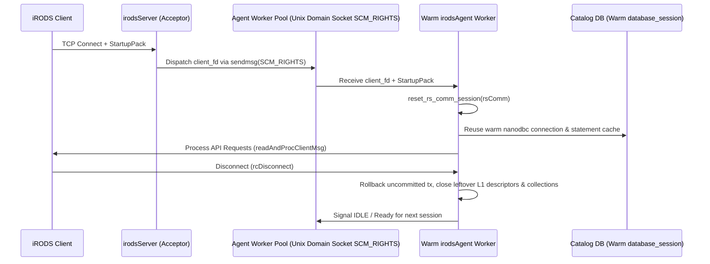

# Stage 22 Design Specification: Pooled / Asynchronous Agent Worker Architecture

**Date**: 2026-10-24  
**Stage**: 22 of 23  
**Parent Roadmap**: [`2026-10-24-irods-nextgen-architecture-roadmap.md`](file:///home/darkfell/dev/irods/docs/superpowers/specs/2026-10-24-irods-nextgen-architecture-roadmap.md)

---

## 1. Problem Statement & Motivation

Historically, the main iRODS server process (`rodsServer.cpp`) handled every incoming client connection by calling `fork()` to spawn a brand-new `irodsAgent` process, which then:
1. Loaded configuration files and initialized plugin managers (`dlopen`ing network, auth, database, resource, and rule engine plugins).
2. Opened a fresh TCP + ODBC database connection (`chlOpen`) to PostgreSQL/MySQL/Oracle.
3. Processed a single client session (`readAndProcClientMsg` loop) and called `exit()`.

While process isolation prevented memory leaks and global state corruption from affecting future connections in the legacy C codebase, it imposed a massive **15–50 ms connection setup penalty** and high database connection churn under short-lived client workloads.

Now that:
- **Stage 14** eliminated `setjmp`/`longjmp` and `alarm()` in [`rsApiHandler.cpp`](file:///home/darkfell/dev/irods/server/core/src/rsApiHandler.cpp),
- **Stage 18** retired the stateful GenQuery1 arrays (`general_query.cpp`),
- **Stage 19** added `reset_rs_comm_session(rsComm_t&)` for clean per-session state reset, and
- **Stage 20** moved rule engine arenas onto `std::pmr::monotonic_buffer_resource`,

an `irodsAgent` worker can safely **serve multiple sequential client sessions** in a persistent **Pre-Forked Agent Worker Pool** while keeping its plugin registries, rule engine caches, and [`database_session`](file:///home/darkfell/dev/irods/plugins/database/include/irods/private/database_session.hpp) (with prepared statement cache) warm across connections!

---

## 2. Architecture & Data Flow

---

## 3. Component Design

### 3.1 Agent Session Sanitizer (`server/core/include/irods/agent_session_sanitizer.hpp`)
Before a warm `irodsAgent` worker returns to the idle pool after a client disconnects, `sanitize_agent_session(rsComm_t& comm)` enforces complete session isolation:
1. **L1 File Descriptors (`L1desc`)**: Closes any leaked or unclosed `L1desc` entries (`freeL1desc` / replica close).
2. **Collection Handles (`CollHandle`)**: Closes any open collection slots (`rsCloseCollection`).
3. **Database Transaction State**: Calls `chlRollback(comm)` on the warm catalog connection to ensure no uncommitted transaction state carries over, while keeping the underlying [`database_session`](file:///home/darkfell/dev/irods/plugins/database/include/irods/private/database_session.hpp) and `statement_cache` connected and warm.
4. **Connection Handle Reset**: Invokes `reset_rs_comm_session(comm)` (from Stage 19) to scrub `clientUser`, `proxyUser`, `rError`, `auth_scheme`, and encryption secrets.

### 3.2 Unix Domain Socket FD Passing (`server/core/include/irods/agent_worker_pool.hpp`)
- Provide a clean `irods::server::agent_worker_pool` class using `socketpair(AF_UNIX, SOCK_STREAM, 0)` and `sendmsg`/`recvmsg` with `SCM_RIGHTS` ancillary data to pass accepted client socket descriptors from the acceptor to idle pre-forked workers.
- Configurable via `server_config.json` (`"agent_pool_size"`, `"max_sessions_per_agent"` with a default recycle threshold of e.g. 1,000 sessions per worker, or fallback to `"agent_pool_size": 0` for traditional `fork`-per-connection).

---

## 4. Verification & Testing Plan

1. **Unit Tests (`unit_tests/src/test_agent_worker_pool.cpp`)**:
   - Test `SCM_RIGHTS` file descriptor passing over `socketpair`.
   - Test `sanitize_agent_session` scrubbing `L1desc`, `CollHandle`, and `rsComm_t` user/error state across simulated multi-session reuse.
   - Test worker recycling after reaching `max_sessions_per_agent`.
2. **Dialectic CPG Gate**:
   - Pass [`scripts/verify_refactoring.sh`](file:///home/darkfell/dev/irods/scripts/verify_refactoring.sh) with 0 concurrency violations and 0 typestate violations.
