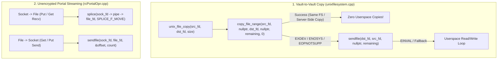

# Stage 23 Design Specification: Zero-Copy Kernel Data Plane (`copy_file_range`, `sendfile`, & `splice`)

**Date**: 2026-10-24  
**Stage**: 23 of 23  
**Parent Roadmap**: [`2026-10-24-irods-nextgen-architecture-roadmap.md`](2026-10-24-irods-nextgen-architecture-roadmap.md)

---

## 1. Problem Statement & Motivation

Despite the transport and `dstream` modernizations in Stage 2, iRODS data transfers still copy every byte through user-space buffers:
1. **Local Vault-to-Vault / Staging Copies (`unix_file_copy` in [`unixfilesystem.cpp`](../../../plugins/resources/unixfilesystem/src/unixfilesystem.cpp#L1125-L1205))**: Allocates a user-space `char* buf` (`trans_buff_size_for_parallel_transfer_in_megabytes`) and loops over `read(inFd, buf, ...)` + `write(outFd, buf, ...)`, causing two context switches and two kernel-to-userspace memory copies per chunk.
2. **Socket-to-File & File-to-Socket Portal Transfers ([`rcPortalOpr.cpp`](../../../lib/core/src/rcPortalOpr.cpp) & [`rsDataObjPut.cpp`](../../../server/api/src/rsDataObjPut.cpp) / [`rsDataObjGet.cpp`](../../../server/api/src/rsDataObjGet.cpp))**: Reads from socket into user-space buffer and writes to disk (or vice versa) even when `rbudp` / encryption is disabled (`encryption_key_size == 0`).

In Stage 23, we introduce a **Zero-Copy Kernel Data Plane (`irods::experimental::io::zero_copy`)** that leverages Linux kernel zero-copy syscalls (`copy_file_range`, `sendfile`, and `splice`) with automatic transparent fallback to user-space read/write when cross-filesystem (`EXDEV`) or kernel support limits are encountered.

---

## 2. Architecture & Data Flow

---

## 3. Component Design

### 3.1 Zero-Copy Kernel Primitives (`lib/core/include/irods/zero_copy_io.hpp` & `lib/core/src/zero_copy_io.cpp`)
Provide three composable, `EINTR`-resilient C++20 functions:
1. **`irods::io::copy_file_ descriptors(int in_fd, int out_fd, std::int64_t count) noexcept -> std::int64_t`**:
   - First attempts `::copy_file_range(in_fd, nullptr, out_fd, nullptr, chunk, 0)` (which enables filesystem-level CoW/reflink or NFS/SMB server-side copy without even reading blocks into page cache when supported).
   - If `copy_file_range` returns `-1` with `EXDEV`, `ENOSYS`, `EOPNOTSUPP`, or `EINVAL`, falls back to `::sendfile(out_fd, in_fd, nullptr, chunk)` (which copies between page cache and target FD inside the kernel without user-space buffer copies).
   - If `sendfile` is unsupported for the descriptor pair, falls back to an aligned user-space buffer loop.
2. **`irods::io::sendfile_to_socket(int sock_fd, int file_fd, std::int64_t count) noexcept -> std::int64_t`**:
   - Uses `::sendfile(sock_fd, file_fd, nullptr, chunk)` in a loop handling partial transfers and `EINTR`.
3. **`irods::io::splice_from_socket(int sock_fd, int file_fd, std::int64_t count) noexcept -> std::int64_t`**:
   - Creates a thread-local or per-transfer kernel pipe (`pipe2(pfd, O_CLOEXEC)`) guarded by `irods::at_scope_exit` and loops over `::splice(sock_fd, nullptr, pfd[1], nullptr, chunk, SPLICE_F_MOVE | SPLICE_F_MORE)` followed by `::splice(pfd[0], nullptr, file_fd, nullptr, spliced, SPLICE_F_MOVE | SPLICE_F_MORE)`.

### 3.2 Integration into `unixfilesystem.cpp` and `rcPortalOpr.cpp`
- **`plugins/resources/unixfilesystem/src/unixfilesystem.cpp` (`unix_file_copy`)**:
  - Replace the manual `std::vector<char>` user-space `read`/`write` loop with `irods::io::copy_file_descriptors(inFd, outFd, statbuf.st_size)`.
- **`lib/core/src/rcPortalOpr.cpp` (`putFileToPortalRbudp` / `getFileFromPortal` / unencrypted TCP portal workers)**:
  - When `encryption_key_size == 0` (unencrypted portal stream) and `file_fd` is a local OS file descriptor, use `sendfile_to_socket` and `splice_from_socket`.

---

## 4. Verification & Testing Plan

1. **Unit Tests (`unit_tests/src/test_zero_copy_io.cpp`)**:
   - Test `copy_file_descriptors` across empty files, small files, and multi-megabyte files, verifying SHA-256 / byte-for-byte identity.
   - Test `sendfile_to_socket` and `splice_from_socket` over a local `socketpair(AF_UNIX, SOCK_STREAM, 0)` between temporary files, verifying exact byte transfer and zero descriptor leaks.
2. **Dialectic CPG Gate**:
   - Pass [`scripts/verify_refactoring.sh`](../../../scripts/verify_refactoring.sh) with 0 concurrency violations and 0 typestate violations.
