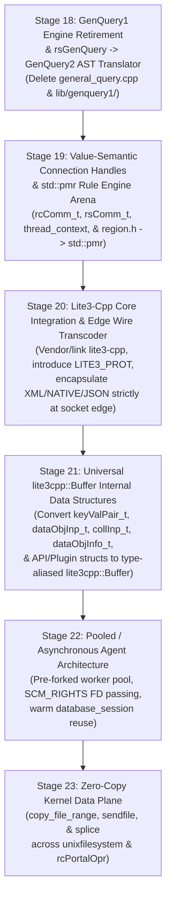

# Phase III: iRODS Next-Generation Architecture Designs (Stages 18–23)

> [!IMPORTANT]
> All specification documents have been updated in `/home/darkfell/dev/irods/docs/superpowers/specs/` on the `irods6` branch to reflect the **Lite3-Core / Edge-Transcoder Architecture** (Stage 20) and **Universal `lite3cpp::Buffer` Internal Data Structures with Type Aliasing** (Stage 21).

---

## 1. Master Dependency & Execution Sequence

- **Master Roadmap**: [`2026-10-24-irods-nextgen-architecture-roadmap.md`](2026-10-24-irods-nextgen-architecture-roadmap.md)

---

## 2. Summary of the 6 Stage Specifications

### Stage 18: Legacy GenQuery1 Engine Retirement & `rsGenQuery` $\rightarrow$ GenQuery2 AST Translator
- **Spec**: [`2026-10-24-stage18-genquery1-retirement-design.md`](2026-10-24-stage18-genquery1-retirement-design.md)
- **Design**:
  - Introduces `genquery1_to_genquery2_ast(const genQueryInp_t&)` in `lib/core/src/genquery1_ast_adapter.cpp` to translate legacy `COL_*` column IDs, aggregate bitflags (`SELECT_MIN`/`MAX`/`SUM`/`AVG`/`COUNT`), `ORDER_BY`/`ORDER_BY_DESC` flags, and `sqlCondInp` condition strings (`=`, `like`, `in`, `between`, `&&`, `||`) directly into a `irods::experimental::genquery2::select` AST.
  - Routes [`_rsGenQuery`](../../../server/api/src/rsGenQuery.cpp) through the GenQuery2 SQL translator and `rows_to_genquery_out` while preserving `acPreProcForGenQuery` / `acPostProcForGenQuery` rule hooks.
  - **Deletions**: Deletes [`plugins/database/src/general_query.cpp`](../../../plugins/database/src/general_query.cpp) (2,651 lines), `general_query_setup.hpp`, and `lib/genquery1/`.

### Stage 19: Value-Semantic Connection Handles (`rcComm_t` / `rsComm_t`) & `std::pmr` Rule Engine Arena
- **Spec**: [`2026-10-24-stage19-raii-connection-handles-design.md`](2026-10-24-stage19-raii-connection-handles-design.md)
- **Design**:
  - Converts [`thread_context`](../../../lib/core/include/irods/irods_threads.hpp) from raw owning pointers (`std::thread*`, `std::mutex*`, `std::condition_variable*`) to direct value members with an automatic destructor that joins `reconnThr`.
  - Upgrades [`rcComm_t`](../../../lib/core/include/irods/rcConnect.h#L82-L126) and [`rsComm_t`](../../../lib/core/include/irods/rcConnect.h#L134-L185) to C++ value-initialized structs with `~RcComm()` / `~RsComm()` destructors and `reset_rs_comm_session(rsComm_t&)` for session reuse.
  - Replaces the custom linked-list C allocator and `<setjmp.h>` `jmp_buf*` in [`region.h`](../../../lib/core/include/irods/region.h) and [`region.cpp`](../../../lib/core/src/region.cpp) with `std::pmr::monotonic_buffer_resource` and 16-byte alignment (`alignof(std::max_align_t)`).

### Stage 20: `lite3-cpp` Core Integration & Edge Wire Transcoder (`LITE3_PROT` + Polyglot Boundary)
- **Spec**: [`2026-10-24-stage20-lite3-edge-wire-transcoder-design.md`](2026-10-24-stage20-lite3-edge-wire-transcoder-design.md)
- **Design**:
  - Integrates `lite3-cpp` (`lite3cpp::Buffer` / `lite3cpp::Document` / `lite3cpp::lite3_json`) into `lib/core`.
  - Extends `irodsProt_t` with `JSON_PROT` and `LITE3_PROT`. After the `StartupPack_PI` / `Version_PI` handshake completes, 6.0-to-6.0 connections automatically upgrade to **`LITE3_PROT`** (zero-parse, zero-copy `lite3cpp::Buffer` streaming), while 4.x/5.x C clients, rolling-upgrade nodes, federated zones, and Python/Go/Java clients stay on `XML_PROT` or `NATIVE_PROT`.
  - Encapsulates `XML_PROT`, `NATIVE_PROT`, and `JSON_PROT` strictly inside the **Edge Wire Transcoder** (`lib/core/src/wire_transcoder.cpp`) at the socket boundary so that internally every network message is a canonical `lite3cpp::Buffer`.

### Stage 21: Universal `lite3cpp::Buffer` Internal Data Structures with Type Aliasing
- **Spec**: [`2026-10-24-stage21-lite3-internal-data-structures-design.md`](2026-10-24-stage21-lite3-internal-data-structures-design.md)
- **Design**:
  - Converts all internal passed data structures (`keyValPair_t`, `dataObjInp_t`, `openedDataObjInp_t`, `dataObjCopyInp_t`, `collInp_t`, `dataObjInfo_t`, `rodsObjStat_t`, `modAVUMetadataInp_t`, `execCmd_t`, etc.) into strongly-typed `lite3cpp::Buffer` / `lite3cpp::Object` facades (`irods::protocol::struct_buffer<Tag>`) with domain type aliases (`using dataObjInp_t = irods::protocol::DataObjInp;`) to preserve readability.
  - Replaces `keyValPair_t` (`char** keyWord`, `char** value`) with a hash-indexed `lite3cpp::Object` B-Tree sub-object ($O(\log K)$ zero-copy `std::string_view` lookups, in-place mutation, and zero `clearKeyVal` scope guards).
  - Replaces `dataObjInfo_t* next` heap linked lists with contiguous `lite3cpp::Array` buffers (`DataObjInfoList`), retiring `freeAllDataObjInfo` and turning `replDataObjInfo` into a single contiguous buffer copy.
  - Eliminates C-pointer serialization registries in `irods_re_serialization.cpp` by passing `lite3cpp::Buffer` directly to dynamic PEP hooks and server-to-server redirects.

### Stage 22: Pooled / Asynchronous Agent Worker Architecture
- **Spec**: [`2026-10-24-stage22-pooled-async-agent-design.md`](2026-10-24-stage22-pooled-async-agent-design.md)
- **Design**:
  - Introduces `irods::server::agent_worker_pool` using Unix domain sockets (`SCM_RIGHTS` FD passing) and `sanitize_agent_session(rsComm_t&)` to scrub `L1desc`, `CollHandle`, uncommitted catalog transactions (`chlRollback`), and `rsComm_t` credentials between sessions.
  - Allows pre-forked `irodsAgent` workers to serve sequential client connections with warm plugin registries and warm [`database_session`](../../../plugins/database/include/irods/private/database_session.hpp) statement caches.

### Stage 23: Zero-Copy Kernel Data Plane (`copy_file_range`, `sendfile`, & `splice`)
- **Spec**: [`2026-10-24-stage23-zero-copy-data-plane-design.md`](2026-10-24-stage23-zero-copy-data-plane-design.md)
- **Design**:
  - Introduces `irods::io::copy_file_descriptors` (`copy_file_range` $\rightarrow$ `sendfile` $\rightarrow$ userspace fallback), `irods::io::sendfile_to_socket`, and `irods::io::splice_from_socket` in `lib/core/include/irods/zero_copy_io.hpp`.
  - Integrates kernel zero-copy transfers into [`unix_file_copy`](../../../plugins/resources/unixfilesystem/src/unixfilesystem.cpp#L1125-L1205) and unencrypted portal transfers in [`rcPortalOpr.cpp`](../../../lib/core/src/rcPortalOpr.cpp).
