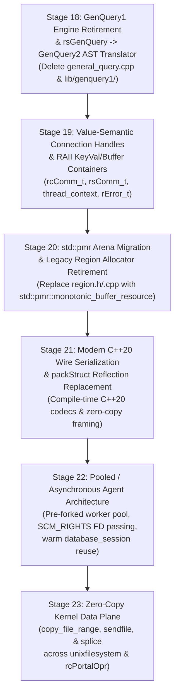

# Phase III: iRODS Next-Generation Architecture Designs (Stages 18–23)

> [!IMPORTANT]
> All 7 specification documents have been written and committed to `/home/darkfell/dev/irods/docs/superpowers/specs/` (`ff7f3d694`). Please review the architecture below and click **Proceed** (or share any adjustments) when you are ready to transition to implementation planning (`writing-plans`) and sequential execution starting with **Stage 18**.

---

## 1. Master Dependency & Execution Sequence

- **Master Roadmap**: [`2026-10-24-irods-nextgen-architecture-roadmap.md`](2026-10-24-irods-nextgen-architecture-roadmap.md)

---

## 2. Summary of the 6 Stage Specifications

### Stage 18: Legacy GenQuery1 Engine Retirement & `rsGenQuery` $\rightarrow$ GenQuery2 AST Translator
- **Spec**: [`2026-10-24-stage18-genquery1-retirement-design.md`](2026-10-24-stage18-genquery1-retirement-design.md)
- **Design**:
  - Introduces `genquery1_to_genquery2_ast(const genQueryInp_t&)` in `lib/core/src/genquery1_ast_adapter.cpp` to translate legacy `COL_*` column IDs, aggregate bitflags (`SELECT_MIN`/`MAX`/`SUM`/`AVG`/`COUNT`), `ORDER_BY`/`ORDER_BY_DESC` flags, and `sqlCondInp` condition strings (`=`, `like`, `in`, `between`, `&&`, `||`) directly into a `irods::experimental::genquery2::select` AST.
  - Routes [`_rsGenQuery`](../../../server/api/src/rsGenQuery.cpp) through the GenQuery2 SQL translator and `rows_to_genquery_out` while preserving `acPreProcForGenQuery` / `acPostProcForGenQuery` rule hooks.
  - **Deletions**: Deletes [`plugins/database/src/general_query.cpp`](../../../plugins/database/src/general_query.cpp) (2,651 lines), `general_query_setup.hpp`, and `lib/genquery1/`.

### Stage 19: Value-Semantic Connection Handles (`rcComm_t` / `rsComm_t`) & RAII Containers
- **Spec**: [`2026-10-24-stage19-raii-connection-handles-design.md`](2026-10-24-stage19-raii-connection-handles-design.md)
- **Design**:
  - Converts [`thread_context`](../../../lib/core/include/irods/irods_threads.hpp) from raw owning pointers (`std::thread*`, `std::mutex*`, `std::condition_variable*`) to direct value members with an automatic destructor that joins `reconnThr`.
  - Upgrades [`rcComm_t`](../../../lib/core/include/irods/rcConnect.h#L82-L126) and [`rsComm_t`](../../../lib/core/include/irods/rcConnect.h#L134-L185) to C++ value-initialized structs with `~RcComm()` / `~RsComm()` destructors and `reset_rs_comm_session(rsComm_t&)` for session reuse.

### Stage 20: `std::pmr` Arena Migration & Legacy `Region` Allocator Retirement
- **Spec**: [`2026-10-24-stage20-pmr-region-allocator-design.md`](2026-10-24-stage20-pmr-region-allocator-design.md)
- **Design**:
  - Replaces the custom linked-list C allocator and `<setjmp.h>` `jmp_buf*` in [`region.h`](../../../lib/core/include/irods/region.h) and [`region.cpp`](../../../lib/core/src/region.cpp) with `std::pmr::monotonic_buffer_resource`.
  - Upgrades `REGION_ALIGNMENT` from `8` to `alignof(std::max_align_t)` (16 bytes on x86_64) to eliminate unaligned access UB while preserving `IN_REGION` and `SIZE` macros for the rule engine.

### Stage 21: Modern C++20 Wire Serialization & `packStruct` Reflection Replacement
- **Spec**: [`2026-10-24-stage21-cpp20-wire-serialization-design.md`](2026-10-24-stage21-cpp20-wire-serialization-design.md)
- **Design**:
  - Adds a compile-time C++20 codec registry (`irods::serialization::compiled_pack`) for core hot-path API structs (`DataObjInp_PI`, `OpenedDataObjInp_PI`, `CollInp_PI`, `KeyValPair_PI`, `Genquery2Input_PI`, `ModAVUMetadataInp_PI`).
  - Bypasses runtime `parsePackInstruct` tokenization and `packItem_t` linked-list heap allocations on hot RPCs while maintaining 100% `XML_PROT` and `NATIVE_PROT` wire compatibility.

### Stage 22: Pooled / Asynchronous Agent Worker Architecture
- **Spec**: [`2026-10-24-stage22-pooled-async-agent-design.md`](2026-10-24-stage22-pooled-async-agent-design.md)
- **Design**:
  - Introduces `irods::server::agent_worker_pool` using Unix domain sockets (`SCM_RIGHTS` FD passing) and `sanitize_agent_session(rsComm_t&)` to scrub `L1desc`, `CollHandle`, uncommitted catalog transactions (`chlRollback`), and `rsComm_t` credentials between sessions.
  - Allows pre-forked `irodsAgent` workers to serve sequential client connections with warm plugin registries and warm [`database_session`](../../../plugins/database/include/irods/private/database_session.hpp) statement caches.

### Stage 23: Zero-Copy Kernel Data Plane (`copy_file_range`, `sendfile`, & `splice`)
- **Spec**: [`2026-10-24-stage23-zero-copy-data-plane-design.md`](2026-10-24-stage23-zero-copy-data-plane-design.md)
- **Design**:
  - Introduces `irods::io::copy_file_descriptors` (`copy_file_range` $\rightarrow$ `sendfile` $\rightarrow$ userspace fallback), `irods::io::sendfile_to_socket`, and `irods::io::splice_from_socket` in `lib/core/include/irods/zero_copy_io.hpp`.
  - Integrates kernel zero-copy transfers into [`unix_file_copy`](../../../plugins/resources/unixfilesystem/src/unixfilesystem.cpp#L1125-L1205) and unencrypted portal transfers in [`rcPortalOpr.cpp`](../../../lib/core/src/rcPortalOpr.cpp).
