# iRODS Modernization Retrospective (Stages 0–17) & Future Directions

> [!IMPORTANT]
> **100% Roadmap Completion**: Over the course of **Stages 0 through 17** across `/home/darkfell/dev/irods`, we have completed the entire [iRODS Master Modernization Roadmap](2026-10-23-irods-master-modernization-roadmap.md)—systematically transforming iRODS's catalog/database layer, query engine, filesystem, transport, collection driver, plugin/FCO framework, C++17/20 standard library usage, client utilities, iCommands, server core/API handlers, rule engine, plugins, and core networking/packing primitives. Every stage has been verified through the 4-Phase Dialectic CPG Verification Gate ([`scripts/verify_refactoring.sh`](../../../scripts/verify_refactoring.sh)).

---

## 1. Architectural Evolution Overview (Stages 0–17)

```mermaid
flowchart TD
    subgraph Phase1["Phase I: Foundational Subsystem Re-Architecture (Stages 0–11)"]
        S0["Stage 0: Database & ICAT Layer\n(nanodbc_executor, database_session,\nSQLi & Raw ODBC Eradication)"]
        S1["Stage 1: irods::filesystem\n(Zero-copy path views, status_options,\nsingle-RPC basic_stat, error_code core)"]
        S2["Stage 2: Transport & Streaming\n(Move-only basic_transport, dstream fixes,\nparallel_transfer_engine latch safety)"]
        S3_9["Stages 3–5 & 8–9: GenQuery2 Everywhere\n(Promoted AST & fluent builder to lib/core,\neradicated GenQuery1 across server/plugins/clients/tests)"]
        S6_7["Stages 6–7: simply_collections\n(Polymorphic collection_driver, stateless archive_engine,\ninvalidatable cache, retired HAAW/MSSO/iphybun)"]
        S10_11["Stages 10–11: std::filesystem & FCO/Plugin Framework\n(100% boost::filesystem eradication, std::shared_ptr,\nstd::any, std::function, std::from_chars)"]
    end

    subgraph Phase2["Phase II: Whole-Codebase C++20 & RAII Modernization (Stages 12–17)"]
        S12["Stage 12: C++17/20 Std Lib & Boost Eradication\n(std::variant AST, fmt::format/vsprintf, std::pmr,\nstd::thread/mutex/cond, std::regex, dropped 5 libboost_*.so)"]
        S13["Stage 13: Client Utilities & iCommands\n(*Util.cpp & clients/icommands/ RAII scope guards,\nstd::from_chars, fmt::format, zero-init)"]
        S14["Stage 14: Server Core & API Handlers\n(Removed setjmp/longjmp Jenv in rsApiHandler,\nfixed FD/socket/pipe/coll/buffer leaks, std::from_chars)"]
        S15["Stage 15: Rule Engine Core & Rule Language\n(Fixed FILE*/tempfile/regex/tagStruct leaks,\nfixed rodsLog UB, std::from_chars across server/re & NRE)"]
        S16["Stage 16: Resource, DB, Auth, & Network Plugins\n(Fixed OpenSSL/pipe/execCmdOut/ODBC leaks,\nstd::from_chars across univmss/compound/db_plugin)"]
        S17["Stage 17: Core Networking, Packing, msParam, & rcMisc\n(Removed Jcenv, fixed region/dlopen leaks,\n0 atoi/atof/atoll/strtol/strtoll/bzero remaining in codebase)"]
    end

    S0 --> S1 --> S2 --> S3_9 --> S6_7 --> S10_11 --> S12 --> S13 --> S14 --> S15 --> S16 --> S17
```

---

## 2. Phase I Retrospective: Foundational Subsystem Re-Architecture (Stages 0–11)

### Stage 0: Database & Catalog Layer (`nanodbc` Unification)
- Replaced raw C ODBC handle management (`SQLAllocHandle`, `SQLPrepare`, `SQLExecute`, `SQLFetch`, manual `SQLDisconnect`) across the database plugin with [`nanodbc_executor`](../../../plugins/database/include/irods/private/nanodbc_executor.hpp) and [`database_session`](../../../plugins/database/include/irods/private/database_session.hpp).
- Purged raw string-concatenated SQL queries in [`db_plugin.cpp`](../../../plugins/database/src/db_plugin.cpp), [`general_query.cpp`](../../../plugins/database/src/general_query.cpp), and [`catalog_access_control.cpp`](../../../plugins/database/src/catalog_access_control.cpp) in favor of parameterized queries and statement caching.

### Stage 1: Weapons-Grade `irods::filesystem` Overhaul (`cffeab111..66840957c`, `62cfe96a5`)
- Added zero-copy `std::string_view` observers and bounded path validation to [`irods::filesystem::path`](../../../lib/filesystem/include/irods/filesystem/path.hpp).
- Added `status_options` bitmask, zero-copy move semantics to [`object_status`](../../../lib/filesystem/include/irods/filesystem/object_status.hpp), single-RPC `basic_stat`, and a non-throwing `std::error_code` core ([`filesystem.cpp`](../../../lib/filesystem/src/filesystem.cpp)).
- Hardened [`collection_iterator`](../../../lib/filesystem/include/irods/filesystem/collection_iterator.hpp) with zero-copy buffer reuse and replaced all internal GenQuery1 and SpecificQuery catalog lookups with `rxGenQuery2`.

### Stage 2: Transport, `dstream`, & Connection Pool (`389e0e222..498b4cacf`)
- Refactored [`basic_transport`](../../../lib/core/include/irods/transport/transport.hpp) to be move-only, zero-copy, and non-throwing (`ff257835d`).
- Fixed move-constructor dangling pointers, `xsgetn` integer overflow, `seekoff` offset calculations, and stream state propagation in [`dstream.hpp`](../../../lib/core/include/irods/dstream.hpp) (`31e61d5f9`).
- Eliminated latch deadlocks in [`parallel_transfer_engine.hpp`](../../../lib/core/include/irods/parallel_transfer_engine.hpp) (`2f593782a`) and fixed connection slot leaks in [`connection_pool.cpp`](../../../lib/core/src/connection_pool.cpp) (`498b4cacf`).

### Stages 3–5 & 8–9: GenQuery2 AST Promotion, Fluent Builder, & GenQuery1 Eradication (`5bf77cda6..9d0de7544`)
- Promoted GenQuery2 AST types ([`genquery2_ast_types.hpp`](../../../lib/core/include/irods/genquery2_ast_types.hpp)) and fluent query builder ([`genquery2_builder.hpp`](../../../lib/core/include/irods/genquery2_builder.hpp)) to `lib/core`, adding direct server-side AST execution without intermediate DSL parsing (`f6bd05025`).
- Extended [`genquery2_sql.cpp`](../../../server/genquery2/src/genquery2_sql.cpp) to support rules, DVMs, FNMs, microservices, tickets, user credentials, session tokens, server load, quotas, resource ACL joins, `col::parent_of`, and `rows_to_genquery_out`.
- Migrated all internal server core, server APIs, plugins, client libraries, iCommands, [`query_processor.hpp`](../../../lib/core/include/irods/query_processor.hpp), [`irodsDelayServer.cpp`](../../../server/delay_server/src/irodsDelayServer.cpp), and unit tests from GenQuery1 to GenQuery2 ASTs.

### Stages 6–7: `simply_collections` Polymorphic Collection Architecture (`98128e9c4..49ee7d128`)
- Introduced strongly-typed collection descriptors, containment validators, an invalidatable collection resolution cache, a stateless `libarchive` engine in [`structfile.cpp`](../../../plugins/resources/src/structfile.cpp), and polymorphic collection drivers (`98128e9c4..ecefc9f2a`).
- Retired orphaned `iphybun` staging remnants and dead HAAW/MSSO special collection branches (`51602edc7`).

### Stages 10–11: `std::filesystem` & FCO/Plugin Framework Modernization (`a7fe1be6a..2edaec1a9`)
- Migrated every `boost::filesystem` usage across the repository to `std::filesystem` and removed `libboost_filesystem.so` (`95b798011`).
- Migrated [`irods_first_class_object.hpp`](../../../lib/core/include/irods/irods_first_class_object.hpp), [`irods_plugin_base.hpp`](../../../lib/core/include/irods/irods_plugin_base.hpp), and all plugins from `boost::shared_ptr`, `boost::any`, `boost::function`, and `boost::lexical_cast` to `std::shared_ptr`, `std::any`, `std::function`, and `std::from_chars` (`2edaec1a9`).

---

## 3. Phase II Retrospective: Whole-Codebase C++20 & RAII Modernization (Stages 12–17)

| Stage & Commits | Subsystem Scope | Key Accomplishments |
| :--- | :--- | :--- |
| **Stage 12** `75345ca89..1684b1bbc` | **C++17/20 Standard Library & Boost Elimination** | Migrated GenQuery2 ASTs to `std::variant` with [`recursive_box<T>`](../../../lib/core/include/irods/genquery2_ast_types.hpp#L14-L47) (`TODO(#7679)`), eliminated `<boost/format.hpp>` (`fmt::format` & `fmt::vsprintf`), migrated `boost::container::pmr` $\rightarrow$ `std::pmr`, `boost::random` $\rightarrow$ `<random>`, `boost::thread`/`mutex`/`condition_variable` $\rightarrow$ `<thread>`/`<mutex>`/`<condition_variable>` (fixing `rcConnect` reconnect thread lifecycle), `boost::regex` $\rightarrow$ `std::regex`, `boost::tokenizer` $\rightarrow$ `std::string_view`, `boost::posix_time` $\rightarrow$ `gmtime_r`/`timegm`, `boost/algorithm/string` $\rightarrow$ C++20 helpers, and removed 5 Boost shared library dependencies (`libboost_thread`, `libboost_regex`, `libboost_random`, `libboost_chrono`, `libboost_container`). |
| **Stage 13** `e3599494b..068e4941e` | **Client Utilities (`*Util.cpp`) & iCommands (`clients/icommands/`)** | Eliminated resource, file descriptor, `genQueryOut_t`, `dataObjInfo_t`, and `keyValPair_t` leaks across all `lib/core/src/*Util.cpp` and `clients/icommands/src/*.cpp` files using [`irods::at_scope_exit`](../../../lib/core/include/irods/irods_at_scope_exit.hpp). Replaced `bzero` with `{}`/value-initialization and migrated all `atoi`, `atof`, `strtol`, and `strtoll` calls in client utilities and iCommands to `std::from_chars`. |
| **Stage 14** `1afb91b99..11c8d1539` | **Server Core & API Handlers (`server/core/`, `server/api/`, `plugins/api/`)** | Removed dead `setjmp`/`longjmp` (`jmp_buf Jenv` and `readTimeoutHandler`) from [`rsApiHandler.hpp`](../../../server/core/include/irods/rsApiHandler.hpp) and [`rsApiHandler.cpp`](../../../server/core/src/rsApiHandler.cpp). Fixed PID file descriptor leak in [`create_pid_file`](../../../server/core/src/server_utilities.cpp), socket leaks in [`reconnManager`](../../../server/core/src/miscServerFunct.cpp), collection/bundle handle leaks in [`rsRmColl.cpp`](../../../server/api/src/rsRmColl.cpp), [`rsStructFileBundle.cpp`](../../../server/api/src/rsStructFileBundle.cpp), and [`rsUnbunAndRegPhyBunfile.cpp`](../../../server/api/src/rsUnbunAndRegPhyBunfile.cpp), pipe and buffer leaks in [`rsExecCmd.cpp`](../../../server/api/src/rsExecCmd.cpp) and [`rsPamAuthRequest.cpp`](../../../server/api/src/rsPamAuthRequest.cpp), and migrated all `atoi`/`strtol`/`strtoll` calls across `server/core/` and `server/api/` to `std::from_chars`. |
| **Stage 15** `f79683f1d..9c452ee7e` | **Rule Engine Core (`server/re/`) & Rule Language (`irods_rule_language/`)** | Fixed CPG-detected `FILE*` stream and `/tmp` tempfile leaks in [`msiPrintGenQueryOutToBuffer`](../../../server/re/src/genQueryMS.cpp#L917-L993), fixed undefined-behavior `rodsLog` format calls and guarded `FILE*` / `condInput` in [`reNaraMetaData.cpp`](../../../server/re/src/reNaraMetaData.cpp#L44-L128), guarded `regex_t` (`regfree`), `tagStruct_t`, `keyValPair_t`, and `strArray.value` with `irods::at_scope_exit` and `fmt::format` in [`extractAvuMS.cpp`](../../../server/re/src/extractAvuMS.cpp) and [`keyValPairMS.cpp`](../../../server/re/src/keyValPairMS.cpp), and migrated all `atoi`/`atof`/`atoll`/`strtoll` calls across `server/re/` and `irods_rule_language/` to `std::from_chars`. |
| **Stage 16** `8359707a3..6f0ba9317` | **Resource, Database, Auth, & Network Plugins (`plugins/`)** | Guarded `execCmdOut` and migrated 15 `atoi`/`atoll` calls in [`univmss.cpp`](../../../plugins/resources/src/univmss.cpp), migrated `strtol` in [`compound.cpp`](../../../plugins/resources/src/compound.cpp), fixed `inFd`/`outFd >= 0` in [`unixfilesystem.cpp`](../../../plugins/resources/unixfilesystem/src/unixfilesystem.cpp), fixed pipe and `req_out`/`authCheckOut` leaks in [`pam.cpp`](../../../plugins/auth_legacy/src/pam.cpp) and [`native.cpp`](../../../plugins/auth_legacy/src/native.cpp), fixed OpenSSL `EVP_PKEY`/`SSL`/`SSL_CTX` and `msg_buf` leaks in [`ssl.cpp`](../../../plugins/network/src/ssl.cpp), and migrated all 28 `strtoll`/`atoll` calls and hardened `db_specific_query_op` in [`catalog_access_control.cpp`](../../../plugins/database/src/catalog_access_control.cpp) and [`db_plugin.cpp`](../../../plugins/database/src/db_plugin.cpp). |
| **Stage 17** `ab097ce78..01f8bffcc` | **Core Networking, Packing, `msParam`, `rcMisc`, & `lib/filesystem` Endgame** | Removed dead `<csetjmp>` / `jmp_buf Jcenv` from [`sockComm.cpp`](../../../lib/core/src/sockComm.cpp) and [`rcGlobalExtern.h`](../../../lib/core/include/irods/rcGlobalExtern.h), fixed null-dereference ordering and region leaks in [`region.cpp`](../../../lib/core/src/region.cpp), fixed `dlopen` handle leaks in [`irods_load_plugin.hpp`](../../../lib/core/include/irods/irods_load_plugin.hpp), fixed `p2cp[0]` pipe leaks in [`pam_password.cpp`](../../../plugins/authentication/src/pam_password.cpp) and ODBC `hstmt` leaks in [`low_level_odbc.cpp`](../../../plugins/database/src/low_level_odbc.cpp), and migrated all remaining `atoi`, `atoll`, and `strtoll` calls in [`getRodsEnv.cpp`](../../../lib/core/src/getRodsEnv.cpp), [`irods_socket_information.cpp`](../../../lib/core/src/irods_socket_information.cpp), [`msParam.cpp`](../../../lib/core/src/msParam.cpp), [`packStruct.cpp`](../../../lib/core/src/packStruct.cpp), [`parseCommandLine.cpp`](../../../lib/core/src/parseCommandLine.cpp), [`rcConnect.cpp`](../../../lib/core/src/rcConnect.cpp), [`rcMisc.cpp`](../../../lib/core/src/rcMisc.cpp), [`collection_iterator.cpp`](../../../lib/filesystem/src/collection_iterator.cpp), and [`filesystem.cpp`](../../../lib/filesystem/src/filesystem.cpp) to `std::from_chars`. |

> [!TIP]
> **Whole-Codebase Invariant Achieved**:
> - **0** active occurrences of `setjmp`, `longjmp`, `Jenv`, or `Jcenv` across `lib/`, `server/`, `clients/`, and `plugins/`.
> - **0** active occurrences of `atoi(`, `atof(`, `atoll(`, `strtol(`, `strtoll(`, or `bzero(` across `lib/`, `server/`, `clients/`, and `plugins/`.
> - **6** compiled Boost shared libraries (`libboost_filesystem`, `libboost_thread`, `libboost_regex`, `libboost_random`, `libboost_chrono`, `libboost_container`) and **15+** header-only Boost libraries completely eliminated.
> - **0** concurrency violations and **0** typestate violations across the Project Insight Code Property Graph (`scripts/verify_refactoring.sh`).

---

## 4. Strategic Future Directions (iRODS 6.0 & Beyond)

With the 17-stage modernization roadmap complete, the codebase is positioned for four strategic next-generation evolutions:

1. **Full Retirement of GenQuery1 (`rsGenQuery` / `general_query.cpp`)**:
   - Now that 100% of internal server, plugin, client, and iCommand catalog queries execute via GenQuery2 ASTs, the legacy 2,650-line [`general_query.cpp`](../../../plugins/database/src/general_query.cpp) SQL generator and `lib/genquery1/` Flex/Bison parser can either be shimmed onto the GenQuery2 AST translator or retired in iRODS 6.0.
2. **Modern Binary/JSON Wire Framing to Replace `packStruct` Instruction Strings**:
   - [`packStruct.cpp`](../../../lib/core/src/packStruct.cpp) relies on runtime C instruction-string reflection and manual `malloc` trees. Introducing compile-time C++20 reflection / `nlohmann::json` / MessagePack serialization for API payloads will eliminate manual `clearKeyVal` / `clearBBuf` / `freeAllDataObjInfo` ownership ceremonies across the C/C++ boundary.
3. **Value-Semantic / RAII `rcComm_t` & `rsComm_t` Connection Handles**:
   - Converting `rcComm_t` and `rsComm_t` sub-objects ([`thread_context`](../../../lib/core/include/irods/irods_threads.hpp), `rError_t`, `bytesBuf_t`) from raw pointers to `std::unique_ptr` or value members will make connection construction and teardown self-managing by construction.
4. **Process-per-Connection $\rightarrow$ Asynchronous / Pooled Agent Execution**:
   - Having eliminated `setjmp`/`longjmp` + `alarm()` in [`rsApiHandler.cpp`](../../../server/core/src/rsApiHandler.cpp) and global mutable state across `server/core/`, the server agent can transition from a `fork()`-per-connection model to a persistent worker pool or C++20 coroutine / Boost.Asio event loop.
